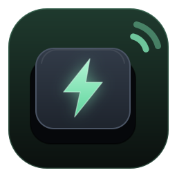
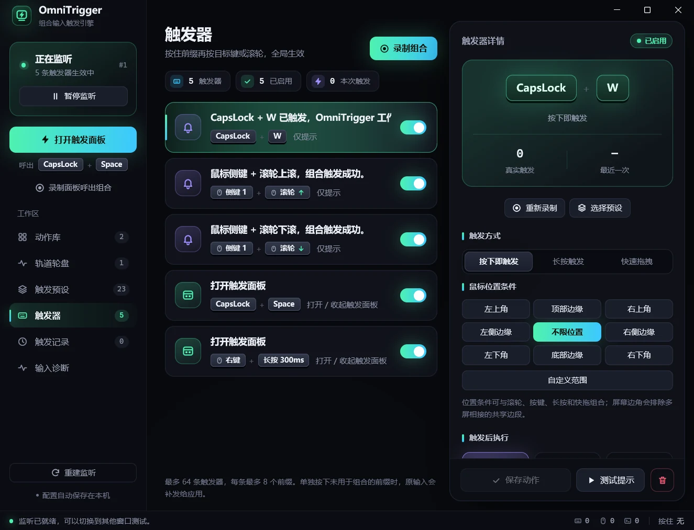
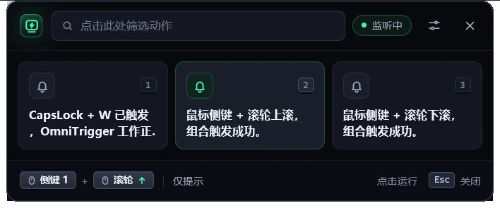
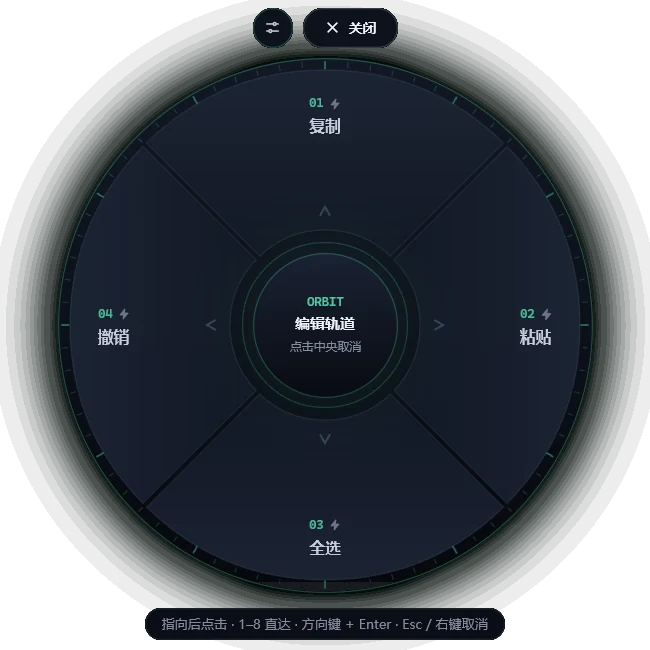
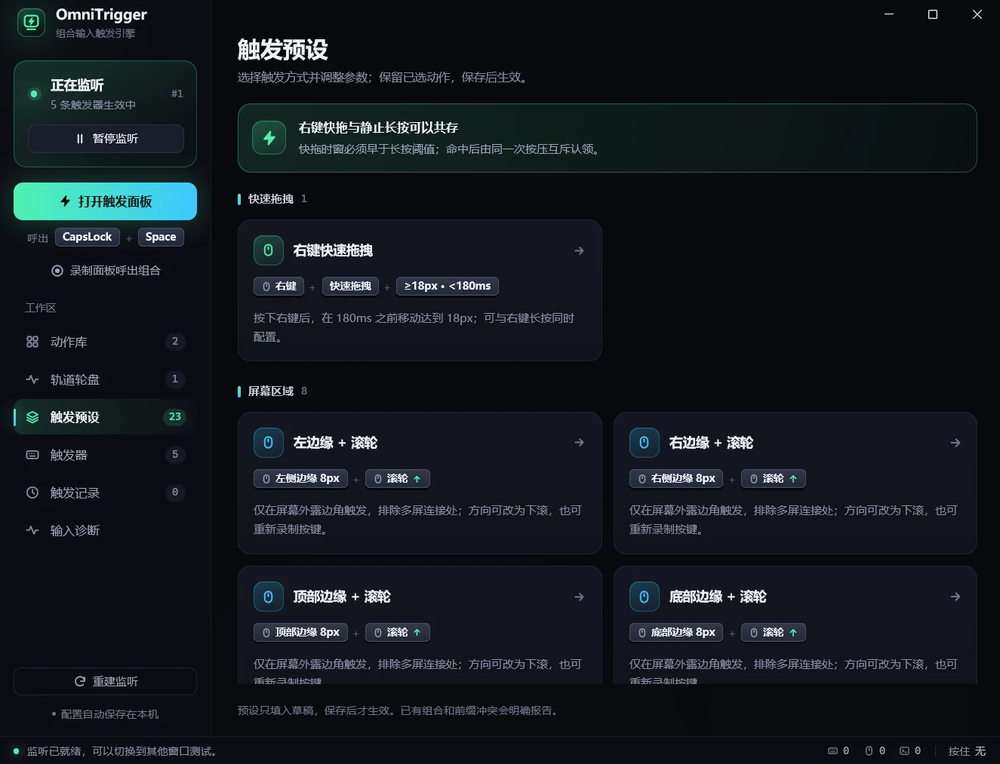

<p align="center">
  
</p>

<h1 align="center">OmniTrigger</h1>

<p align="center">统一录制、注册与管理键盘和鼠标组合的 Rust 触发引擎。</p>

<p align="center">
  <a href="https://ceastld.github.io/omnitrigger/">主页</a> ·
  <a href="https://ceastld.github.io/omnitrigger/docs/getting-started">快速开始</a> ·
  <a href="https://ceastld.github.io/omnitrigger/docs/">文档</a> ·
  <a href="https://github.com/ceastld/omnitrigger/releases">下载</a>
</p>

<p align="center">
  <a href="https://github.com/ceastld/omnitrigger/releases"></a>
  <a href="https://github.com/ceastld/omnitrigger/actions/workflows/ci.yml"></a>
  
  <a href="LICENSE"></a>
</p>



录下一个操作，就能将其注册为触发器，例如 `CapsLock + W`、`鼠标侧键 + 滚轮上滚`。当前提供 Windows 桌面测试程序，触发后显示本地提示、发送快捷键、运行程序或脚本，也可呼出自定义动作轮盘；还可在“扩展”页一键启用 RaiShot，自动复用兼容的已有安装或下载依赖，再选择截图动作并设置触发。

项目处于 `0.1.0` 早期开发阶段，API 与配置格式可能调整。目前仅支持 Windows，不提供稳定版本或自动更新。

[源码仓库](https://github.com/ceastld/omnitrigger) · [贡献指南](CONTRIBUTING.md) · [安全说明](SECURITY.md) · [MIT 许可证](LICENSE)

## 当前状态

当前提供 Windows + GPUI 桌面测试程序，核心引擎可独立测试，主要能力包括：

- **统一触发描述**：键鼠组合、长按、快速拖拽与鼠标区域条件共用 `TriggerSpec`，录制、注册与运行时匹配采用同一套规则；边缘支持起止缩进，可同时配置左右边缘亮度与上边缘音量，并排除多屏连接处。
- **动作执行**：本地提示、发送快捷键、本地步骤、窗口操作、音量 / 亮度调节、外部程序及可选截图插件。
- **动作包扩展**：统一动作引用与运行时接口，支持本地 JavaScript 动作包、JSON 输入、多步骤程序调用和结构化执行结果；Node.js 需单独安装。
- **浏览器动作**：安装连接器后，在动作库选择“浏览器操作”，可绑定标签页管理、前进后退、恢复关闭和新建窗口，也可直接调用 Chrome API；后台复用持久连接，无需 Node.js。
- **桌面界面**：触发器管理、23 个可编辑预设、浮动触发面板、多轮盘与按应用选择槽位；亮度提示由独立 Win32 窗口显示紧凑横条，滚动时立即反馈请求目标，后台结果静默校正，只响应本软件动作，不等待 GPUI 绘制。上边缘音量示例发送系统音量键，步长和原生音量浮层的位置由 Windows 决定。
- **界面与滚动**：主界面使用低饱和纯色和紧凑列表；列表、详情、动作库与轮盘编辑区使用 120ms 缓出滚动，反向立即转向，筛选和键盘定位即时生效。后台鼠标事件不再触发整页刷新，隐藏面板与轮盘在显示前更新内容。
- **外观设置**：左下角“设置”可切换浅色、深色或跟随系统；主题立即生效并自动保存，下次启动继续使用。
- **配置与诊断**：本地自动保存、旧配置迁移备份、只读配置检查、输入诊断及监听重建。

| 浮动触发面板 | 轨道轮盘 | 触发预设 |
| :---: | :---: | :---: |
|  |  |  |

详细交互、执行限制与界面说明见[当前功能](docs/FEATURES.md)，专题入口见[文档目录](docs/README.md)。尚未实现双击 / 连击、按设备区分、系统托盘、插件市场或自动更新。[Chrome API 桥接扩展](docs/BROWSER_EXTENSION.md)提供本地 RPC、JS Proxy、书签读取和浏览器动作；Chrome 扩展单独安装。按需授权功能需要新版扩展源码或本地测试包，公开 v0.1.0 包尚未包含本轮更新。

## 下载 Windows 预览版

从 [Releases](https://github.com/ceastld/omnitrigger/releases) 下载 `OmniTrigger-<版本>-windows-x86_64.zip`，完整解压后运行 `omnitrigger.exe`。当前只提供 Windows x64 包，建议使用 Windows 11；Windows 10 尚未完成全面兼容验证。发布包包含项目及依赖许可，旁附 `SHA256SUMS.txt` 供核验下载完整性。

程序未经代码签名。运行需要 [Microsoft Visual C++ v14 Redistributable x64](https://learn.microsoft.com/en-us/cpp/windows/latest-supported-vc-redist)；如提示缺少 `VCRUNTIME140.dll`，请安装微软官方运行库。无需安装 Rust 或开发工具。预览版仍有下文说明的输入、焦点与权限限制。

首次启动加载示例绑定：先按住 `CapsLock` 再按 `W`，松开后确认提示浮层和列表中的命中次数；然后测试侧键加滚轮，最后录制一个自定义组合。单独按下并松开未被组合使用的前缀时，会回放原输入。试用步骤、截图插件安装与命令行参数见[快速开始](docs/GETTING_STARTED.md)。

## 文档

| 主题 | 文档 |
| --- | --- |
| 开始使用 | [快速开始](docs/GETTING_STARTED.md) · [当前功能与交互](docs/FEATURES.md) |
| 触发与输入 | [触发预设、长按与快拖](docs/TRIGGER_PRESETS.md) · [鼠标区域与系统调节](docs/POINTER_REGIONS.md) · [输入语义与边界](docs/INPUT_SEMANTICS.md) |
| 面板、轮盘与动作 | [浮动触发面板](docs/TRIGGER_PANEL.md) · [自定义轮盘](docs/RADIAL_WHEELS.md) · [发送按键](docs/KEYBOARD_ACTIONS.md) · [本地步骤](docs/LOCAL_ACTIONS.md) · [程序与脚本](docs/COMMAND_ACTIONS.md) · [动作包与 JS 入口](docs/ACTION_PACKAGES.md) · [插件动作](docs/PLUGIN_SYSTEM.md) |
| 配置与排查 | [配置文件与隐私](docs/CONFIGURATION.md) · [并用其他工具与诊断](docs/TROUBLESHOOTING.md) |
| 开发与发布 | [从源码构建](docs/BUILDING.md) · [工程架构](docs/ARCHITECTURE.md) · [动作执行架构](docs/EXECUTION_ARCHITECTURE.md) · [开源与发布检查](docs/RELEASING.md) |

同一批文档也发布在[文档站](https://ceastld.github.io/omnitrigger/docs/)，支持中文搜索；主页提供可在浏览器中试用的前缀与右键手势模拟。

## 输入、权限与隐私

- **前缀与补发**：已注册的前缀按下时暂存输入，组合命中后消费整次按压；遇到不匹配输入或单独松开时回放。鼠标键前缀在指针移出按下点 8 像素后立即交还，拖动不受影响；左键作为前缀时不暂存，按下与释放照常交给应用，只消费完成组合的那次输入（例如“左键 + 右键”中的右键）。延迟与补发会改变时序，不能承诺完全无损。
- **系统限制**：普通权限运行，无需安装驱动；向权限更高的应用补发输入可能失败，此时暂停监听并显示错误。Windows 安全桌面和系统保留组合仍受系统限制；其他软件在上游拦截输入时，OmniTrigger 可能收不到。
- **隐私**：当前应用不提供遥测、云同步或输入上传。配置保存在 `%LOCALAPPDATA%\OmniTrigger\bindings.json`，触发记录和输入诊断仅保留在进程内；插件安装只在用户操作时访问 GitHub 下载程序及运行依赖。

完整说明见[输入语义与边界](docs/INPUT_SEMANTICS.md)、[配置文件与隐私](docs/CONFIGURATION.md)和[并用其他工具与诊断](docs/TROUBLESHOOTING.md)。

## 从源码构建

需要 Windows、Rust（MSVC 工具链）及 Visual Studio C++ Build Tools（含“使用 C++ 的桌面开发”和 Windows SDK）。仓库通过 `rust-toolchain.toml` 固定 Rust 1.90.0、rustfmt 与 Clippy；脚本需要 PowerShell 7。

```powershell
git clone https://github.com/ceastld/omnitrigger.git
cd omnitrigger
.\start.ps1                                      # 构建并打开界面
cargo run -p omnitrigger-app --locked             # 在终端运行
.\scripts\check.ps1                               # 与 Windows CI 共用的检查
```

直接启动产物：`target\debug\omnitrigger.exe`。真实 Hook 检查、隔离配置、轮盘入口及主页与文档站的构建方式见[从源码构建](docs/BUILDING.md)。非 Windows 环境可运行 `cargo test -p omnitrigger-core --locked` 验证核心；桌面程序仍仅面向 Windows。

## 核心设计

- **统一描述**：录制器生成 `TriggerSpec`，注册、冲突检查与运行时匹配共享这一份语义。
- **确定性状态机**：核心按 `InputEvent + 显式时间与上下文 → Engine::process_at / advance_time → Decision` 工作，鼠标位置和屏幕矩形由平台显式提供，输出透传、消费、触发通知及必要的补发计划。核心不读取系统时钟，不依赖 UI 或 Windows API；原 `process` 接口沿用最近显式时间。
- **平台适配**：Windows 适配层负责采集输入、执行消费决策和补发；系统 Hook 的同步路径只做有界匹配，不执行动作、网络请求或 Agent 推理。
- **应用层扩展**：`ActionCall` 保存动作身份和输入，动作目录解析契约，`ActionService` 负责有界执行和回执，运行时适配器执行具体实现。当前提供 JavaScript 入口，新增脚本业务无需更改输入核心；不内置流程图，跨动作调用尚未实现。
- **轻量界面**：GPUI 作为候选界面，负责录制、展示、编辑与必要确认，与核心引擎解耦。

插件采用“插件提供预设动作与默认快捷键，OmniTrigger 管理绑定”的方式。RaiShot 动作库由 manifest 生成，内置截图动作，也支持开发者在配置目录放置 RaiShot 多动作清单。默认组合可自定义、恢复并经过统一冲突检查，执行仍在 Hook 之外。已实现范围、本机发现规则与清单格式见[插件动作与快速绑定设计](docs/PLUGIN_SYSTEM.md)；执行路径与扩展边界见[动作执行架构](docs/EXECUTION_ARCHITECTURE.md)。现有 Node 调用示例见[截图脚本](examples/raishot-capture.mjs)。

自定义复杂动作可使用[动作包](docs/ACTION_PACKAGES.md)：在配置同级的 `actions/<包目录>` 放入 `action.json` 和 JS 入口，在动作库选择动作并填写 JSON 参数。JS 使用 `export default async function(ctx)`；`await ctx.process.run(...)` 等待程序退出并取得输出，`await ctx.process.start(...)` 独立启动桌面程序后继续后续步骤。`--check-action <call.json>` 只读检查调用，`--run-action <call.json>` 真实执行；两者都可结合 `--config` 指定动作目录。

## 工程结构

| 目录 | 职责 |
| --- | --- |
| `crates/omnitrigger-core` | 无外部依赖的模型、注册验证、状态机、录制器与区域计算；按职责分模块并保留统一公共 API。 |
| `crates/omnitrigger-windows` | Windows 输入采集、消费 / 补发、窗口与系统操作；隔离原生 API。 |
| `crates/omnitrigger-actions` | 通用动作契约、包目录、运行时注册、有界执行与 Node.js 宿主。 |
| `crates/omnitrigger-app` | GPUI 界面、持久化、动作分派、后台执行器与插件安装。 |
| `docs` / `examples` | 使用与架构文档、可通过 `--check-config` 验证的配置示例。 |
| `site` | 主页与文档站，从 `docs` 等仓库文档同步生成。 |
| `scripts` / `.github` | 本地检查入口、CI、站点发布和协作模板。 |

模块定位、事件流和后续拆分边界见[项目架构](docs/ARCHITECTURE.md)。

## 参与开发与许可证

问题与建议请使用仓库的 [Issues](https://github.com/ceastld/omnitrigger/issues)，贡献前阅读 [CONTRIBUTING.md](CONTRIBUTING.md)。Windows CI 检查格式、工作区测试、Clippy、应用构建和示例配置，Linux CI 独立检查核心测试与 Clippy；实际输入行为仍需桌面验证。

项目自身的代码、文档和资源采用 [MIT 许可证](LICENSE)，允许在保留版权及许可声明的前提下使用、修改、分发和商业使用。第三方依赖遵循各自许可证，参见 [第三方说明](THIRD_PARTY_NOTICES.md)。准备公开源码或分发程序时，参照 [发布检查](docs/RELEASING.md)。
