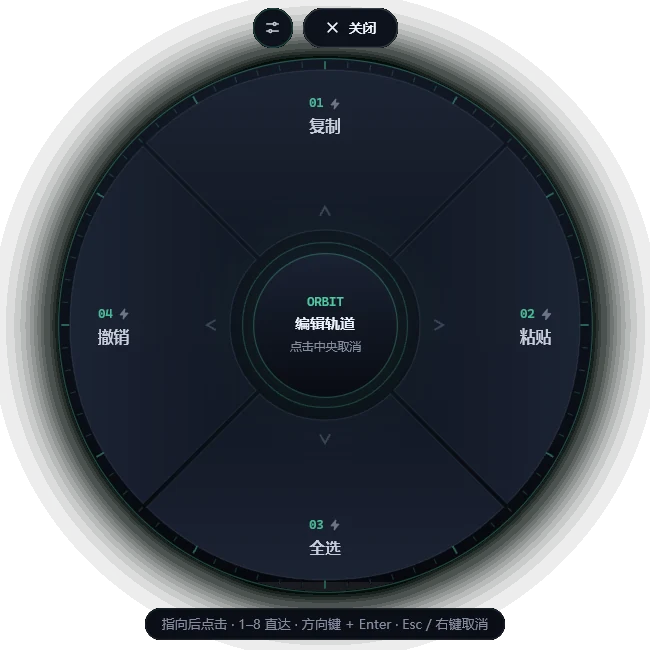

<p align="center">
  
</p>

<h1 align="center">OmniTrigger</h1>

<p align="center">统一录制、注册与管理键盘和鼠标组合的 Rust 触发引擎。</p>

<p align="center">
  <a href="https://ceastld.github.io/omnitrigger/">主页</a> ·
  <a href="https://ceastld.github.io/omnitrigger/docs/getting-started">快速开始</a> ·
  <a href="https://ceastld.github.io/omnitrigger/docs/">文档</a> ·
  <a href="https://github.com/ceastld/omnitrigger/releases">下载</a>
</p>

<p align="center">
  <a href="https://github.com/ceastld/omnitrigger/releases"></a>
  <a href="https://github.com/ceastld/omnitrigger/actions/workflows/ci.yml"></a>
  
  <a href="LICENSE"></a>
</p>


录下一个操作，就能将其注册为触发器，例如 `CapsLock + W`、`鼠标侧键 + 滚轮上滚`。当前提供 Windows 桌面测试程序，触发后显示本地提示、发送快捷键、运行程序或脚本，也可呼出自定义动作轮盘；还可在“扩展”页一键启用 RaiShot，自动复用兼容的已有安装或下载依赖，再选择截图动作并设置触发。

当前为 Windows x64 开发预览版，API 与配置格式可能调整。v0.2.1 提供当前用户安装器和独立的本机测试配置档，日常窗口的设置页支持检查更新、后台下载并重启更新。

[源码仓库](https://github.com/ceastld/omnitrigger) · [贡献指南](CONTRIBUTING.md) · [安全说明](SECURITY.md) · [MIT 许可证](LICENSE)

## 当前状态

当前提供 Windows + GPUI 桌面测试程序，核心引擎可独立测试，主要能力包括：

- **统一触发描述**：键鼠组合、长按、快速拖拽、鼠标手势与鼠标区域条件共用 `TriggerSpec`，录制、注册与运行时匹配采用同一套规则；边缘支持起止缩进，可同时配置左右边缘亮度与上边缘音量，并排除多屏连接处。
- **动作执行**：本地提示、发送快捷键、本地步骤、窗口操作、音量 / 亮度调节、外部程序及可选截图插件。
- **动作包扩展**：统一动作引用与运行时接口，支持本地 JavaScript 动作包、JSON 输入、多步骤程序调用和结构化执行结果；Node.js 需单独安装。
- **浏览器动作**：安装连接器后，在动作库选择“浏览器操作”，可绑定标签页管理、前进后退、恢复关闭和新建窗口，也可直接调用 Chrome API；后台复用持久连接，无需 Node.js。
- **桌面界面**：触发器管理、23 个可编辑预设、浮动触发面板、多轮盘与按应用选择槽位；亮度提示由独立 Win32 窗口显示紧凑横条，滚动时立即反馈请求目标，后台结果静默校正，只响应本软件动作，不等待 GPUI 绘制。上边缘音量示例发送系统音量键，步长和原生音量浮层的位置由 Windows 决定。
- **快速搜索**可用工作台内的 `Ctrl+K` 打开。搜索页面名称、触发器名称或 `CapsLock+W` 等组合，用上下方向键选择并回车打开。以 `触发器:` 开头可只搜索触发器。输入 `2**10`、`sqrt(2)`、`sin(radians(90))`、`10 km to mi` 或 `1 GiB to MiB` 可计算和换算，按回车复制结果。三角函数使用弧度，数据单位的 `B` 表示字节，`b` 表示比特。
- 输入 `已启用触发器`、`已停用触发器`、`全局触发器` 或 `指定应用触发器` 可直接查看对应列表。加冒号后可再输入名称、组合或应用名。结果会显示绑定的应用范围和场景。
- 页面、触发器和动作等匹配项超过一页时，用 `PageUp`、`PageDown` 或点击页码旁的按钮翻页。方向键也可连续选择跨页的结果。
- 输入 `?` 可浏览全部用法，按 `Page Up` 或 `Page Down` 翻页。输入 `? 时长` 可按关键词查找示例，用方向键选择示例并回车即可填入。
- 可直接输入 `计算器`、`字数` 或 `分数` 查找对应示例，回车就能填入。
- 算术结果可按 `Tab` 填回输入框。输入 `1-4` 后按 `Tab`，再输入 `**2` 可继续算得 `9`。
- 选中示例、历史算式或换算候选时，可按 `Tab` 或回车填回输入框。
- 输入 `算式历史:` 可找回本次运行中最近复制或用于续算的 12 条算式。搜索框最多显示 6 条，可按算式或结果筛选，按回车填回输入框。
- 输入 `换算历史:` 可查找本次运行中最近复制的 12 条单位或进制换算，也可继续输入单位或结果筛选。按回车可填回所选换算式。
- 在快速搜索输入 `剪贴板: 关键词` 并回车可打开文本历史并查找已保存文本的正文。
- 输入 `触发记录: CapsLock+W` 可在最近 30 条触发记录中查找组合，也可按提示文字筛选。留空关键词可查看全部记录。
- 输入 `动作: 浏览器` 可打开动作库并填入筛选词。动作包和插件动作也会按名称出现在快速搜索结果中，回车可在动作库中查看。只输入 `动作:` 可清空筛选。
- 可以按名称搜索已配置的轮盘，回车打开对应编辑页。输入 `轮盘: 编辑` 可只搜索轮盘。
- 输入 `槽位: 复制` 可查找轮盘槽位，回车打开对应布局并选中槽位。可以加上轮盘名或应用名来缩小结果。
- 输入 `预设: 顶部边缘` 可查找触发预设，回车打开对应的预设卡片。
- 输入 `设置: 主题` 或 `设置: 备份` 可直达对应设置。点击「查看全部设置」可回到完整页面。
- 搜索框为空时，本次运行中通过搜索打开过的页面和触发器会排在前面。
- 输入 `0xff to dec`、`255 to bin` 或 `0b1010 转八进制` 可精确转换整数进制。
- 输入 `0xff to` 可选择十进制、二进制、八进制或十六进制，也可继续输入名称或缩写筛选。
- 输入 `分数: 42/56` 可约分为 `3/4`，输入 `分数: 0.125` 可精确转为 `1/8`。
- 输入 `分数: 计算 (1/2+1/3)*6` 可得到 `5`，`分数: 计算 0.1+0.2` 得到 `3/10`。支持括号和四则运算。
- 分数算式可用 `**` 或 `^` 求整数次幂。`分数: 计算 2**80` 得到 `1208925819614629174706176`。指数绝对值最多为 1024，运算中分子和分母各最多 8192 个二进制位。[Python 幂运算优先级](https://docs.python.org/3/reference/expressions.html#the-power-operator)
- `7 // 3` 会向下取整，`7 % 3` 求余数，两者使用 Python 的负数规则。`percent(15) * 200` 可计算 200 的 15%。
- 输入 `200 的 15%` 或 `15% of 200` 可直接计算百分数。
- 输入 `200 增加 15%` 得到 `230`，输入 `200 减少 15%` 得到 `170`。
- 输入 `百分比: 变化 200 到 150` 得到 `-25%`，差值除以原值。`百分比: 占比 18 占 60` 得到 `30%`。`百分比: 百分点 15% 到 21.5%` 得到 `6.5 个百分点`。
- 输入 `200 打 8.5 折` 得到 `170`，折扣前的金额也可以用算式表示。
- 输入 `avg(12,18,30)` 可求平均值 `20`。`sum`、`min`、`max` 分别求和、最小值和最大值，参数可以是算式。
- 输入 `median(9,1,4)` 求得中位数 `4`，`hypot(3,4,12)` 求得向量长度 `13`。`degrees(atan2(1,-1))` 可求得方向角 `135` 度。
- 输入 `log(1024,2)` 可求以 2 为底的对数，结果为 `10`。`pow(2,10)` 可求得 `1024`。
- 可以直接输入根号。输入 `√(9 + 16)` 得到 `5`，输入 `∛(-27)` 得到 `-3`。
- 输入 `gcd(48,18)` 得到最大公约数 `6`，输入 `lcm(12,18)` 得到最小公倍数 `36`。两个函数使用计算器的安全整数范围，绝对值最大为 `2^53 - 1`。
- 输入 `factorial(10)` 可求阶乘 `3628800`，`comb(52,5)` 可求组合数 `2598960`，`perm(5,3)` 可求排列数 `60`。参数为非负整数，结果须在计算器的安全整数范围内。
- 输入 `stdev(1,3,5)` 得到样本标准差 `2`，至少需要两个值。输入 `pstdev(1,3)` 得到总体标准差 `1`。
- 输入 `quantile(0.25,4,1,3,2)` 或 `percentile(25,4,1,3,2)` 得到下四分位数 `1.75`，`iqr(4,1,3,2)` 得到四分位距 `1.5`。分位数使用排序后相邻样本间的线性插值。[R 的 Type 7 定义](https://stat.ethz.ch/R-manual/R-devel/library/stats/html/quantile.html#types)
- `degrees(asin(0.5))` 得到 `30`。用 `round(2.5)` 取最近整数时，恰好在中点会取偶数，结果为 `2`。`trunc(-1.8)` 向零取整得到 `-1`。
- `round(2.675, 2)` 按两位小数舍入得到 `2.67`，`round(1250, -2)` 按百位舍入得到 `1200`。第二个参数可用整数指定保留位数。`log1p(x)` 与 `expm1(x)` 分别计算 `ln(1+x)` 与 `exp(x)-1`，适用于接近零的输入。
- 数字中的下划线可分隔数位，例如 `1_000 + 2_500` 和 `1_000ms to s`。
- 算式可直接使用 `0b`、`0o`、`0x` 开头的整数，例如 `0xFF + 0b1` 得到 `256`。这些操作数的绝对值最大为 `2^53 - 1`。
- 用 `bitand`、`bitor`、`bitxor` 计算按位与、或、异或，用 `shl`、`shr` 左移或右移。也可用 `popcount(0xff)` 统计二进制中的 `1`，结果为 `8`。这些函数支持不超过 `2^53 - 1` 的非负整数。
- 输入 `180° to rad`、`1 atm to kPa` 或 `2 MHz to kHz` 可换算角度、压强和频率。压强和频率的单位前缀区分 `m`（毫）与 `M`（兆）。
- 输入 `8 Mbps to MB/s` 可换算数据速率，结果为 `1 MB/s`。
- 输入 `500 nm to um` 得到 `0.5 μm`，输入 `125 ns to us` 得到 `0.125 μs`。微米、纳米、微秒和纳秒会优先建议相近量级的单位。
- 输入 `5 ft 10 in to cm` 得到 `177.8 cm`，也可用 `5′10″` 或 `5英尺10英寸` 表示这个长度。输入 `177.8 cm to ft in` 可换算回 `5 ft 10 in`。
- 输入 `10 km` 或 `8Mbps` 就会显示常见目标单位和换算预览，也可以继续输入 `to` 或 `转`。按方向键选择，再按回车填入完整换算式。
- 用 `PageUp` 和 `PageDown` 浏览更多换算单位。输入目标单位符号的开头可筛选，例如 `1 GiB to Ti` 会列出 `TiB` 和 `Tib`。
- 输入 `10 dC to dF` 可将摄氏温差换成 `18 Δ°F`。也可直接输入 `Δ°C`、`Δ°F` 或 `ΔK`。 [NIST 温差换算表](https://www.nist.gov/pml/special-publication-811/nist-guide-si-appendix-b-conversion-factors/nist-guide-si-appendix-b9)
- 输入 `60′ to °` 可将角分换成 `1 °`。角分和角秒也可分别写作 `arcmin` 和 `arcsec`。 [BIPM《国际单位制手册》表 8](https://www.bipm.org/documents/20126/41483022/SI-Brochure-9.pdf/fcf090b2-04e6-88cc-1149-c3e029ad8232)
- 输入 `30° 15′ 30″ to °` 可把组合角度换算成十进制度，`12.5° to dms` 得到 `12° 30′ 0″`。组合写法中角分与角秒均小于 60，角秒最多显示六位小数。
- 输入 `1度电转MJ` 得到 `3.6 MJ`，输入 `500 mW to W` 得到 `0.5 W`。
- 输入 `1000 kg/m³ to g/cm³` 可换算密度，输入 `1 L/min to m³/h` 可换算体积流量，得到 `0.06 m³/h`。
- 输入 `1 kgf to N` 可换算力，得到 `9.80665 N`。输入 `1 g0 to m/s²` 可将标准重力加速度换算为 `9.80665 m/s²`。换算系数见 [NIST SI 指南](https://www.nist.gov/pml/special-publication-811/nist-guide-si-appendix-b-conversion-factors/nist-guide-si-appendix-b9)。
- 输入 `颜色: #3A86FF` 可预览颜色并得到 `rgb(58, 134, 255)`，输入 `颜色: rgba(58, 134, 255, 0.5)` 可转回 HEX，结果带透明度时保留其通道。
- 输入 `颜色: hsl(210 100% 50%)` 得到 `#0080FF`，也可以输入带透明度的 HSL 颜色。
- 输入 `颜色: rebeccapurple` 得到 `#663399`。固定的 CSS 颜色名也可用于叠加和对比度查询，`transparent` 可用于带透明度的换算和叠加。参见 [CSS Color 4 的颜色名](https://www.w3.org/TR/css-color-4/#named-colors)。
- 输入 `颜色: #FF800080 to hsl` 得到 `hsl(30.118 100% 50% / 0.502)`。用 `to hex`、`to rgb` 或 `to hsl` 可指定输出格式。
- 输入 `颜色: hwb(210 10% 20%)` 得到 `#1A73CC`，也可用 `to hwb` 输出色相、白度和黑度。白度和黑度各可输入 0 至 100 的数值或百分数。参见 [CSS Color 4 的 HWB 语法](https://www.w3.org/TR/css-color-4/#the-hwb-notation)。
- 输入 `对比度: #fff vs #000` 会预览两个不透明颜色，并显示 `21:1`。计算采用 [WCAG 2.2 的对比度定义](https://www.w3.org/TR/WCAG22/#dfn-contrast-ratio)。
- 输入 `颜色: #0080FF80 叠加 #fff` 得到 `#7FBFFF`。前一种颜色覆盖在后一种颜色上，也可用 `over`，按 sRGB 通道计算 [透明度叠加](https://www.w3.org/TR/compositing-1/#simplealphacompositing)。
- 输入 `字数: 你好👩‍💻` 得到 `3 字符 · 17 UTF-8 字节`。加引号可统计首尾空格，例如 `字数: " a "`。
- 输入 `文本: 大写 Straße` 得到 `STRASSE`。也可用 `文本: 小写 ÉTÉ` 转成小写，或用 `文本: 合并空白 A   B` 得到 `A B`。
- 输入 `文本: 替换 "北京" "上海" 北京 A+B` 得到 `上海 A+B`。在替换内容中可用 `""` 删除、用 `"\n"` 换行。`文本: 倒序 你好ABC` 得到 `CBA好你`，并保留组合字符的完整性。
- 输入 `文本: SHA-256 北京` 或 `文本: SHA-512 abc` 可计算 UTF-8 文本的摘要。可用引号保留开头和末尾的空格。
- 输入 `URL: 编码 北京 A+B` 可把文本转换为 URL 参数值，得到 `%E5%8C%97%E4%BA%AC%20A%2BB`。用 `URL: 解码` 加上编码后的值即可还原文本，解码保留原样写入的加号。
- 输入 `URL: 表单编码 北京 A+B` 得到 `%E5%8C%97%E4%BA%AC+A%2BB`。用 `URL: 表单解码` 还原时，`+` 表示空格，`%2B` 表示加号。 [WHATWG 表单编码规则](https://url.spec.whatwg.org/#concept-urlencoded-serializer)
- 输入 `URL: 参数 https://example.invalid/?tag=a+1&tag=b%2Bc` 可逐行查看解码后的名称和值。也可粘贴查询串，结果按原有顺序保留重名参数。 [WHATWG 查询参数解析规则](https://url.spec.whatwg.org/#concept-urlencoded-parser)
- 输入 `JSON: 格式化 {"名称":"北京","值":1}` 可添加两格缩进，输入 `JSON: 压缩` 加上 JSON 文本可移除结构空白。两种操作均检查语法，并保留原有键顺序、数字和字符串拼写。搜索框可输入最多 4096 个字符。
- 输入 `JSON: 取值 /商品/0/价格 {"商品":[{"价格":9007199254740993}]}` 可提取原文中的 `9007199254740993`。路径中的 `~1` 表示键名内的斜杠，`~0` 表示波浪号。带空白的路径可用 JSON 双引号包住。参见 [RFC 6901](https://www.rfc-editor.org/rfc/rfc6901.html#section-4)。
- 输入 `JSON:`、`URL:` 或 `文本:` 可查看该工具的可用操作。继续输入操作名称可筛选，按回车可填入所选示例。
- 输入 `文本: Base64编码 北京` 得到 `5YyX5Lqs`，输入 `文本: Base64解码 5YyX5Lqs` 可还原文字。`Base64URL编码` 使用网址安全字母表并省略末尾的 `=`。两种解码均接受带或不带 `=` 的对应编码，可粘贴换行分隔的 UTF-8 文本编码。[RFC 4648](https://www.rfc-editor.org/rfc/rfc4648.html#section-4)
- 搜索结果预览最多显示六行，按回车复制完整内容。
- 粘贴到快速搜索的换行和制表符会保留，输入框用可见符号显示。文本工具中用引号包住内容，也可保留首尾空白。
- 在输入框按 `Shift+Enter` 可插入换行。
- 输入 `文本: 按行去重` 后加空格并粘贴多行内容，可保留每行首次出现的顺序。`按行排序` 按 Unicode 字符顺序排列，`去空行` 移除空白行。结果使用换行符分隔。
- 输入 `日期: 今天 + 14天` 可计算日期，输入 `日期: 2026-11-21 - 2026-11-01` 可计算相差天数。`今天` 使用系统本地日期。
- 输入 `日期: 2026-11-21 星期几` 得到 `星期六`。日期运算也支持 `昨天`、`明天` 和整周，例如 `日期: 明天 + 2周`。
- 输入 `日期: 2027-01-01 第几周` 得到 ISO 周号 `2026-W53`。输入 `日期: 2026-W47` 可查看该周周一至周日的日期。
- 日期支持加减整月和整年。输入 `日期: 2024-01-31 + 1个月` 得到 `2024-02-29`，遇到较短的月份时取该月最后一天。
- 日期也可以按周一至周五计数。输入 `日期: 2026-11-20 + 1工作日` 得到 `2026-11-23`。
- 输入 `日期: 2026-11-23 - 2026-11-20 工作日` 得到 `1 工作日`。从较早日期的次日起计到较晚日期，只计周一至周五。交换日期会反转结果的正负号。
- 输入 `日期: 2025-03-15 - 2024-01-31 年月日` 得到 `1 年 1 个月 15 天`。从较早日期先推算整月，月底按该月最后一天计，再计算剩余天数。
- 输入 `时长: 01:30:00` 可换算为秒，反向输入 `时长: 5400秒` 或 `时长: 1小时30分钟` 可显示为 `01:30:00`。两段数字表示分和秒。
- 时长可以相加减。输入 `时长: 01:30:00 - 25分钟` 可得到 `01:05:00`。
- 时长支持小数秒和毫秒、微秒、纳秒。输入 `时长: 00:00:01.25 + 500ms` 得到 `00:00:01.75`，最小计算单位为纳秒。
- 输入 `时间戳: 1700000000` 或 `时间戳: 1700000000123ms` 可转为 UTC 时间，也可输入 `时间戳: 1970-01-01T08:00:00+08:00` 反查 Unix 时间戳。
- 时间戳也接受微秒（`us`、`µs`）和纳秒（`ns`）。例如 `时间戳: 1700000000123456us` 得到 `2023-11-14T22:13:20.123456Z`。反查带小数秒的时间会选择能精确表示结果的单位。参见 [RFC 3339 的时间格式](https://www.rfc-editor.org/rfc/rfc3339.html#section-5.6)。
- 输入 `时间戳: 现在` 可显示系统当前的 Unix 秒数，输入 `时间戳: 现在毫秒` 可获取毫秒值。
- 加上 `本地` 或 `local` 可按系统时区显示带偏移量的时间，例如 `时间戳: 1700000000 本地` 或 `时间戳: 现在 本地`。
- 用 `to +08:00` 或 `to -05:30` 可指定目标时区偏移。Unix 时间戳和带时区的时间都可以换算，例如 `时间戳: 1700000000123ms to +08:00`。
- **界面与滚动**：主界面使用低饱和纯色和紧凑列表；列表、详情、动作库与轮盘编辑区使用 120ms 缓出滚动，反向立即转向，筛选和键盘定位即时生效。后台鼠标事件不再触发整页刷新，隐藏面板与轮盘在显示前更新内容。
- **外观设置**：左下角“设置”可切换浅色、深色或跟随系统；主题立即生效并自动保存，下次启动继续使用。
- **测试副本**：在日常窗口的设置页点击“打开测试副本”，即可用已保存的热键、轮盘和动作包测试。副本独立保存。重装后也可在“查看已有测试档”中按名称和别名选回原档，继续上次的测试。
- **应用更新**：通过统一 Cloudflare 版本 API 在启动后及每 5 小时检查一次，也可在设置页手动检查；发现新版后点击“更新并重启”，后台下载官方 Windows x64 包并校验 SHA-256，准备好后自动重启，保留配置；新版启动失败时尝试恢复旧版。
- **配置与诊断**：本地自动保存、旧配置迁移备份、只读配置检查、输入诊断及监听重建。

| 浮动触发面板 | 轨道轮盘 | 触发预设 |
| :---: | :---: | :---: |
|  |  |  |

日常主窗口关闭后收至系统托盘，触发器继续监听。单击托盘图标可返回主窗口。当前源码构建的安装包支持右键选择“暂停监听”或“恢复监听”，主窗口会留在托盘。选择“退出 OmniTrigger”可结束程序。从开始菜单再次打开同一入口可以唤回现有窗口。测试配置档仍随窗口关闭而退出。

使用当前 CI 安装包时，悬停在托盘图标上即可看到运行版本和构建提交的前 12 位。日常档和测试档的“设置”页首也会显示各自运行的版本。

详细交互、执行限制与界面说明见[当前功能](docs/FEATURES.md)，专题入口见[文档目录](docs/README.md)。尚未实现双击 / 连击、按设备区分或插件市场。[Chrome API 桥接扩展](docs/BROWSER_EXTENSION.md)提供本地 RPC、JS Proxy、书签读取和浏览器动作；Chrome 扩展单独安装。按需授权功能需要新版扩展源码或本地测试包，公开 v0.1.0 包尚未包含本轮更新。

## 下载 Windows 预览版

运行 `OmniTrigger-<版本>-windows-x86_64-setup.exe` 安装到当前 Windows 用户。开始菜单的 **OmniTrigger** 沿用日常配置，卸载和重装后仍保留。**OmniTrigger 测试** 使用独立的持久配置，默认关闭全局监听。需要便携版时下载 ZIP，完整解压后运行 `omnitrigger.exe`。两个包的摘要见 `SHA256SUMS.txt`。建议使用 Windows 11 x64。[前往下载](https://github.com/ceastld/omnitrigger/releases)

在当前源码构建的安装包中，勾选“登录 Windows 时在托盘启动 OmniTrigger”，下次登录即可使用日常热键。这项设置默认关闭，覆盖安装会记住上次的选择。要关闭它，重新运行安装器并取消勾选即可。

程序未经代码签名。运行需要 [Microsoft Visual C++ v14 Redistributable x64](https://learn.microsoft.com/en-us/cpp/windows/latest-supported-vc-redist)；如提示缺少 `VCRUNTIME140.dll`，请安装微软官方运行库。无需安装 Rust 或开发工具。预览版仍有下文说明的输入、焦点与权限限制。

首次启动加载示例绑定：先按住 `CapsLock` 再按 `W`，松开后确认提示浮层和列表中的命中次数；然后测试侧键加滚轮，最后录制一个自定义组合。单独按下并松开未被组合使用的前缀时，会回放原输入。试用步骤、截图插件安装与命令行参数见[快速开始](docs/GETTING_STARTED.md)。

## 文档

| 主题 | 文档 |
| --- | --- |
| 开始使用 | [快速开始](docs/GETTING_STARTED.md) · [当前功能与交互](docs/FEATURES.md) |
| 触发与输入 | [触发预设、长按、快拖与手势](docs/TRIGGER_PRESETS.md) · [鼠标区域与系统调节](docs/POINTER_REGIONS.md) · [输入语义与边界](docs/INPUT_SEMANTICS.md) |
| 面板、轮盘与动作 | [浮动触发面板](docs/TRIGGER_PANEL.md) · [自定义轮盘](docs/RADIAL_WHEELS.md) · [发送按键](docs/KEYBOARD_ACTIONS.md) · [本地步骤](docs/LOCAL_ACTIONS.md) · [程序与脚本](docs/COMMAND_ACTIONS.md) · [动作包与 JS 入口](docs/ACTION_PACKAGES.md) · [插件动作](docs/PLUGIN_SYSTEM.md) |
| 配置与排查 | [配置文件与隐私](docs/CONFIGURATION.md) · [并用其他工具与诊断](docs/TROUBLESHOOTING.md) |
| 开发与发布 | [从源码构建](docs/BUILDING.md) · [工程架构](docs/ARCHITECTURE.md) · [动作执行架构](docs/EXECUTION_ARCHITECTURE.md) · [开源与发布检查](docs/RELEASING.md) |

同一批文档也发布在[文档站](https://ceastld.github.io/omnitrigger/docs/)，支持中文搜索；主页提供可在浏览器中试用的前缀与右键手势模拟。

## 输入、权限与隐私

- **前缀与补发**：已注册的前缀按下时暂存输入，组合命中后消费整次按压；遇到不匹配输入或单独松开时回放。鼠标键前缀在指针移出按下点 8 像素后立即交还，拖动不受影响；左键作为前缀时不暂存，按下与释放照常交给应用，只消费完成组合的那次输入（例如“左键 + 右键”中的右键）。延迟与补发会改变时序，不能承诺完全无损。
- **系统限制**：普通权限运行，无需安装驱动；向权限更高的应用补发输入可能失败，此时暂停监听并显示错误。Windows 安全桌面和系统保留组合仍受系统限制；其他软件在上游拦截输入时，OmniTrigger 可能收不到。
- **隐私**：当前应用不提供遥测、云同步或输入上传。配置保存在 `%LOCALAPPDATA%\OmniTrigger\bindings.json`，触发记录和输入诊断仅保留在进程内；版本检查访问 `update.alinko.cc`，失败时回退 GitHub。更新包与插件按用户操作下载，不上传配置或输入记录。

完整说明见[输入语义与边界](docs/INPUT_SEMANTICS.md)、[配置文件与隐私](docs/CONFIGURATION.md)和[并用其他工具与诊断](docs/TROUBLESHOOTING.md)。

## 从源码构建

需要 Windows、Rust（MSVC 工具链）及 Visual Studio C++ Build Tools（含“使用 C++ 的桌面开发”和 Windows SDK）。仓库通过 `rust-toolchain.toml` 固定 Rust 1.90.0、rustfmt 与 Clippy；脚本需要 PowerShell 7。

```powershell
git clone https://github.com/ceastld/omnitrigger.git
cd omnitrigger
.\start.ps1                                      # 构建并打开本机测试配置档
cargo run -p omnitrigger-app --locked -- --test-workspace
.\scripts\check.ps1                               # 与 Windows CI 共用的检查
```

直接启动产物：`target\debug\omnitrigger.exe`。真实 Hook 检查、隔离配置、轮盘入口及主页与文档站的构建方式见[从源码构建](docs/BUILDING.md)。非 Windows 环境可运行 `cargo test -p omnitrigger-core --locked` 验证核心；桌面程序仍仅面向 Windows。

## 核心设计

- **统一描述**：录制器生成 `TriggerSpec`，注册、冲突检查与运行时匹配共享这一份语义。
- **确定性状态机**：核心按 `InputEvent + 显式时间与上下文 → Engine::process_at / advance_time → Decision` 工作，鼠标位置和屏幕矩形由平台显式提供，输出透传、消费、触发通知及必要的补发计划。核心不读取系统时钟，不依赖 UI 或 Windows API；原 `process` 接口沿用最近显式时间。
- **平台适配**：Windows 适配层负责采集输入、执行消费决策和补发；系统 Hook 的同步路径只做有界匹配，不执行动作、网络请求或 Agent 推理。
- **应用层扩展**：`ActionCall` 保存动作身份和输入，动作目录解析契约，`ActionService` 负责有界执行和回执，运行时适配器执行具体实现。当前提供 JavaScript 入口，新增脚本业务无需更改输入核心；不内置流程图，跨动作调用尚未实现。
- **轻量界面**：GPUI 作为候选界面，负责录制、展示、编辑与必要确认，与核心引擎解耦。

插件采用“插件提供预设动作与默认快捷键，OmniTrigger 管理绑定”的方式。RaiShot 动作库由 manifest 生成，内置截图动作，也支持开发者在配置目录放置 RaiShot 多动作清单。默认组合可自定义、恢复并经过统一冲突检查，执行仍在 Hook 之外。已实现范围、本机发现规则与清单格式见[插件动作与快速绑定设计](docs/PLUGIN_SYSTEM.md)；执行路径与扩展边界见[动作执行架构](docs/EXECUTION_ARCHITECTURE.md)。现有 Node 调用示例见[截图脚本](examples/raishot-capture.mjs)。

自定义复杂动作可使用[动作包](docs/ACTION_PACKAGES.md)：在配置同级的 `actions/<包目录>` 放入 `action.json` 和 JS 入口，在动作库选择动作并填写 JSON 参数。Node 入口使用 `export default async function(ctx)`；`await ctx.process.run(...)` 等待程序退出并取得输出，`await ctx.process.start(...)` 独立启动桌面程序后继续后续步骤。`--check-action <call.json>` 只读检查调用，`--run-action <call.json>` 真实执行，`--list-package-actions` 只读列出动作包目录；均可结合 `--config` 指定目录。外部宿主可为运行命令增加 `--stream-action-events`，分别取得开始事件与终态结果。

轻量脚本可选择 `script` 运行时：独立 Rust JS 宿主提供文件、进程、剪贴板、打开目标，以及原目标查询、快捷键、连续按键、文本、选区、窗口操作和浏览器 API，不要求 Node。动作库支持新建脚本、启动本地编辑器和重新加载目录；工程附带 SDK 与编辑器配置，使用标准 `function main(ctx)` 入口。开发命令仍提供 `--create-script-action`；安装与现有能力见[轻量脚本宿主](docs/ACTION_PACKAGES.md#轻量脚本宿主)。

## 工程结构

| 目录 | 职责 |
| --- | --- |
| `crates/omnitrigger-core` | 无外部依赖的模型、注册验证、状态机、录制器与区域计算；按职责分模块并保留统一公共 API。 |
| `crates/omnitrigger-windows` | Windows 输入采集、消费 / 补发、窗口与系统操作；隔离原生 API。 |
| `crates/omnitrigger-actions` | 通用动作契约、包目录、运行时注册、有界执行与 Node.js 宿主。 |
| `crates/omnitrigger-app` | GPUI 界面、持久化、动作分派、后台执行器与插件安装。 |
| `docs` / `examples` | 使用与架构文档、可通过 `--check-config` 验证的配置示例。 |
| `site` | 主页与文档站，从 `docs` 等仓库文档同步生成。 |
| `scripts` / `.github` | 本地检查入口、CI、站点发布和协作模板。 |

模块定位、事件流和后续拆分边界见[项目架构](docs/ARCHITECTURE.md)。

## 参与开发与许可证

问题与建议请使用仓库的 [Issues](https://github.com/ceastld/omnitrigger/issues)，贡献前阅读 [CONTRIBUTING.md](CONTRIBUTING.md)。Windows CI 检查格式、工作区测试、Clippy、应用构建和示例配置，Linux CI 独立检查核心测试与 Clippy；实际输入行为仍需桌面验证。

项目自身的代码、文档和资源采用 [MIT 许可证](LICENSE)，允许在保留版权及许可声明的前提下使用、修改、分发和商业使用。第三方依赖遵循各自许可证，参见 [第三方说明](THIRD_PARTY_NOTICES.md)。准备公开源码或分发程序时，参照 [发布检查](docs/RELEASING.md)。
