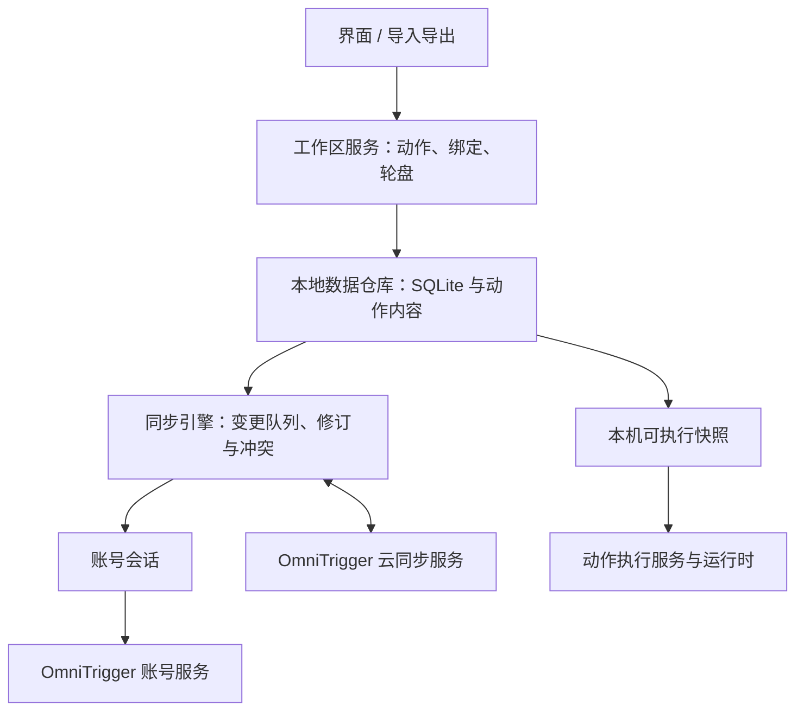

# 账号工作区与同步设计

状态：设计目标，尚未实现。产品范围确定为 OmniTrigger 自建账号系统、同一账号的个人多设备同步；首版每个账号一份工作区，允许离线使用和修改。当前程序仍使用 JSON 配置和本地动作包目录，没有 SQLite 用户库、账号登录或云同步。

本机的数据目录、配置档切换、离线账号与单实例约束见[配置档与数据目录设计](PROFILES.md)；本页的“账号工作区”在本机对应一个账号类型的配置档。

## 应用边界

账号服务负责身份、会话和设备会话撤销；云同步服务管理账号所属的数据及修订。二者是职责边界，首版可以由同一个后端部署提供，无需先拆成多个服务。客户端的存储、同步和执行通过独立接口连接，输入核心不依赖账号或网络。

编辑先通过工作区服务校验，在本地事务中保存；联网同步在后台进行。Hook 仅使用内存中的触发快照，不查询数据库、不等待网络。持久化记录使用跨设备稳定 ID，输入核心继续使用由应用映射得到的本机 `u64` ID。保存的数据规模和当前参与监听的有界集合分别管理。

## 数据模型与存储

| 对象 | 职责 |
| --- | --- |
| 账号与个人工作区 | 用稳定用户 ID 确定数据归属；邮箱、显示名及设备名不作为数据主键。 |
| 动作定义与修订 | 保存内置能力引用、包动作引用或个人脚本内容；区分接口契约版本与具体内容修订。 |
| 用户动作 | 独立的稳定 ID、名称、定义引用和参数。一个动作可被多个入口引用。 |
| 触发绑定 | 保存触发描述与用户动作 ID；不再内嵌一份完整业务动作。 |
| 轮盘与槽位 | 保存布局、标签与用户动作 ID。共享同一动作和复制为新动作是两种明确操作。 |
| 同步元数据 | 对象修订、待上传变更、服务器游标、删除记录和冲突版本。 |
| 本机设置 | 程序路径映射、设备选择、依赖安装状态、凭据引用的本机值和本机启停覆盖。 |

SQLite 管理用户记录、关系和同步元数据。参数及触发描述可以使用有版本的 JSON 字段，JSON 文件保留作导入、导出和迁移来源。一次编辑与其待同步记录必须在同一事务提交，不能先改数据再单独写同步队列。

个人单文件脚本作为动作修订的内容保存；多文件动作包以清单和内容哈希引用各文件，大资源放入应用管理的内容仓库。内容哈希用于校验和去重，不代替访问权限。动作执行器取得已解析的确定修订，正在运行的调用不受途中下载的新版本影响。

目录保留为开发工作区、导入导出格式及运行缓存。用户在应用中创建脚本动作，不需要先手工建立目录；Node 所需的入口和资源由应用准备到对应修订的缓存目录。`package_root` 等绝对路径属于运行时解析结果，不进入可同步的动作身份。

## 同步范围

| 随账号同步 | 仅留在本机 |
| --- | --- |
| 用户动作、脚本及引用的资源、参数、名称和分类 | Node / EXE 安装路径、程序逻辑名称到本机路径的映射 |
| 触发绑定、轮盘、用户期望启停状态 | 显示器等设备映射、依赖安装状态、本机可用性与启停覆盖 |
| 依赖身份及固定版本、凭据引用名称 | 凭据实际值、会话令牌、执行历史、运行缓存 |

例如，动作声明依赖“编辑器”，每台设备分别配置程序路径。另一设备缺少依赖时仍保留动作与绑定，显示待配置；脚本写死的绝对路径不能自动转换成可移植资源引用。参数或脚本正文中的任意字符串也不能靠同步层自动识别为秘密，凭据应通过明确的本机引用使用。

## 账号生命周期

- 未登录时使用独立的本地工作区，能够离线创建和运行动作。
- 登录并启用同步后，恢复该账号工作区。首次关联已有本地数据时明确处理导入与合并，保留可恢复的本地副本，不直接整库覆盖。
- 每个账号隔离本地记录、待上传变更、同步游标和内容访问范围。账号标识进入存储与同步上下文，不能只在登录界面保存。
- 退出登录停止网络同步并清除会话凭据；保留的本机副本可以继续离线使用。删除本地副本、删除云端数据与退出登录是不同操作。
- 切换账号时停止旧会话的同步任务，撤下旧工作区触发快照，再加载新工作区；旧账号的待上传变更不得使用新账号凭据发送。异步返回结果还需校验所属账号和会话代次，防止切换后写入错误工作区。
- 登录方式通过账号会话接口接入。邮箱登录或第三方身份提供商的具体选择不改变稳定用户 ID 和工作区归属；当前尚未实现任何登录方式或后端部署。

## 同步协议的最小职责

| 操作 | 请求与结果 |
| --- | --- |
| 拉取变更 | 使用账号会话和服务器游标获取分页变更；返回下一游标。游标失效时执行明确的重新同步，保留本地待提交修改。 |
| 提交变更 | 携带唯一操作 ID、对象 ID、基础修订和新内容或删除意图；返回接纳修订或冲突。重传同一操作可去重。 |
| 获取与提交内容 | 按哈希传输代码及资源；每次访问都检查账号权限，校验内容与引用一致。 |

服务端从登录凭据确定账号归属，不信任客户端任意填写的账号 ID。服务器分配同步游标和确认修订，设备时间只用于展示，不用于决定谁覆盖谁。首版采用每个对象的基础修订检查即可，无需引入多人实时协作协议。

不同对象的修改独立推进；同一对象发生并发编辑时保留本地与云端修订，提供选择或另存为新动作，不能静默覆盖脚本。删除以删除记录传播，不能只移除本机行；删除记录的清理必须与设备同步确认及游标失效规则配套，避免长期离线设备复活旧数据。

关联动作和资源完整可用后才更新本机运行快照。同步自身不会运行脚本；新配置仍经过本机触发冲突检查和依赖解析。备份可导出一致快照，日常多设备同步交换逻辑变更，不直接同步正在使用的 SQLite 文件。

## 实现顺序

1. 建立独立用户动作、绑定引用和账号工作区的数据模型，以及存储接口。
2. 实现 SQLite 仓库与旧 JSON 的事务迁移，保留原文件。旧绑定和槽位内嵌的每份动作先分别导入，避免自动合并导致原有独立配置互相影响。
3. 将目录加载改为内容导入与修订缓存适配，界面通过工作区服务编辑，复用现有 `ActionService` 和运行时。
4. 实现本地变更队列、修订、删除与冲突处理，以两个独立本地库测试离线修改、断线重传和账号切换。
5. 建立账号服务、云同步 API 和登录界面，完成同一账号两台设备的端到端验证。

首版聚焦个人账号同步；团队共享、多人共同编辑、可选网盘后端、云端动作执行和插件市场不在这一阶段范围内。上述均是待实现的数据与账号架构，当前可运行功能仍以[配置说明](CONFIGURATION.md)和[动作包说明](ACTION_PACKAGES.md)为准。
