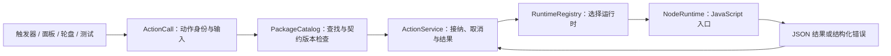

# 动作包与 JavaScript 入口

动作包把动作身份、参数和执行实现分开。一个绑定保存“调用哪个动作、传什么输入”，动作包提供清单和入口文件，运行时负责执行。当前提供 Node.js 与独立 Rust JS 宿主两种运行方式，适合带参数的程序启动、多个步骤、条件判断和结果处理；不内置流程图编辑器。

现有的运行程序、快捷键、本地步骤、系统调节和内置截图插件继续使用原有配置。新增脚本业务通过 `invoke` 入口接入，不需要为每个业务增加 `ActionSpec` 枚举成员或修改输入核心。

本文描述当前可运行的执行层原型。正式用户数据将按[账号工作区与同步设计](ACCOUNT_WORKSPACE.md)引入独立动作实体和 SQLite；手工目录保留为开发与导入入口，应用管理的动作内容及运行缓存属于待实现部分。当前尚无账号登录或云同步。

## 统一接口



| 对象 | 职责 | 变化时影响 |
| --- | --- | --- |
| `ActionCall` | 保存 `package_id`、`action_id`、`action_version` 和 JSON 对象 `input`。 | 绑定和轮盘使用同一调用结构。 |
| `PackageManifest` | 描述包身份、包版本和动作目录；每个动作声明运行时与入口。 | 添加 JS 动作只需增加清单和脚本。 |
| `PackageCatalog` | 加载目录、检查重复身份和入口路径、解析动作引用。 | 缺失或无效包产生诊断，用户绑定继续保留。 |
| `ActionService` | 有界接纳、调用 ID、忙碌判断、取消和终态回执。 | 执行管理不依赖脚本内部步骤。 |
| `ActionRuntime` | 将已解析动作和调用上下文转为结果。 | 新增语言或流程执行器时实现适配器并注册运行时 ID。 |
| `NodeRuntime` | 在独立 Node 进程调用 JS 默认导出，通过版本化协议取得 JSON 结果。 | JS 宿主 API 与绑定格式分别演进。 |

这些类型位于 `omnitrigger-actions`，不依赖 GPUI 或 Windows 输入核心。应用层负责目录位置、界面编辑和状态展示。原有执行器保留各自的输入目标核验、队列和系统调节合并语义，当前没有覆盖所有执行器的统一全局配额。

## 创建动作包

### 新建可编辑的脚本工程

开发命令在当前配置同级的 `actions` 目录创建工程；配置所在目录需已存在：

```powershell
.\target\debug\omnitrigger.exe --config D:\Demo\bindings.json --create-script-action my-script
```

返回 JSON 包含工程、入口、调用文件和 SDK 的完整路径。创建不要求安装脚本引擎，不启动脚本、不新增绑定。工程包含：

```text
actions/my-script/
  action.json
  main.js
  call.json
  jsconfig.json
  README.md
  sdk/api.d.ts
```

使用支持 JavaScript / TypeScript 的编辑器打开该目录，直接编辑 `main.js`。工程附带本地 SDK 类型快照，启用标准 JS 类型检查，不依赖仓库路径或 npm 包，也无需转译；运行只需要独立宿主。SDK 的[源声明](../crates/omnitrigger-actions/runtime/script-api.d.ts)随应用维护，更新应用不会覆盖既有工程。

安装宿主后，可使用同一配置校验和运行：

```powershell
.\target\debug\omnitrigger.exe --config D:\Demo\bindings.json --check-action D:\Demo\actions\my-script\call.json
.\target\debug\omnitrigger.exe --config D:\Demo\bindings.json --run-action D:\Demo\actions\my-script\call.json
```

`--check-action` 只校验引用与运行时是否可用，不执行脚本，也不代替编辑器类型检查。生成入口只清理输入中的文本并返回 JSON，不操作窗口或剪贴板。应用已打开时，重新启动后动作库才会加载新包。

工程标识为 1–64 个英文字母、数字、`-` 或 `_`，以字母或数字开头，不能是 Windows 设备名。命令拒绝重复身份、已有目录、目录容量不足，以及含诊断的动作目录；不会覆盖作者文件。链接、云盘目录和占位路径沿用动作目录校验；写入失败可能保留部分工程，错误会给出路径。该命令不能与运行、事件流、系统调节或其他操作混用。

### 轻量脚本宿主

`runtime: "script"` 可通过现有动作服务运行独立的 Rust JS 宿主，无需安装 Node。宿主不链接进输入核心；脚本执行、取消与终态仍由 `ActionService` 管理。已有 Boa 和 QuickJS 两种构建使用同一份宿主 API。入口文件声明标准 JS 函数 `function main(ctx)`，返回 JSON 值；不需要自定义文件语法或 npm 包。

目前可用的同步 API 为 `ctx.fs.readText/writeText`、`ctx.process.run/start`、`ctx.clipboard.readText/writeText`、`ctx.open`，以及 `ctx.desktop.target/targetContext/sendShortcut/sendKeySequence/sendText/copySelectionText` 和 `ctx.browser.call/profiles/chrome.*`，完整参数与限制见[宿主 API](../tools/js-engine-probe/API.md)。动作上下文额外提供 `ctx.packageRoot` 和保留完整整数精度的 `ctx.invocation`。可使用 [ScriptContext 类型声明](../crates/omnitrigger-actions/runtime/script-api.d.ts)获得编辑器提示；示例见[脚本文本清理动作](../examples/actions/script-clean-file/)和[只读目标查询](../examples/actions/script-target/)。目标查询示例附带 `jsconfig.json`，编辑器可直接检查标准 JS 与 `ScriptContext` 类型，无需转译后执行。桌面 API 复用应用捕获的原目标与 Rust 适配层，和 Node 共用参数校验；浏览器调用复用应用的 Rust 客户端，此处 API 同步返回，不使用 `await`。该运行时暂不提供 Node 模块、ESM 导入、Promise 入口；需要这些能力的动作继续选择 `node` 运行时。

Windows x64 开发环境可先构建本机 QuickJS 包，再通过开发命令安装。包中包含独立宿主、SDK、许可通知和文件清单；构建命令不会发布或上传二进制：

```powershell
./tools/js-engine-probe/package-runtime.ps1 -OutputDirectory D:\Demo\script-development
$package = Get-Content D:\Demo\script-development\result.json -Raw | ConvertFrom-Json
.\target\debug\omnitrigger.exe --config D:\Demo\bindings.json --install-script-runtime $package.archive --sha256 $package.sha256
```

输出目录必须不存在；构建需要 Rust 1.90 MSVC、对应 `rust-docs`、Visual Studio C++ 工具和 PowerShell 7。安装端使用系统 Windows PowerShell 5.1，不需要 Node。摘要应来自已信任的本机构建记录；SHA-256 是完整性检查，不是作者签名。安装拒绝越界、重复路径、链接、超限或清单不符的文件，核对宿主能力描述并实际运行一段纯 JS 后才切换当前版本。失败不替换当前指针，可能保留暂存目录供排障。旧包保留，已运行的调用不因切换而结束；没有自动清理或断电恢复保证。

应用读取配置同级 `runtimes/script/current.json` 指向的包，每次动作执行前验证宿主映像的大小和 SHA-256；Windows 上在宿主退出前保留只读句柄，禁止写入或替换该映像。指针或托管包无效时报告错误，不静默回退。该开发入口只接受 `development` 包，不创建绑定或常驻进程；尚无界面自动下载和安装入口。

也可把自行构建的宿主放到配置同级 `runtimes/script/host.exe`（非 Windows 为 `host`），或用 `OMNITRIGGER_SCRIPT_HOST` 指定完整本地路径。环境变量优先于托管包；手动路径不附带托管包完整性保证，不能使用云盘、占位或链接路径。没有宿主时，相关动作报告运行时不可用。清单与 `ActionCall` 格式保持一致；`--check-action` 检查引用，`--run-action` 实际执行。

外层最多运行 60 秒，取消或超时终止并等待本次宿主退出，不重试或回滚。已启动的独立程序不会随调用结束关闭；宿主强停时也不保证正在执行的原生调用及其后代全部收尾。普通脚本错误与协议错误分别返回 `script_failed`、`invalid_response`；桌面结构化错误保留原 `code`、`method`、`effect_state`。API 的 `not_started` 仅表示本次调用未开始，不代表此前脚本步骤无副作用；宿主强停时为 `unknown`。

运行时限从操作系统的进程创建返回后开始计算，不能中断阻塞在操作系统内的进程创建。

引擎自身还有 CPU、循环或内存限制，与外层时限独立，先达到的限制生效。

### Node 动作包

将文件放在绑定配置同级的 `actions` 目录下：

```text
OmniTrigger/
  bindings.json
  actions/
    my-tools/
      action.json
      main.mjs
```

默认根目录是 `%LOCALAPPDATA%\OmniTrigger`；使用 `--config D:\Demo\bindings.json` 时，动作目录为 `D:\Demo\actions`。程序只读取 `actions` 下一级目录里的 `action.json`，不会递归寻找包。包目录、清单和入口不支持云端占位文件或符号链接；将需要使用的文件放在普通本地目录。

`action.json`：

```json
{
  "schema_version": 1,
  "id": "my-tools",
  "name": "我的工具",
  "version": "1.0.0",
  "actions": [
    {
      "id": "launch-sequence",
      "title": "运行两个步骤",
      "version": 1,
      "runtime": "node",
      "entry": "main.mjs"
    }
  ]
}
```

`entry` 是包内相对文件路径，不能指向包目录之外。一个包可声明多个动作，每个动作有独立的稳定 ID、契约版本和入口。显示名称可以改变，不用作引用键；目录名也不代替清单中的包 ID。

`main.mjs`：

```javascript
export default async function (ctx) {
  const { firstProgram, firstArgs = [], secondProgram, secondArgs = [], cwd } = ctx.input;
  if (typeof firstProgram !== 'string' || typeof secondProgram !== 'string') {
    throw new Error('请提供两个程序的路径');
  }

  const first = await ctx.process.run(firstProgram, firstArgs, { cwd });
  await ctx.delay(100);
  const second = await ctx.process.run(secondProgram, secondArgs, { cwd });

  return { firstCode: first.code, secondCode: second.code };
}
```

这里按顺序等待两个进程退出。第一步抛错时不会执行第二步；需要分支、循环或特定失败处理时，直接使用 JavaScript。

启动编辑器等需要保持打开的桌面程序时，使用 `start`，创建进程后即可继续后续步骤：

```javascript
export default async function (ctx) {
  const { editor, document } = ctx.input;
  const { pid } = await ctx.process.start(editor, [document]);
  return { launchedPid: pid };
}
```

`run` 等待进程退出并取得输出；`start` 只确认进程已创建，返回 `{ pid }`，不确认窗口已显示或文档已打开。通过 `start` 成功启动的独立程序不会随本次动作结束或取消而关闭。

程序路径和参数数组分开传递，不按空格拆分，不隐式调用 Shell。需要运行 PowerShell 等解释器时，显式将解释器路径作为程序，把脚本路径和其他参数分别放入数组。

## 输入与 JS API

每次运行调用 `export default async function(ctx)`，返回 JSON 可序列化结果；抛出异常会使本次调用失败。

| API | 含义 |
| --- | --- |
| `ctx.input` | 绑定保存的 JSON 输入对象。由动作入口验证业务字段和取值。 |
| `ctx.invocation` | 当前 `invocation_id` 和 `binding_id`，以十进制字符串保留 Rust `u64` 的完整精度，用于关联本次调用。 |
| `ctx.packageRoot` | 当前动作包的绝对目录，可用于定位包内资源。 |
| `ctx.process.run(program, args, { cwd, allowNonZero })` | 启动进程并等待退出，返回 `code`、`stdout` 和 `stderr`；启动失败或非零退出抛错。省略 `cwd` 时使用包目录；显式设置 `allowNonZero: true` 时由脚本处理非零退出。 |
| `ctx.process.start(program, args, { cwd })` | 独立启动程序，返回 `{ pid }`，不等待退出、不采集输出；省略 `cwd` 时使用包目录。成功启动后，取消动作不会关闭该程序。 |
| `ctx.delay(milliseconds)` | 等待指定毫秒数。 |
| `ctx.signal` | 当前调用的取消信号；自定义异步步骤可监听此信号停止后续工作。 |
| `ctx.browser.profiles({ timeoutMs })` | 列出已连接浏览器及其 `browser_instance_id`；连接可用不代表业务动作已完成。 |
| `ctx.browser.call(method, args, { profile, timeoutMs })` | 复用已安装连接器的 SDK，通过持久 IPC 调用 Chrome API，返回原始结果。 |
| `ctx.browser.chrome.*` | 动态 Proxy，例如 `await ctx.browser.chrome.bookmarks.getTree()`；指定 profile 或超时时使用 `call`。 |
| `ctx.desktop.target()` | 读取本次提交时捕获的目标，返回真实 `processName`、`windowRole`（`unknown`／`application`／`desktop`／`taskbar`）、`title`、`processId`、`isForeground`。角色在调用时采集，不重新选择目标。 |
| `ctx.desktop.targetContext()` | 导出原目标的完整值快照，字段可直接保存为 `--target-context` 文件；调用时重新核验原身份，生成 30 秒的提交期限。 |
| `ctx.desktop.sendShortcut(keys, options?)` | 向原目标发送一次快捷键，明确 VK、修饰键在前，最多四类修饰键加一个普通键。可设置 `keyDownDelayMs`，或用 `timing` 复用原生进程时序配置；两者互斥，默认零。返回 `{ submitted: true }` 仅表示系统接纳输入。 |
| `ctx.desktop.sendKeySequence(modifiers, keys, options?)` | 最多四类修饰键在整组 1–16 个普通键期间保持按下。保留顺序和左右侧；可设置 `keyDownDelayMs`。 |
| `ctx.desktop.sendText(text)` | 分批发送 Unicode 文本，不借用剪贴板；每批核验原目标及取消状态。 |
| `ctx.desktop.copySelectionText()` | 向原目标发送 Ctrl+C，等待剪贴板序号变化后读取文本；复制结果保留在剪贴板。 |
| `ctx.clipboard.readText()` | 读取 Unicode 文本，保留空白；没有文本格式或 UTF-16 无效时抛错。 |
| `ctx.clipboard.writeText(text, options?)` | 替换全部剪贴板内容为 Unicode 文本，返回 `{ written: true, sequenceNumber }`，不自动恢复。临时回贴可传 `{ excludeFromHistory: true }`，同时写入 Windows 历史排除格式与 `OmniTrigger.TransientClipboard.v1`，回执另含本次随机 `writeId`；识别标记的采集器应跳过该内容。默认不排除；标记不限制其它程序读取。序号是写入后观察值，不代表独占剪贴板。 |

临时格式以版本 DWORD `1` 开头，后接以 NUL 终止的 UTF-16 写入标识。采集器只需查询格式存在；需要恢复旧快照的宿主必须在同一次打开剪贴板期间核验本次标识与预期序号，发现其它来源更新时保留当前内容。标识属于合作协议，不能阻止其它软件修改或复制标记。测试恢复原载荷时也加入排除元数据，因此恢复后的完整格式集合可能与最初不同。

### 桌面脚本

外部桌面宿主可在 `--run-action` 后附加 `--target-context <target.json>`，把打开菜单前已捕获的目标交给现有动作运行器。这个入口不安装 Hook、不启动界面或常驻服务。目标文件最多 4 KiB，字段如下：

| 字段 | JSON 类型 | 含义 |
| --- | --- | --- |
| `window_handle` | 十进制字符串 | 明确目标的正数 HWND |
| `process_id` | 正整数 | 该窗口所属进程 |
| `thread_id` | 正整数 | 该窗口所属线程 |
| `process_created_file_time` | 十进制字符串 | 进程创建 FILETIME 的原始 64 位值，避免 JS Number 精度损失 |
| `expires_at_unix_ms` | 整数 | 本次提交的到期时间，调用时生成，最多为当前 Unix 毫秒加 30,000 |

```powershell
omnitrigger.exe --config C:\Actions\bindings.json --run-action C:\Actions\call.json --target-context C:\Actions\target.json
```

文件必须包含完整身份，拒绝未知字段、重复参数、过期或超长有效期；不能与 `--check-action` 合用。提交前按原身份重新核验，失败返回 `status: rejected`、`invalid_target_context` 和 `effect_state: not_started`，不会改选当前前台或执行脚本。接纳后仍逐次核验目标，输入还要求它是前台；CLI 不恢复焦点。到期时间只限制提交，不延长动作运行时限，也不是身份凭证或权限隔离。

Windows 适配层提供 `ScriptTarget::snapshot()` 和 `ScriptTarget::from_snapshot(...)`，后者核验传入值后恢复上下文。传递值快照不代表能原子锁住窗口生命周期。目标文件及动作参数可能含个人信息，宿主应使用自己的本机临时目录，避免放入仓库或日志正文。

脚本可用 `await ctx.desktop.targetContext()` 取得同样的文件内容，再通过 `ctx.process.start(...)` 启动桌面宿主。脚本返回后按次桥接会关闭；持久界面应保存原身份，在用户操作时核验它并发起新调用，不能继续使用已结束的桥接，也不能在子进程启动后改抓当前前台。剪贴板序号会变化和回绕，检查与后续写入也不是原子操作，不能把匹配的序号当作安全恢复旧内容的充分条件。

桌面上下文由应用在接纳动作前捕获；轮盘调用沿用打开轮盘前的目标。运行时每次操作重新核对窗口、线程、进程及进程创建时间；发送前还要求原窗口仍为前台，不自动抢焦点。读取目标失败只影响桌面 API，纯代码及浏览器动作仍可运行。这些检查不能原子锁住 Windows 的窗口生命周期。

```javascript
export default async ctx => {
  const target = await ctx.desktop.target();
  const keys = target.processName.toLowerCase() === 'acrobat.exe'
    ? [162, 87]   // 左 Ctrl + W
    : [164, 115]; // 左 Alt + F4
  await ctx.desktop.sendShortcut(keys);
  return { inputSubmitted: true };
};
```

快捷键复用原生发送器的键位校验、已按住修饰键处理和输入标记。API 不确认应用是否已经关闭文档或完成其他业务操作。多步动作在每步发送前重新核验目标；发送时前台不再是原目标、目标失效、非法按键或取消会拒绝后续输入。核验不记录前台历史，不能检测两次调用之间切走又切回的情况。没有已开始副作用时错误的 `effectState` 为 `not_started`，输入发送失败或回执未确认时可能为 `unknown`；均不会自动重试。取消不撤销已提交的输入。

`effectState` 描述失败的这一次 API 调用，最终错误会保留该字段；它不表示脚本此前没有执行其他步骤。判断整段动作是否可以重试仍需结合业务结果。

桌面调用须逐个 `await`，并发调用报 `desktop_busy`，每次动作最多 128 次桌面调用。单次回执等待最多 5 秒，仍受动作总运行时限限制；返回时尚有调用会报 `pending_desktop_calls`。桥接仅在本次调用期间监听回环地址，使用系统随机令牌，不占用脚本 stdout，也不新增常驻服务或桥接线程。它与脚本代码一样使用当前用户权限，不构成沙盒。

键盘 `options.keyDownDelayMs` 须为 0–1000 的整数。正延迟在修饰键就绪后等待一次，再在每个普通键按下后等待一次；总等待预算 `(普通键数量 + 1) × keyDownDelayMs` 不得超过 3000ms。等待及逐次提交期间检查取消和原目标；失败只尝试释放本次已提交的按键，不重试动作，也不释放借用的修饰键。零延迟的单次 `sendShortcut` 保留原媒体键 Shell 路径；`sendKeySequence` 始终使用按键输入。错误保留 `method`、`code` 和 `effectState`，部分提交或释放收尾失败仍可能有副作用。

`sendShortcut` 另接受 `{timing:{key_down_delay_ms:0,process_overrides:{wps:10}}}`，字段与原生快捷键配置一致，由 Rust 共用同一校验和解析。覆盖最多 16 个明确进程文件名，忽略大小写和可选 `.exe`，按本次捕获的原目标进程选择；身份读取失败则报错，不退到当前窗口或忽略覆盖。它与 `keyDownDelayMs` 互斥，`sendKeySequence` 仍只接受后者。[发送快捷键示例](../examples/actions/shortcut/)展示动作包调用与隔离浏览器验收。

[键盘序列示例](../examples/actions/keyboard-sequence/)提供保持修饰键的序列与可设置步骤间隔的多个独立快捷键。例如 `await ctx.desktop.sendKeySequence([163], [77, 77], {keyDownDelayMs:10})` 在右 Ctrl 按住期间依次轻点两次 M。示例按原目标进程选择默认时序，调用方可显式覆盖；这不是通用 SendKeys 解释器。

同一包的 `recipe` 动作组合 `sequence`、`tap`、`text`、`delay`，最多 32 步。`sequence` 使用上述进程时序，`tap` 只轻点一个普通键且不增加按下延迟；`text` 保留字面内容。每一步等待及输入均遵守动作取消和原目标身份边界。[删除到行首调用](../examples/actions/keyboard-sequence/delete-line-start.json)先发左 Shift+Home，再等待 30ms 和 50ms，最后发 Backspace；行首执行时可能合并上一行，应按实际编辑器行为验收。

桥接创建失败只在调用桌面或剪贴板 API 时抛出 `native_bridge_unavailable`，不阻止纯代码或浏览器脚本运行。桌面桥接的单请求、单回执上限为 512 KiB；文本 API 接受最多 65,536 个 UTF-16 单元，拒绝 NUL 和不完整代理对。最终动作结果仍限 64 KiB，处理长文本后应返回摘要。

`sendText` 将 CRLF 和 LF 分别规范为一次回车，不解析 SendKeys、模板或按键脚本语法。它拒绝仍被按住的 Ctrl、Shift、Alt、Win；已发送的文字无法回滚。`copySelectionText` 最多等待约 600ms 的序号变化，期间持续核验目标和取消；超时会报错，不使用旧剪贴板文本冒充选区。它不使用 UI Automation，也不能保证任意应用都响应 Ctrl+C；剪贴板不是隔离事务，其他程序的同时写入仍可能影响结果。

[文本动作示例](../examples/actions/desktop-text/)包含直接输入、粘贴、括号包裹选区、行尾换行。粘贴示例先写剪贴板、等待 50ms、发送 Ctrl+V；包裹选区先复制，保留空格和制表符，然后执行同样的粘贴过程。这些示例都实际改变目标文本，粘贴后的文本留在剪贴板。

[删除到行首示例](../examples/actions/desktop-line-edit/)依次发送 Shift+Home、等待 80ms、发送 Backspace。它会实际编辑目标输入框，检查清单不会执行它。专用输入框的真实验证在本机显式运行：

```powershell
cargo test -p omnitrigger-app interactive_desktop_api_smoke --locked -- --ignored --nocapture
cargo test -p omnitrigger-app interactive_desktop_text_smoke --locked -- --ignored --nocapture
cargo test -p omnitrigger-app interactive_desktop_key_sequence_smoke --locked -- --ignored --nocapture
```

测试短暂激活自建窗口，验证编辑结果、步骤间切窗和取消；不使用个人配置。独立的 `tools/js-engine-probe` 仍是另一套同步实验宿主，这里描述的是应用内 Node 动作 API。

文本烟测在支持完整备份当前格式时才执行剪贴板用例，结束后恢复并逐格式读回核对；遇到不支持的格式会保留原剪贴板并明确失败，不把跳过算作通过。其他来源在测试期间更新剪贴板时，测试保留新内容。

### 浏览器脚本

先在“扩展”安装浏览器连接器，并让 Chrome 扩展连接本机。宿主从当前配置同级的固定版本连接器目录加载 SDK，无需在动作参数中保存 SDK 路径、端点或扩展 ID。未安装时只有浏览器调用报 `browser_unavailable`，其他脚本仍可运行。完整宿主类型见 [api.d.ts](../crates/omnitrigger-actions/runtime/api.d.ts)。

```javascript
export default async ctx => {
  const tree = await ctx.browser.call('bookmarks.getTree', [], {
    ...(ctx.input.profile ? { profile: ctx.input.profile } : {}),
    timeoutMs: 10000,
  });
  return { roots: tree.length };
};
```

`profile` 为 `profiles()` 返回的 `browser_instance_id`。省略时由桥接服务要求恰好一个连接，多个连接会明确失败。每个动作复用一条客户端连接，最多同时等待 8 个浏览器调用；不启动 CLI 或额外 Node 子进程。所有调用都需要 `await`；动作返回时仍有未完成调用会报 `pending_browser_calls`，随后停止等待、关闭连接。

`timeoutMs` 默认为 10000，允许 1–60000 毫秒，同时受动作总计 60 秒期限约束。动作取消自动传入 SDK，取消或超时只停止等待或尚未派发的调用，不能保证中断 Chrome 内部操作，不能撤销副作用，也不自动重试。捕获异常可读 `code`、`method`、`effectState`，支持的新版连接器还会提供 `requiredPermissions`；未捕获时最终 `ActionError` 使用 `effect_state` 和 `required_permissions` 字段保留这些信息。`unknown` 表示结果未确认。

脚本内可处理 SDK 最大 32 MiB 的结果；最终动作结果仍限 64 KiB，建议只返回摘要。`undefined` 和 `null` 在脚本内保持区别。通用转发仍受扩展权限、调用模式和 Chrome 自身条件限制，不支持事件订阅或任意页面脚本注入。v0.1.0 发布扩展没有新增可选权限界面，不能把源码里的新增能力当作已安装能力。

可直接复制的[书签统计示例](../examples/actions/browser-summary/)只返回数量，不保存书签内容。将它放到当前配置同级 `actions` 目录后，用其 `call.json` 执行 `--run-action`；可在 `input.profile` 中明确指定目标。轻量宿主也提供同步浏览器接口，见[脚本书签统计](../examples/actions/script-browser-summary/)；该示例使用相同 Chrome API，不使用 `await`，可在没有 Node 的环境中运行。在仓库外编辑时，先创建脚本工程，再移入示例逻辑并保留工程的本地 SDK 引用；已有工程的 SDK 快照需由作者显式更新，应用不会覆盖。

当前参数编辑器保存 JSON 对象，没有通用参数表单或完整 JSON Schema 校验。包清单加载和“检查动作”只验证调用结构、动作身份、版本和运行时解析，不执行脚本，所以不能验证所有业务输入。需要修改必填输入、输出含义或行为约定时，提高动作的契约版本，并显式更新绑定；包的发布版本不能代替动作契约版本。

## 设置触发与命令行调用

1. 安装 Node.js，使 `node` 可从 `PATH` 启动；也可在启动 OmniTrigger 前通过 `OMNITRIGGER_NODE` 指定 `node.exe` 的完整绝对路径。应用不会自动下载安装 Node。
2. 将包放入所选配置目录的 `actions`，重新启动 OmniTrigger 加载清单。
3. 在“动作库”选择动作并“设置触发”，录制或选择触发方式，编辑 JSON 输入后保存。选择动作不自动运行脚本，“测试动作”才会真实执行。
4. 也可将已有动作绑定复制到轮盘槽位，槽位保存同一 `invoke` 描述。

绑定中的动作形态如下；`bindings.json` 使用版本 8，轮盘中的 `invoke` 需要版本 3：

```json
{
  "kind": "invoke",
  "package_id": "my-tools",
  "action_id": "launch-sequence",
  "action_version": 1,
  "input": {
    "firstProgram": "C:\\Tools\\first.exe",
    "firstArgs": ["--title", "包含空格的参数"],
    "secondProgram": "C:\\Tools\\second.exe",
    "secondArgs": ["--finish"],
    "cwd": "C:\\Tools"
  }
}
```

命令行直接调用时，将上例去掉 `kind` 字段，保存为独立的 `call.json`。这份文件只保存 `ActionCall`，不需要创建输入触发器：

```powershell
.\target\debug\omnitrigger.exe --config D:\Demo\bindings.json --check-action D:\Demo\call.json
.\target\debug\omnitrigger.exe --config D:\Demo\bindings.json --run-action D:\Demo\call.json
```

`--check-action` 只读检查，不执行 JS，不安装 Hook。`--run-action` 真实执行并返回结构化结果，也不安装 Hook。运行时或包不可用、版本不兼容、调用忙碌、进程启动失败和脚本运行失败均报告错误，不自动重试。

### 外部宿主的目录与事件

`--list-package-actions` 输出一个 JSON 对象：`schema_version: 1`、`actions` 和 `diagnostics`。每项包含完整 `call`（默认 `input: {}`）、`package_name`、`title`、`runtime`、可空的 `reference_error`。目录只包含已安装动作包；不枚举原生动作或个人绑定，不导入 JS。引用检查通过只说明包和运行时可解析，不保证业务成功或输入满足脚本要求。输出超过 4 MiB 时整体拒绝，不返回部分目录。

```powershell
omnitrigger.exe --config D:\Demo\bindings.json --list-package-actions
omnitrigger.exe --config D:\Demo\bindings.json --run-action D:\Demo\call.json --stream-action-events
```

事件模式在 stdout 先输出一行 `{"schema_version":1,"invocation_id":1,"status":"started"}`，随后输出成功终态 JSON。`started` 表示服务开始处理这次调用；它不证明 JS 已执行或业务成功。调用 ID 仅在本次进程内有效。失败终态写入 stderr，退出码为 1；执行前拒绝不会输出 started。宿主必须同时读取两个流、核对开始与终态的调用 ID，并等待进程实际退出；成功终态与退出码 0 才组成成功结果。未指定事件参数时保留单终态输出。

`--stream-action-events` 只能与 `--run-action` 合用，可同时传递明确的 `--target-context`。检查、运行和列目录三种命令互斥。外部宿主取消时应收尾自己启动的调用进程；进程退出不能撤销脚本已产生的副作用，失败或缺失回执不能自动重试。

仓库提供可直接复制的[顺序运行程序示例包](../examples/actions/process-sequence/)，其包 ID 为 `examples.process-sequence`，动作 ID 为 `run`，同时提供[完整绑定配置](../examples/action-packages.json)和[独立调用文件](../examples/actions/process-sequence/call.json)。从仓库根目录可以直接检查并运行两个无文件写入的 Node 步骤；需要 `node` 位于 `PATH`：

```powershell
.\target\debug\omnitrigger.exe --config .\examples\action-packages.json --check-config
.\target\debug\omnitrigger.exe --config .\examples\action-packages.json --check-action .\examples\actions\process-sequence\call.json
.\target\debug\omnitrigger.exe --config .\examples\action-packages.json --run-action .\examples\actions\process-sequence\call.json
```

运行会依次读取 Node 版本和输出“第二步完成”，返回两个进程的输出与退出状态。也可以带同一 `--config` 启动界面，用示例绑定 `CapsLock + R` 触发。若复制到其他目录试用，应同时复制配置文件和同级 `actions` 目录。独立调用文件内容如下：

```json
{
  "package_id": "examples.process-sequence",
  "action_id": "run",
  "action_version": 1,
  "input": {
    "steps": [
      { "program": "node", "args": ["--version"] },
      { "program": "node", "args": ["-p", "'第二步完成'"] }
    ]
  }
}
```

## 执行与权限边界

通用动作服务最多接纳 4 次未完成或终态未读取的调用；同一绑定不重叠执行。每次调用获得独立 ID，终态区分成功、失败和取消。工作线程异常转为失败，不把异常当作成功继续执行。动作编辑区的“停止此动作”请求取消；Node 先通知 `ctx.signal`，协作取消会请求终止 `ctx.process.run` 启动的直接子进程，宽限后强制停止仅作用于 Node 宿主。脚本占满 CPU、阻塞事件循环或自行通过原生 API 创建进程时，不能保证子进程全部结束；不提供完整进程树收尾保证。`ctx.process.start` 已成功启动的独立程序始终不随动作取消关闭。取消和超时不能撤销已经发生的文件修改或其他副作用。

JS 宿主必须返回匹配协议版本和调用 ID 的有效结果；仅有进程退出码 0 不算动作成功。成功结果表示脚本完成其声明的逻辑，外部程序的业务是否真正完成仍由动作自行验证。单次调用上限为 60 秒；每个子程序的标准输出和标准错误合计最多 64 KiB，最终 JSON 回执最多 64 KiB。宿主不保留 `console` 日志；需要带回的信息应通过 `return` 返回，界面只显示终态，命令行可读取 JSON 结果。协议使用独立临时响应文件，与日志输出分开，运行后清理临时目录。

Node 进程以当前用户权限运行，能导入 Node 自带模块并访问用户权限范围内的文件、网络和进程。清单、独立进程及路径检查均不是安全沙盒；只加载自己信任的包。已有浏览器调用和有限的原目标键盘、文本与剪贴板 API；尚无动作包级别的权限声明与授权隔离、鼠标操作或任意窗口控制。

## 动作内容来源与托管（规划）

本节为设计目标，尚未实现。当前只有上文的 `actions\<包目录>` 手工目录。

动作内容按是否需要文件分为三种来源，用户不需要像安装浏览器扩展那样经过打包和安装步骤：

| 来源 | 适用场景 | 内容位置 | 同步 |
| --- | --- | --- | --- |
| 内联 | 快捷键、本地步骤、系统调节、打开程序等无文件动作 | 配置档中的一条记录 | 随配置档同步 |
| 托管包 | 单个脚本文件，或包含入口与资源的目录 | 应用管理的内容仓库 | 按内容哈希同步 |
| 链接目录 | 在外部目录（例如 git 仓库）中开发的动作包 | 用户指定的本机目录，应用只读不复制 | 只同步链接记录，每台设备分别指定路径 |

在界面中新建脚本动作时，应用直接创建托管包；导入文件夹或 zip 时复制为托管包。链接目录用于开发调试，界面标明“仅本机”。现有 `actions\<包目录>` 保留为链接目录模式，配置档迁移时可导入为托管包。

### 修订与编辑

托管包在所属配置档下保存不可变修订和一份可编辑的工作副本：

```text
profiles\<配置档 ID>\packages\<包 ID>\
  revisions\<内容哈希>\   不可变修订，执行与同步只使用这里
  work\                   工作副本，供编辑器直接修改
```

- “在编辑器中打开”准备 `work\` 并用用户选择的编辑器打开，修改的就是普通文件。
- 应用监视工作副本。保存后校验清单与入口，通过则生成新修订，后续调用使用新修订；正在运行的调用继续使用开始时的修订。
- 校验失败时继续使用上一修订，界面显示结构化错误，不运行未通过校验的内容。
- 旧修订保留，可以回退到任一修订；回退本身也生成记录。
- 单文件动作是只有一个文件的包，清单由应用生成，用户不需要编写 `action.json`。

### 引用、依赖与限制

- 用户动作引用包 ID 与动作 ID，默认跟随最新修订，也可以锁定某一修订。修订以内容哈希标识，与[账号工作区与同步设计](ACCOUNT_WORKSPACE.md)中按哈希引用内容的规则一致。
- 托管包不包含 `node_modules` 等依赖目录。依赖需打包进入口文件，或在清单中声明，由每台设备分别准备。
- 单个包设定大小上限，大资源通过内容仓库单独存放。
- 密钥不写入包内容，只能通过本机凭据引用使用，因为包内容会同步。
- 运行本机已有的脚本文件（例如 `D:\scripts\x.ps1`）属于命令动作加本机路径映射，不是托管内容；界面区分“托管脚本”与“引用本机文件”。
- 导出格式与托管包相同；以后的分享或市场在此格式上增加签名，不另设格式。

## 后续扩展方式

| 需求 | 应采用的扩展点 |
| --- | --- |
| 新的程序启动或复杂步骤 | 增加动作包和 JS 入口，复用 `runtime: "node"`。 |
| 业务输入表单 | 基于动作描述扩充编辑器，最终仍生成 `ActionCall.input`。 |
| 流程图（外部扩展） | 不内置。外部工具编辑图，图作为包内资源，由扩展提供的运行时适配器解释，默认不安装；触发绑定仍是同一个 `ActionCall`。 |
| 新语言或外部执行服务 | 实现并注册 `ActionRuntime`，明确结果、取消和超时语义。 |
| 原生桌面能力 | 增加宿主能力接口并定义目标、权限和输入释放边界；不能靠新增任意 JSON 字段绕过这些约束。 |

流程图扩展、跨动作调用、包市场、热重载和自动更新均未实现。这套接口把新增业务与输入绑定解耦，但新增运行时或宿主能力仍需要对应实现和测试；契约发生不兼容变化时仍需版本迁移。

独立的 [Rust JS 宿主](../tools/js-engine-probe/README.md)已接入动作包的 `script` 运行时，提供共享 API、SDK 和本机开发包安装验证；同目录保留 Boa 与 QuickJS-NG 的体积测量。现有 Node 动作继续使用各自的运行时。
