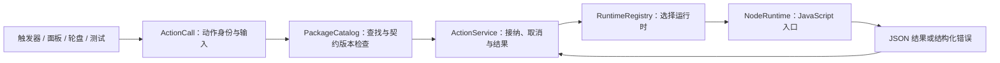

# 动作包与 JavaScript 入口

动作包把动作身份、参数和执行实现分开。一个绑定保存“调用哪个动作、传什么输入”，动作包提供清单和入口文件，运行时负责执行。当前提供 Node.js 与独立 Rust JS 宿主两种运行方式，适合带参数的程序启动、多个步骤、条件判断和结果处理；不内置流程图编辑器。

现有的运行程序、快捷键、本地步骤、系统调节和内置截图插件继续使用原有配置。新增脚本业务通过 `invoke` 入口接入，不需要为每个业务增加 `ActionSpec` 枚举成员或修改输入核心。

本文描述当前可运行的执行层原型。正式用户数据将按[账号工作区与同步设计](ACCOUNT_WORKSPACE.md)引入独立动作实体和 SQLite；手工目录保留为开发与导入入口，应用管理的动作内容及运行缓存属于待实现部分。当前尚无账号登录或云同步。

## 统一接口



| 对象 | 职责 | 变化时影响 |
| --- | --- | --- |
| `ActionCall` | 保存 `package_id`、`action_id`、`action_version` 和 JSON 对象 `input`。 | 绑定和轮盘使用同一调用结构。 |
| `PackageManifest` | 描述包身份、包版本和动作目录；每个动作声明运行时与入口。 | 添加 JS 动作只需增加清单和脚本。 |
| `PackageCatalog` | 加载目录、检查重复身份和入口路径、解析动作引用。 | 缺失或无效包产生诊断，用户绑定继续保留。 |
| `ActionService` | 有界接纳、调用 ID、忙碌判断、取消和终态回执。 | 执行管理不依赖脚本内部步骤。 |
| `ActionRuntime` | 将已解析动作和调用上下文转为结果。 | 新增语言或流程执行器时实现适配器并注册运行时 ID。 |
| `NodeRuntime` | 在独立 Node 进程调用 JS 默认导出，通过版本化协议取得 JSON 结果。 | JS 宿主 API 与绑定格式分别演进。 |

这些类型位于 `omnitrigger-actions`，不依赖 GPUI 或 Windows 输入核心。应用层负责目录位置、界面编辑和状态展示。原有执行器保留各自的输入目标核验、队列和系统调节合并语义，当前没有覆盖所有执行器的统一全局配额。

## 创建动作包

### 新建可编辑的脚本工程

在应用“动作库”点击“新建脚本”，填写名称并创建。名称支持中文，调用身份由系统生成；同名工程分别保存，不覆盖原文件。创建后动作立即出现在目录中，不新增触发绑定，也不要求先安装引擎。

“编辑代码”直接启动本机可用的 VS Code，打开工程和入口；未找到普通本地安装时使用记事本。不会通过 `.js` 文件关联运行入口，也不会为编辑器下载占位文件。VS Code 可读取随工程附带的 SDK 和 `jsconfig.json` 获得提示；记事本只提供文本编辑。开发时可用 `OMNITRIGGER_EDITOR` 指定完整本地编辑器 EXE 路径，该程序只接收入口文件参数，不能在变量中附加命令或参数。

保存代码后，下次运行会读取新内容；新增包、修改动作信息或安装宿主后，点击“重新加载”即可更新目录和运行时注册，无需重启。重载保留已接纳调用的运行时、取消令牌、调用 ID、配额和结果通道；它不会中止或重跑正在执行的动作。已有绑定继续保存原动作身份；动作被移除或契约不兼容时报告错误。

选择脚本并设置触发时，可以先点击底部“运行草稿”，不必保存绑定。这会真实执行当前参数对应的动作；普通提示动作的“预览”仍只显示提示。运行结束后，底部“查看结果”可展开 JSON 返回值或结构化错误，再次运行时显示新的调用状态。修改动作身份、版本或参数后不会把旧结果当作当前调用结果。

结果预览只保存在本次应用进程的内存中，最多保留最近 4 次完成记录，每项最多 8 KiB，超出时明确标注截断；这些预览不写入配置或动作日志；主动保存绑定时，参数仍按绑定设置保存。关闭或重启应用后不保留这些预览，完整返回值仍可从开发运行命令读取。

`ctx.packageRoot` 为绝对路径；常规 Windows 目录去掉 `\\?\` 前缀，例如 `ctx.packageRoot + '/output.txt'` 可直接用于文件 API。必须使用 Windows 字面名称的特殊路径保留原前缀，避免指向另一个文件或设备。入口和包边界在执行前仍按实际规范路径核验。

开发命令在当前配置同级的 `actions` 目录创建工程；配置所在目录需已存在：

```powershell
.\target\debug\omnitrigger.exe --config D:\Demo\bindings.json --create-script-action my-script
```

返回 JSON 包含工程、入口、调用文件和 SDK 的完整路径。创建不要求安装脚本引擎，不启动脚本、不新增绑定。工程包含：

```text
actions/my-script/
  action.json
  main.mjs
  lib/text.js
  call.json
  jsconfig.json
  README.md
  sdk/api.d.ts
```

使用支持 JavaScript / TypeScript 的编辑器打开整个目录，编辑 `main.mjs` 和 `lib` 中的模块。入口具名导出同步 `main(ctx)`，通过标准相对 `import` / `export` 拆分代码。工程附带本地 SDK 类型快照，启用标准 JS 类型检查，不依赖仓库路径或 npm 包，也无需转译；运行需要支持包内模块的新宿主；已有 `.js` 工程继续使用 `function main(ctx)`，更新应用不会改写作者文件。路径、缓存、循环和限额见[包内模块](../tools/js-engine-probe/MODULES.md)。入口的 `@type {ScriptMain}` 注释同时提供 `ctx` 补全和 JSON 返回值检查，能在编辑时发现异步入口、遗漏返回及 Promise、函数、`undefined` 等非 JSON 返回值；无结果时返回 `null`。静态类型无法排除 `any`、循环引用和非有限数，实际运行仍有独立校验。模块没有全局 `ctx`，辅助函数需要显式传参。SDK 的[源声明](../crates/omnitrigger-actions/runtime/script-types.d.ts)随应用维护，更新应用不会覆盖既有工程。

安装宿主后，可使用同一配置校验和运行：

```powershell
.\target\debug\omnitrigger.exe --config D:\Demo\bindings.json --check-action D:\Demo\actions\my-script\call.json
.\target\debug\omnitrigger.exe --config D:\Demo\bindings.json --run-action D:\Demo\actions\my-script\call.json
```

`--check-action` 只校验引用与运行时是否可用，不执行脚本，也不代替编辑器类型检查。生成入口只清理输入中的文本并返回 JSON，不操作窗口或剪贴板。应用已打开时，点击“重新加载”可看到新包。

工程标识为 1–64 个英文字母、数字、`-` 或 `_`，以字母或数字开头，不能是 Windows 设备名。命令拒绝重复身份、已有目录、目录容量不足，以及含诊断的动作目录；不会覆盖作者文件。链接、云盘目录和占位路径沿用动作目录校验；写入失败可能保留部分工程，错误会给出路径。该命令不能与运行、事件流、系统调节或其他操作混用。

### 轻量脚本宿主

`runtime: "script"` 可通过现有动作服务运行独立的 Rust JS 宿主，无需安装 Node。宿主不链接进输入核心；脚本执行、取消与终态仍由 `ActionService` 管理。已有 Boa 和 QuickJS 两种构建使用同一份宿主 API。`.mjs` 入口具名导出同步 `main(ctx)`，`.js` 入口声明标准 JS 函数 `function main(ctx)`，均返回 JSON 值；不需要自定义文件语法或 npm 包。

目前可用的同步 API 为 `ctx.fs.readText/writeText`、`ctx.process.run/start/capture`、`ctx.delay`、`ctx.clipboard.readText/readData/writeText/history.*`、`ctx.open`，以及 `ctx.desktop.target/targetContext/sendShortcut/sendKeySequence/sendText/copySelectionText/copySelectionData/windowAction` 和 `ctx.browser.call/profiles/chrome.*`，完整参数与限制见[宿主 API](../tools/js-engine-probe/API.md)。动作上下文额外提供 `ctx.packageRoot` 和保留完整整数精度的 `ctx.invocation`。可使用 [ScriptContext 类型声明](../crates/omnitrigger-actions/runtime/script-api.d.ts)获得编辑器提示；示例见[脚本文本清理动作](../examples/actions/script-clean-file/)和[只读目标查询](../examples/actions/script-target/)。目标查询示例附带 `jsconfig.json`，编辑器可直接检查标准 JS 与 `ScriptContext` 类型，无需转译后执行。桌面 API 复用应用捕获的原目标与 Rust 适配层，和 Node 共用参数校验；浏览器调用复用应用的 Rust 客户端，此处 API 同步返回，不使用 `await`。该运行时提供包内相对 ESM 导入，暂不提供 Node/npm 模块或 Promise 入口；需要 Node 环境或异步入口的动作继续选择 `node` 运行时。

Windows `process.capture` 在 Node、Boa、QuickJS 间共用 Rust 后端；Node 通过应用原生桥接逐次 `await`，轻量宿主同步返回。使用本地绝对 EXE 路径，可设置绝对 `cwd`；默认10秒预算、双流合计64KiB、严格UTF-8，默认拒绝非零退出。Node 默认工作目录为动作包目录，轻量默认继承宿主目录。预算不是硬实时超时，失败不返回部分输出、不自动重试。轻量宿主强停由操作系统关闭它的私有Job；Node断连由应用检测后协作取消，其Job仍由应用持有。旧 `process.run/start` 契约保持原样，详见[程序输出采集契约](../tools/js-engine-probe/API.md#程序输出采集)。

Windows x64 开发环境可先构建本机 QuickJS 包，再通过开发命令安装。包中包含独立宿主、SDK、许可通知和文件清单；构建命令不会发布或上传二进制：

```powershell
./tools/js-engine-probe/package-runtime.ps1 -OutputDirectory D:\Demo\script-development
$package = Get-Content D:\Demo\script-development\result.json -Raw | ConvertFrom-Json
.\target\debug\omnitrigger.exe --config D:\Demo\bindings.json --install-script-runtime $package.archive --sha256 $package.sha256
```

输出目录必须不存在；构建需要 Rust 1.90 MSVC、对应 `rust-docs`、Visual Studio C++ 工具和 PowerShell 7。安装端使用系统 Windows PowerShell 5.1，不需要 Node。摘要应来自已信任的本机构建记录；SHA-256 是完整性检查，不是作者签名。安装拒绝越界、重复路径、链接、超限或清单不符的文件，核对宿主能力描述并实际运行一段纯 JS 后才切换当前版本。失败不替换当前指针，可能保留暂存目录供排障。旧包保留，已运行的调用不因切换而结束；没有自动清理或断电恢复保证。

应用读取配置同级 `runtimes/script/current.json` 指向的包，每次动作执行前验证宿主映像的大小和 SHA-256；Windows 上在宿主退出前保留只读句柄，禁止写入或替换该映像。指针或托管包无效时报告错误，不静默回退。该开发入口只接受 `development` 包，不创建绑定或常驻进程；尚无界面自动下载和安装入口。

也可把自行构建的宿主放到配置同级 `runtimes/script/host.exe`（非 Windows 为 `host`），或用 `OMNITRIGGER_SCRIPT_HOST` 指定完整本地路径。环境变量优先于托管包；手动路径不附带托管包完整性保证，不能使用云盘、占位或链接路径。没有宿主时，相关动作报告运行时不可用。清单与 `ActionCall` 格式保持一致；`--check-action` 检查引用，`--run-action` 实际执行。

外层默认使用 60 秒预算，取消或超时终止并等待本次宿主退出，不重试或回滚。已启动的独立程序不会随调用结束关闭；宿主强停时也不保证正在执行的原生调用及其后代全部收尾。普通脚本错误与协议错误分别返回 `script_failed`、`invalid_response`；桌面结构化错误保留原 `code`、`method`、`effect_state`。API 的 `not_started` 仅表示本次调用未开始，不代表此前脚本步骤无副作用；脚本输入已提交后的宿主强停为 `unknown`。

脚本失败时，错误消息附带实际入口文件路径。新构建的 Boa / QuickJS 宿主将用户代码标为 `action.js`，用户函数内部的调用栈行号对应入口原文件；SDK 代码另标为 `omnitrigger-sdk.js`，自动调用 `main` 的尾部栈帧属于执行包装。首行列号包含执行包装的函数前缀，暂不提供源映射。诊断文本按 UTF-8 最多保留 16 KiB，过长消息保留首尾并标明截断；语法错误与引擎限额异常的定位细节以引擎输出为准。协议仍为版本 1，旧宿主可继续使用，但没有新的文件名和行号定位。

轻量宿主的同一预算包含映像校验、能力探测、进程创建和脚本执行。进程创建返回后、脚本输入写入前会再次检查取消与剩余预算；尚未提交输入就取消或超时，返回 `not_started`，不继续运行动作。操作系统内阻塞的进程创建仍不能被强制中断，返回后才能复核和回收，因此预算不保证整个调用在 60 秒内返回。

引擎自身还有 CPU、循环或内存限制，与外层时限独立，先达到的限制生效。

### Node 动作包

将文件放在绑定配置同级的 `actions` 目录下：

```text
OmniTrigger/
  bindings.json
  actions/
    my-tools/
      action.json
      main.mjs
```

默认根目录是 `%LOCALAPPDATA%\OmniTrigger`；使用 `--config D:\Demo\bindings.json` 时，动作目录为 `D:\Demo\actions`。程序只读取 `actions` 下一级目录里的 `action.json`，不会递归寻找包。包目录、清单和入口不支持云端占位文件或符号链接；将需要使用的文件放在普通本地目录。

`action.json`：

```json
{
  "schema_version": 1,
  "id": "my-tools",
  "name": "我的工具",
  "version": "1.0.0",
  "actions": [
    {
      "id": "launch-sequence",
      "title": "运行两个步骤",
      "version": 1,
      "runtime": "node",
      "entry": "main.mjs",
      "single_instance": true
    }
  ]
}
```

`entry` 是包内相对文件路径，不能指向包目录之外。一个包可声明多个动作，每个动作有独立的稳定 ID、契约版本和入口。显示名称可以改变，不用作引用键；目录名也不代替清单中的包 ID。

`main.mjs`：

```javascript
export default async function (ctx) {
  const { firstProgram, firstArgs = [], secondProgram, secondArgs = [], cwd } = ctx.input;
  if (typeof firstProgram !== 'string' || typeof secondProgram !== 'string') {
    throw new Error('请提供两个程序的路径');
  }

  const first = await ctx.process.run(firstProgram, firstArgs, { cwd });
  await ctx.delay(100);
  const second = await ctx.process.run(secondProgram, secondArgs, { cwd });

  return { firstCode: first.code, secondCode: second.code };
}
```

这里按顺序等待两个进程退出。第一步抛错时不会执行第二步；需要分支、循环或特定失败处理时，直接使用 JavaScript。

启动编辑器等需要保持打开的桌面程序时，使用 `start`，创建进程后即可继续后续步骤：

```javascript
export default async function (ctx) {
  const { editor, document } = ctx.input;
  const { pid } = await ctx.process.start(editor, [document]);
  return { launchedPid: pid };
}
```

`run` 等待进程退出并取得输出；`start` 只确认进程已创建，返回 `{ pid }`，不确认窗口已显示或文档已打开。通过 `start` 成功启动的独立程序不会随本次动作结束或取消而关闭。

程序路径和参数数组分开传递，不按空格拆分，不隐式调用 Shell。需要运行 PowerShell 等解释器时，显式将解释器路径作为程序，把脚本路径和其他参数分别放入数组。

### 动作级单实例

动作定义可设置 `single_instance: true`，同一 `ActionService` 中相同 `package_id` 与 `action_id` 的调用不能重叠执行，即使它们来自不同绑定、传入不同参数、使用不同契约版本或运行时。不同包或动作分别判断；该策略同时适用于 `node` 和 `script`。省略或设置 `false` 保留原行为；新建脚本工程也默认关闭，由作者编辑 `action.json` 后重新加载。值只能是 JSON 布尔值，`null`、字符串、数值或其他类型会使清单无效。动作包 `schema_version` 仍为 1，绑定及 `ActionCall` 不增加字段。

同一动作已有活跃调用时，只要已有调用或新调用中任一个启用单实例，新调用就返回 `action_busy`、`effect_state: "not_started"`。因此重载清单开启或关闭策略，不会绕过已经运行的调用；两边都关闭时仍遵守原有绑定与总配额限制。重复同一绑定时优先保留原来的 `binding_busy`。拒绝不会执行入口，也不排队、替换、取消旧调用或自动重试。

单实例占用在运行时返回、工作线程持有的运行时与宿主引用清理完成后释放，不必等界面读取终态；请求取消本身不会提前释放。原绑定占用和最多 4 次未完成或终态未读取调用的配额仍沿用原协议，所以单实例已经释放，也可能因绑定或总配额尚未释放而被拒绝。

单实例只覆盖同一个动作服务，不是跨服务或跨进程的全局锁。分别启动的命令行进程拥有各自服务，不能靠此字段防止它们重叠；通过 `ctx.process.start` 启动的独立程序也不属于运行时结束后的动作占用。

## 输入与 JS API

每次运行调用 `export default async function(ctx)`，返回 JSON 可序列化结果；抛出异常会使本次调用失败。

| API | 含义 |
| --- | --- |
| `ctx.input` | 绑定保存的 JSON 输入对象。由动作入口验证业务字段和取值。 |
| `ctx.invocation` | 当前 `invocation_id` 和 `binding_id`，以十进制字符串保留 Rust `u64` 的完整精度，用于关联本次调用。 |
| `ctx.packageRoot` | 当前动作包的绝对目录，可用于定位包内资源。 |
| `ctx.process.run(program, args, { cwd, allowNonZero })` | 启动进程并等待退出，返回 `code`、`stdout` 和 `stderr`；启动失败或非零退出抛错。省略 `cwd` 时使用包目录；显式设置 `allowNonZero: true` 时由脚本处理非零退出。 |
| `ctx.process.capture(program, args?, { cwd?, timeoutMs?, allowNonZero? }?)` | Windows 严格采集，须 `await`；返回 `{code, stdout, stderr}`。默认10秒、双流合计64KiB、严格UTF-8，失败不交付部分输出；默认工作目录为包目录。 |
| `ctx.process.start(program, args, { cwd })` | 独立启动程序，返回 `{ pid }`，不等待退出、不采集输出；省略 `cwd` 时使用包目录。成功启动后，取消动作不会关闭该程序。 |
| `ctx.delay(milliseconds)` | 等待指定毫秒数。 |
| `ctx.signal` | 当前调用的取消信号；自定义异步步骤可监听此信号停止后续工作。 |
| `ctx.browser.profiles({ timeoutMs })` | 列出已连接浏览器及其 `browser_instance_id`；连接可用不代表业务动作已完成。 |
| `ctx.browser.call(method, args, { profile, timeoutMs })` | 复用已安装连接器的 SDK，通过持久 IPC 调用 Chrome API，返回原始结果。 |
| `ctx.browser.chrome.*` | 动态 Proxy，例如 `await ctx.browser.chrome.bookmarks.getTree()`；指定 profile 或超时时使用 `call`。 |
| `ctx.desktop.target()` | 读取本次提交时捕获的目标，返回真实 `processName`、`windowRole`（`unknown`／`application`／`desktop`／`taskbar`）、`title`、`processId`、`isForeground`。角色在调用时采集，不重新选择目标。 |
| `ctx.desktop.targetContext()` | 导出原目标的完整值快照，字段可直接保存为 `--target-context` 文件；调用时重新核验原身份，生成 29 秒的提交期限，为调用方的时钟粒度预留余量。提交校验上限仍为 30 秒。 |
| `ctx.desktop.sendShortcut(keys, options?)` | 向原目标发送一次快捷键，明确 VK、修饰键在前，最多四类修饰键加一个普通键。可设置 `keyDownDelayMs`，或用 `timing` 复用原生进程时序配置；两者互斥，默认零。返回 `{ submitted: true }` 仅表示系统接纳输入。 |
| `ctx.desktop.sendKeySequence(modifiers, keys, options?)` | 最多四类修饰键在整组 1–16 个普通键期间保持按下。保留顺序和左右侧；可设置 `keyDownDelayMs`。 |
| `ctx.desktop.sendText(text)` | 分批发送 Unicode 文本，不借用剪贴板；每批核验原目标及取消状态。 |
| `ctx.desktop.copySelectionText()` | 向原目标发送 Ctrl+C，等待剪贴板序号变化后读取文本；复制结果保留在剪贴板。 |
| `ctx.desktop.copySelectionData(options?)` | 向原目标发送一次 Ctrl+C，按明确等待参数读取文本或文件列表，另返回 `changed`。 |
| `ctx.clipboard.readText()` | 读取 Unicode 文本，保留空白；没有文本格式或 UTF-16 无效时抛错。 |
| `ctx.clipboard.readData()` | 读取文本或文件列表及观察到的剪贴板序号，不需要前台目标，不读取文件内容。 |
| `ctx.clipboard.history.list/get/append/remove` | 显式访问应用的有界纯文本历史；默认不监听或读取系统剪贴板。 |
| `ctx.clipboard.writeText(text, options?)` | 替换全部剪贴板内容为 Unicode 文本，返回 `{ written: true, sequenceNumber }`，不自动恢复。临时回贴可传 `{ excludeFromHistory: true }`，同时写入 Windows 历史排除格式与 `OmniTrigger.TransientClipboard.v1`，回执另含本次随机 `writeId`；识别标记的采集器应跳过该内容。默认不排除；标记不限制其它程序读取。序号是写入后观察值，不代表独占剪贴板。 |

Node 本机桥接在每次 API 调用时将参数编码为固定请求。调用返回 Promise 后再修改按键数组或嵌套时序对象，不会改变等待连接的请求；参数编码失败在连接前返回 `invalid_input/not_started`。这份快照只覆盖本次调用，后续调用仍单独核验目标和取消状态。

浏览器 API 在校验时复制参数中的嵌套 JSON 值和调用选项；`profiles` 也固定本次选项。调用方可继续修改自己的对象，连接等待与适配器内部处理均使用这份副本。方法名称、参数范围及取消检查仍按上述契约执行。

临时格式以版本 DWORD `1` 开头，后接以 NUL 终止的 UTF-16 写入标识。采集器只需查询格式存在；需要恢复旧快照的宿主必须在同一次打开剪贴板期间核验本次标识与预期序号，发现其它来源更新时保留当前内容。标识属于合作协议，不能阻止其它软件修改或复制标记。测试恢复原载荷时也加入排除元数据，因此恢复后的完整格式集合可能与最初不同。

### 文本与文件列表

`readData()` 返回 `{kind: "text", text, sequenceNumber}` 或 `{kind: "files", paths, sequenceNumber}`。文本格式优先，空文本也保留；没有支持的格式会返回 `unsupported_clipboard_format`，格式损坏或超出上限时抛错。文件列表中的路径只作为字符串返回，不检查路径合法性、存在性或云端属性，也不打开它们。

文本最多 65,536 个 UTF-16 单元；文件列表最多 64 项，路径总长最多 65,536 个 UTF-16 单元。文件路径不能为空，文本和路径都不能含 NUL 或不完整代理对；合法空列表保留为 `[]`。序号是读取期间的观察值，可能回绕，不能用来证明数据来自某个窗口或保证后续访问仍是同一份内容。

`copySelectionData` 接受以下可选字段，全部先于输入操作校验：

| 字段 | 默认值 | 范围与含义 |
| --- | --- | --- |
| `format` | `"auto"` | `"auto"` 优先读取文本；`"text"`／`"files"` 只读取指定格式，缺失或无效时失败，不回退。 |
| `timeoutMs` | 600 | 1–5000ms，等待序号变化的预算。 |
| `pollIntervalMs` | 15 | 1–1000ms，且不超过 `timeoutMs`。 |
| `settleMs` | 30 | 0–1000ms，读格式前的额外等待。 |
| `allowUnchanged` | false | 为 `true` 时，等待结束仍可读取未变化的数据，并返回 `changed: false`。 |

复制结果保留在剪贴板；此方法不恢复原内容、不重新抓取前台、不重发复制。它持续核验原目标和取消状态，读到的序号与复制前不同才标记 `changed: true`；这仍不能证明数据由目标窗口产生。默认未变化时返回 `selection_unchanged`。等待预算不包含延迟渲染等阻塞系统调用的硬期限；取消也不能撤销已发送的复制。

轻量入口同步使用；Node 入口在调用前加 `await`。示例只返回摘要，完整内容仍可在脚本内处理：

```js
function main(ctx) {
    const data = ctx.desktop.copySelectionData({timeoutMs: 400, pollIntervalMs: 10, settleMs: 0});
    return data.kind === 'files'
        ? {kind: data.kind, count: data.paths.length, changed: data.changed}
        : {kind: data.kind, units: data.text.length, changed: data.changed};
}
```

两个新方法都要求应用的本机桥接；无桥接时返回 `native_bridge_unavailable`。需要同时更新应用与脚本宿主开发包。格式和合成宿主测试分别覆盖读取与协议，不代表任意软件响应复制或个人绑定已经验收。

### 显式文本历史

`omnitrigger.exe --text-history` 打开独立历史窗口；可附加 `--config <路径>` 选择配置。此模式不启动触发引擎，不能混用动作运行、设置或 Hook 检查参数。窗口默认不采集，点击“开启采集”后仅接收之后的剪贴板变更；摘要筛选不读取全部正文。

首次明确进入历史页时，后台自动加载一次摘要；失败后由“刷新”重试，不因重新进入页面循环读取。“上一条／下一条”沿当前筛选结果移动并滚动到选中项，抵达首尾后停止；不会自动发送文本。

点击列表或相邻导航按钮后，列表可用 ↑／↓、Home／End 选择当前可见记录。Enter 在释放事件时核对选中 ID、显示版本、列表焦点和发送状态后提交一次；重复按下不会重复提交。改选、失焦、刷新、查询或关闭会取消待提交状态。筛选输入框的编辑键与列表键盘处理分开。

输入内容会即时筛选已加载摘要；点击“查找正文”才搜索本项目保存的完整文本，最多 200 条。查询按 Unicode 小写归一化、空白分词，要求全部词项逐字命中，保留历史顺序。后台返回规范摘要、匹配 ID 和同一存储版本，界面不展开全部正文。改词会丢弃过期查询结果；历史版本变化后返回摘要筛选，可再次明确查找。查询失败保留旧摘要供参考，发送和删除须等显式读取成功。

窗口在打开前保留原目标身份，最多在本进程内有效 5 分钟。选中项的“发送到原窗口”复用既有文本输入接口；从历史窗口交还焦点时若前台已换成第三个窗口，会拒绝发送。目标关闭、身份变化或过期时须从原窗口重新打开。普通主窗口中的历史页没有这一启动目标，仍可查询、删除和控制采集。发送回执只表示系统接纳输入，结果不确定时要求核对与刷新，不自动重试；CLI 目标上下文的 30 秒限制保持不变。

`ctx.clipboard.history` 通过应用本机桥接访问配置文件同级的 `clipboard-history.json`，内容以明文 JSON 持久化。服务构造不读写历史文件；只有显式历史调用才访问存储。默认不监听系统剪贴板、不导入其他历史，也不自动采集图片或文件列表。四个方法不需要前台目标；后续发送文本仍使用本次动作原目标的 `sendText`。

Node 逐次 `await`；轻量脚本同步返回。参数只接受表中的对象字段，错误类型和未知字段在存储访问前拒绝：

| 方法 | 参数 | 返回 |
| --- | --- | --- |
| `list(options?)` | `{limit?}`，默认100，整数1–200。 | `{items:[{id,preview,utf16Units,createdAt}],revision}`；只有单行摘要，没有全文字段。 |
| `get({id})` | 非零、无前导零的十进制u64字符串。 | `{id,text,createdAt,revision}`；不存在抛 `history_item_missing`。 |
| `append({text})` | 有效Unicode、无NUL，最多65536个UTF-16单元；可为空，保留原始空白。 | `{id,revision,inserted}`；与当前最新条目完全相同时可去重，返回 `inserted:false`。 |
| `remove({id})` | 与 `get` 相同的ID字符串。 | `{removed,revision}`；不存在返回 `removed:false`。 |

ID和修订号都用十进制字符串传递，避免JS整数精度损失；修订号可为 `"0"`，不要转成 `number`。`createdAt` 是Unix毫秒的十进制字符串，排序与淘汰按稳定ID顺序，不按墙钟重新排列。列表最新在前；摘要最多64个UTF-16单元，不切断代理对，换行和控制字符替换为单行显示内容。`utf16Units` 是原文长度，摘要不是原文。

默认最多200项、原文总计1048576个UTF-16单元。达到容量时逐条淘汰最旧项，不截断条目正文。读取的存储文件最多8MiB；未知版本或损坏内容明确报错并保留原文件。去重或删除不存在的ID不增加修订号，删除后不复用旧ID；ID或修订号溢出会明确失败。

轻量入口可以只返回数量和长度；Node入口为相同调用增加 `await`：

```js
/** @param {ScriptContext} ctx */
function main(ctx) {
    const listing = ctx.clipboard.history.list({limit: 10});
    if (!listing.items.length) return {itemCount: 0};
    const item = ctx.clipboard.history.get({id: listing.items[0].id});
    return {itemCount: listing.items.length, selectedUtf16Units: item.text.length};
}
```

`get` 的正文供脚本内部使用；默认配方的终态只输出状态、数量和长度，不回显正文。可信脚本仍能主动返回或记录已取得的文本，SDK不提供正文追踪或自动删改。完整的保存、摘要选择与向原目标发送示例见[显式文本历史动作](../examples/actions/clipboard-history/)，包含Node和同步轻量入口；发送入口会实际向原目标输入文本。

错误包含 `code`、`method:'history.*'` 和 `effectState`，正文固定，不附带历史文本或底层路径。常用代码为 `invalid_input`、`invalid_response`、`history_unavailable`、`history_item_missing`、`history_busy`、`history_corrupt`、`history_conflict`、`history_id_exhausted`、`history_revision_exhausted`、`cancelled`、`timeout`；其他无法分类的失败为 `history_failed`。无应用桥接或存储不可用时明确 `history_unavailable`，不退回读取系统剪贴板。

`get` 返回独立的文本快照，删除不会撤回其他调用方已经取得的正文。删除成功确认该项已从持久历史移除，不保证已取得的文本不会随后被发送。读取历史与向原目标输入是分别完成的操作，不组成原子事务；输入回执也不表示目标应用已经完成业务操作。

`list/get` 失败的 `effectState` 为 `not_started`；写入在提交前明确拒绝为 `not_started`，提交后不能确认结果时为 `unknown`。不同调用不是一个事务，列表后条目可能被另一调用移除。锁竞争会报 `history_busy`，外部变化可能报 `history_conflict`；不会自动覆盖冲突、回滚或重试。客户端历史请求的传输期限为5秒，仍受更短的动作取消/总时限限制，不能保证立即中断已进入的文件系统调用。使用新增接口需要更新应用、宿主及已有工程的SDK快照。

### 桌面脚本

外部桌面宿主可在 `--run-action` 后附加 `--target-context <target.json>`，把打开菜单前已捕获的目标交给现有动作运行器。这个入口不安装 Hook、不启动界面或常驻服务。目标文件最多 4 KiB，字段如下：

| 字段 | JSON 类型 | 含义 |
| --- | --- | --- |
| `window_handle` | 十进制字符串 | 明确目标的正数 HWND |
| `process_id` | 正整数 | 该窗口所属进程 |
| `thread_id` | 正整数 | 该窗口所属线程 |
| `process_created_file_time` | 十进制字符串 | 进程创建 FILETIME 的原始 64 位值，避免 JS Number 精度损失 |
| `expires_at_unix_ms` | 整数 | 本次提交的到期时间，调用时生成，最多为当前 Unix 毫秒加 30,000 |

```powershell
omnitrigger.exe --config C:\Actions\bindings.json --run-action C:\Actions\call.json --target-context C:\Actions\target.json
```

文件必须包含完整身份，拒绝未知字段、重复参数、过期或超长有效期；不能与 `--check-action` 合用。提交前按原身份重新核验，失败返回 `status: rejected`、`invalid_target_context` 和 `effect_state: not_started`，不会改选当前前台或执行脚本。接纳后仍逐次核验目标，输入还要求它是前台；CLI 不恢复焦点。到期时间只限制提交，不延长动作运行时限，也不是身份凭证或权限隔离。

Windows 适配层提供 `ScriptTarget::snapshot()` 和 `ScriptTarget::from_snapshot(...)`，后者核验传入值后恢复上下文。传递值快照不代表能原子锁住窗口生命周期。目标文件及动作参数可能含个人信息，宿主应使用自己的本机临时目录，避免放入仓库或日志正文。

脚本可用 `await ctx.desktop.targetContext()` 取得同样的文件内容，再通过 `ctx.process.start(...)` 启动桌面宿主。脚本返回后按次桥接会关闭；持久界面应保存原身份，在用户操作时核验它并发起新调用，不能继续使用已结束的桥接，也不能在子进程启动后改抓当前前台。剪贴板序号会变化和回绕，检查与后续写入也不是原子操作，不能把匹配的序号当作安全恢复旧内容的充分条件。

桌面上下文由应用在接纳动作前捕获；轮盘调用沿用打开轮盘前的目标。运行时每次操作重新核对窗口、线程、进程及进程创建时间；发送前还要求原窗口仍为前台，不自动抢焦点。读取目标失败只影响桌面 API，纯代码及浏览器动作仍可运行。这些检查不能原子锁住 Windows 的窗口生命周期。

```javascript
export default async ctx => {
  const target = await ctx.desktop.target();
  const keys = target.processName.toLowerCase() === 'acrobat.exe'
    ? [162, 87]   // 左 Ctrl + W
    : [164, 115]; // 左 Alt + F4
  await ctx.desktop.sendShortcut(keys);
  return { inputSubmitted: true };
};
```

快捷键复用原生发送器的键位校验、已按住修饰键处理和输入标记。API 不确认应用是否已经关闭文档或完成其他业务操作。多步动作在每步发送前重新核验目标；发送时前台不再是原目标、目标失效、非法按键或取消会拒绝后续输入。核验不记录前台历史，不能检测两次调用之间切走又切回的情况。没有已开始副作用时错误的 `effectState` 为 `not_started`，输入发送失败或回执未确认时可能为 `unknown`；均不会自动重试。取消不撤销已提交的输入。

`effectState` 描述失败的这一次 API 调用，最终错误会保留该字段；它不表示脚本此前没有执行其他步骤。判断整段动作是否可以重试仍需结合业务结果。

桌面调用须逐个 `await`，并发调用报 `desktop_busy`，每次动作最多 128 次桌面调用。单次回执等待最多 5 秒，仍受动作总运行时限限制；返回时尚有调用会报 `pending_desktop_calls`。桥接仅在本次调用期间监听回环地址，使用系统随机令牌，不占用脚本 stdout，也不新增常驻服务或桥接线程。它与脚本代码一样使用当前用户权限，不构成沙盒。

键盘 `options.keyDownDelayMs` 须为 0–1000 的整数。正延迟在修饰键就绪后等待一次，再在每个普通键按下后等待一次；总等待预算 `(普通键数量 + 1) × keyDownDelayMs` 不得超过 3000ms。等待及逐次提交期间检查取消和原目标；失败只尝试释放本次已提交的按键，不重试动作，也不释放借用的修饰键。零延迟的单次 `sendShortcut` 保留原媒体键 Shell 路径；`sendKeySequence` 始终使用按键输入。错误保留 `method`、`code` 和 `effectState`，部分提交或释放收尾失败仍可能有副作用。

`sendShortcut` 另接受 `{timing:{key_down_delay_ms:0,process_overrides:{wps:10}}}`，字段与原生快捷键配置一致，由 Rust 共用同一校验和解析。覆盖最多 16 个明确进程文件名，忽略大小写和可选 `.exe`，按本次捕获的原目标进程选择；身份读取失败则报错，不退到当前窗口或忽略覆盖。它与 `keyDownDelayMs` 互斥，`sendKeySequence` 仍只接受后者。[发送快捷键示例](../examples/actions/shortcut/)展示动作包调用与隔离浏览器验收。

[键盘序列示例](../examples/actions/keyboard-sequence/)提供保持修饰键的序列与可设置步骤间隔的多个独立快捷键。例如 `await ctx.desktop.sendKeySequence([163], [77, 77], {keyDownDelayMs:10})` 在右 Ctrl 按住期间依次轻点两次 M。示例按原目标进程选择默认时序，调用方可显式覆盖；这不是通用 SendKeys 解释器。

同一包的 `recipe` 动作组合 `sequence`、`tap`、`text`、`delay`，最多 32 步。`sequence` 使用上述进程时序，`tap` 只轻点一个普通键且不增加按下延迟；`text` 保留字面内容。每一步等待及输入均遵守动作取消和原目标身份边界。[删除到行首调用](../examples/actions/keyboard-sequence/delete-line-start.json)先发左 Shift+Home，再等待 30ms 和 50ms，最后发 Backspace；行首执行时可能合并上一行，应按实际编辑器行为验收。

同包新增 `recipe-script`，以标准同步 JS 和现有 API 在轻量宿主中执行相同步骤输入，无需 Node；[调用示例](../examples/actions/keyboard-sequence/call-script.json)与[完整说明](../examples/actions/keyboard-sequence/README.md)包含编辑器配置、时序和边界。该入口在执行前检查步骤形状、等待、时序、文本和 32 次宿主调用预算；默认目标查询也占一次，含连续按键的 32 步输入须显式指定 `keyDownDelayMs`。按键语义和当前桌面状态仍由每次 API 调用核验，不能视为整组输入的事务。

桥接创建失败只在调用桌面或剪贴板 API 时抛出 `native_bridge_unavailable`，不阻止纯代码或浏览器脚本运行。桌面桥接的单请求、单回执上限为 512 KiB；文本 API 接受最多 65,536 个 UTF-16 单元，拒绝 NUL 和不完整代理对。最终动作结果仍限 64 KiB，处理长文本后应返回摘要。

`sendText` 将 CRLF 和 LF 分别规范为一次回车，不解析 SendKeys、模板或按键脚本语法。它拒绝仍被按住的 Ctrl、Shift、Alt、Win；已发送的文字无法回滚。`copySelectionText` 最多等待约 600ms 的序号变化，期间持续核验目标和取消；超时会报错，不使用旧剪贴板文本冒充选区。它不使用 UI Automation，也不能保证任意应用都响应 Ctrl+C；剪贴板不是隔离事务，其他程序的同时写入仍可能影响结果。

[文本动作示例](../examples/actions/desktop-text/)包含直接输入、粘贴、括号包裹选区、行尾换行。粘贴示例先写剪贴板、等待 50ms、发送 Ctrl+V；包裹选区先复制，保留空格和制表符，然后执行同样的粘贴过程。这些示例都实际改变目标文本，粘贴后的文本留在剪贴板。

[删除到行首示例](../examples/actions/desktop-line-edit/)依次发送 Shift+Home、等待 80ms、发送 Backspace。`delete-line-start-script` 使用标准 JS 和独立轻量宿主，通过 `call-script.json` 调用，不需要 Node；`waitMs` 与 `keyDownDelayMs` 可显式设置，并在发送输入前校验。默认按原目标进程选择按下时序。它会实际编辑目标输入框，检查清单不会执行它。专用输入框的真实验证在本机显式运行：

```powershell
cargo test -p omnitrigger-app interactive_desktop_api_smoke --locked -- --ignored --nocapture
cargo test -p omnitrigger-app interactive_desktop_text_smoke --locked -- --ignored --nocapture
cargo test -p omnitrigger-app interactive_desktop_key_sequence_smoke --locked -- --ignored --nocapture
$env:OMNITRIGGER_TEST_SCRIPT_HOST = 'D:/Local/script-host.exe'
cargo test -p omnitrigger-app interactive_script_line_edit_smoke --locked -- --ignored --nocapture --test-threads=1
```

测试短暂激活自建窗口，验证编辑结果、步骤间切窗和取消；不使用个人配置。行编辑验收覆盖行中、行尾、行首的真实文本结果；行首可能合并上一行，具体编辑器的 Home 行为仍需分别验收。轻量脚本验收使用显式指定的真实宿主，不访问剪贴板；上面的其他命令分别覆盖 Node API 与原生输入适配。

文本烟测在支持完整备份当前格式时才执行剪贴板用例，结束后恢复并逐格式读回核对；遇到不支持的格式会保留原剪贴板并明确失败，不把跳过算作通过。其他来源在测试期间更新剪贴板时，测试保留新内容。

### Node 打开网址或本地目标

`await ctx.open(target)` 请求系统默认程序打开网址或本地路径，无需前台窗口。只接受一个目标字符串：`http`、`https`、`mailto`、`about` 或盘符开头的本地绝对路径，最多32,766个UTF-16单元；首尾空白、控制字符及非法目标会被拒绝。目标原样传递，不拆成命令行，不接收参数、verb或其他选项。

```javascript
await ctx.open('https://example.com/');
const receipt = await ctx.open('D:/Work/report.txt');
return {submitted: receipt.submitted};
```

Node返回严格的 `{submitted:true}`，仅表示系统接纳打开请求，不证明文件、网页或外部应用完成加载。轻量 `ctx.open` 保持既有同步行为。目标按系统默认方式处理，本地可执行文件和快捷方式也可能启动程序；只运行可信动作。没有应用原生桥返回 `native_bridge_unavailable`，不会自动重试。原生调用并发返回 `open_busy`，Node须await；遗留打开Promise会使动作失败。

错误包含 `method:'system.open'` 和 `effectState`。校验或提交前取消/过期为 `not_started`；进入系统调用后的失败、迟到、取消或丢失回执为 `unknown`。等待受动作总时限限制，但单次系统打开不能被强制抢占，取消不会撤销已接纳请求，`unknown`不能作为安全重试依据。

### 打开独立文本历史

`ctx.ui.openHistory()` 在运行中的应用内打开独立历史窗口。Node 需要 `await`，轻量脚本同步返回 `{opened:true}`。目标沿用本次动作提交时的窗口快照，不接受目标、程序路径或配置路径参数；没有可用原目标时返回 `target_unavailable`。打开示例见[文本历史动作包](../examples/actions/clipboard-history/README.md)。

回执只确认窗口创建，动作结束后窗口仍然存在。窗口默认关闭采集；关闭它只停止自身采集，确认停止后才移除，不停止主窗采集或退出应用。采集停止失败时窗口保留，可再次关闭以重试。已有选择窗或历史窗时返回 `ui_busy`；无应用界面的 CLI 返回 `ui_unavailable`。提交前取消或过期为 `not_started`，创建已经开始但结果无法确认时为 `unknown`，不会自动重试。

`ctx.ui.toggleHistory()` 切换上述同一个窗口：无窗时沿用本次 Host 原目标创建，返回 `{opened:true}`；已有窗时仅关闭该窗，等待自身采集停止并移除后返回 `{closed:true}`。Node 需要 `await`，轻量脚本同步返回。关闭无需新的外部目标，不停止主窗采集；选择窗占用、手动关闭或切换关闭尚未确认时返回 `ui_busy`。无界面时为 `ui_unavailable`，不另启进程。调用无参数；取消或超时在开始前为 `not_started`，创建或关闭已经开始后为 `unknown`，不会回滚或自动重试。原 `openHistory()` 仍只创建窗口。

### 本地文件元数据

`ctx.fs.stat(path)` 只查询本地路径的类型，返回 `{kind:'file'|'directory'|'missing'|'other'}`，不打开文件内容或枚举目录。Node 使用 `await`；轻量脚本同步返回。它通过本机宿主工作，无需应用界面或前台窗口，可用于“存在普通文件时打开，否则搜索文本”等分支。

```javascript
const info = await ctx.fs.stat('D:/Work/report.txt');
if (info.kind === 'file') {
  await ctx.open('D:/Work/report.txt');
}
```

接受有效 Unicode 的普通盘符绝对路径，最多 32767 个 UTF-16 单元。只支持本地固定磁盘的物理卷；相对路径、UNC、设备路径、SUBST、网络映射及可移动磁盘不支持。路径不能含 `.`、`..`、中间空组件、备用数据流、设备名、非法字符或以空格、点结尾的组件；设备名依据 [Windows 命名规则](https://learn.microsoft.com/en-us/windows/win32/fileio/naming-a-file)校验。可使用正斜杠或反斜杠，盘符根和末尾单个分隔符有效。

逐级检查祖先属性，遇到链接、联接点、其他重解析点、离线或召回占位属性时报告 `path_unavailable`；OneDrive、Dropbox、iCloud 目录名也会被拒绝。目标或祖先不存在时返回 `missing`，访问拒绝和其他错误不会被当作不存在，也不会自动回退搜索。调用不改文件或个人配置；它不是脚本沙盒。

错误包含 `method:'fs.stat'` 和 `effectState:'not_started'`。格式错误为 `invalid_input`，不支持的磁盘为 `path_not_local`，访问拒绝为 `access_denied`，其他元数据错误为 `fs_error`；没有本机宿主为 `fs_unavailable`。Node 中须 `await`，已有本机调用未结束时报告 `fs_busy`。调用检查动作取消与截止时限，但不能抢占已经进入的单次系统元数据调用，也不自动重试。

返回值是查询时的观察，不能保证后续打开时路径仍指向同一个对象。通用调用见[搜索与打开文件示例](../examples/actions/common-search/)。开发检查使用新建的隔离配置、文件和目录联接，不启动界面或 Hook：

```powershell
node tools/script-sdk-check/check-fs-stat.mjs target/debug/omnitrigger.exe
```

可在命令末尾追加已构建的轻量宿主 EXE 路径，逐个验证真实脚本到原生元数据的调用。已安装旧宿主和已有工程的 SDK 快照需要更新后才能使用新接口。

### 原生通知

应用界面中的脚本可调用 `ctx.ui.notify({message, title?, level?, placement?, durationMs?})`，提交一个不抢焦点、鼠标透传的纯文本通知。Node 使用 `await`；轻量脚本同步返回。它不创建定时或事件触发器。

```javascript
export default async ctx => {
  return await ctx.ui.notify({
    message: '处理完成',
    title: '工作流',
    level: 'success',
    placement: 'topRight',
    durationMs: 3000,
  });
};
```

`message` 必填，非空白，最多 1024 个 UTF-16 单元，可含换行与制表符；`title` 默认 `OmniTrigger`，为最多 128 个 UTF-16 单元的非空白单行文本。文本须为有效 Unicode，不接受 NUL、孤立代理项及其它控制字符。`level` 为 `info`、`success`、`warning` 或 `error`，默认 `info`；`placement` 为主显示器工作区的 `topRight`、`bottomRight` 或 `center`，默认 `topRight`。`durationMs` 默认 3000，接受 1000–30000 的整数。参数不接受额外字段，也不会执行 HTML 或链接。

返回 `{submitted:true}` 表示应用接纳并创建了通知界面请求，不证明用户看见或读到内容。调用不等待通知到期，脚本正常结束后通知继续显示到期；应用退出时清理。同一时间只接纳一个通知，重叠请求明确报告 `ui_busy`，不自动覆盖或排队。没有运行中的应用界面时报告 `ui_unavailable`。创建前取消或超过时限为 `not_started`；界面已创建后的未确认结果可能为 `unknown`，不能据此自动重试。

窗口大小受主显示器工作区限制，过长内容可能被裁切，适合简短提示。通用示例见[脚本通知](../examples/actions/script-notification/)，真实界面检查见[桌面脚本验收](DESKTOP_SCRIPT_SMOKE.md)。

轻量脚本需要包含该接口的宿主版本；更新应用源码或类型声明不会替换已经安装的旧宿主。独立脚本 CLI 没有应用界面，不会自动启动通知服务。

### 脚本选择菜单

应用界面中的动作可调用 `ctx.ui.choose({items, title?, placeholder?, timeoutMs?})`，显示可搜索、支持键盘和鼠标选择的菜单。每项包含唯一稳定的 `id`、显示 `label` 和可选 `description`；接受 1–200 项，总参数最多 32 KiB。返回 `{status:'selected', id}`，或 `{status:'cancelled', reason:'dismissed'|'timeout'}`。默认时限 30 秒，另受动作总时限限制。Node 调用需 `await`，轻量脚本同步等待发生在动作线程，Hook 不等待。

动作取消或宿主断连会关闭未完成的选择窗口。当前只能打开一个选择窗口；已有选择时报告 `ui_busy`，独立 CLI 没有 GPUI 界面时报告 `ui_unavailable`。选择完成后仅在窗口仍为前台且原目标身份有效时尝试交还焦点；系统可能拒绝，后续输入继续核验原目标，不能把选择回执当作目标已恢复的证明。示例见[脚本选择菜单](../examples/actions/script-choice/)。

### 窗口脚本

同步脚本可直接调用 `ctx.desktop.windowAction('toggle_maximize')`；Node 脚本使用 `await`。操作还包括 `minimize` 和 `close`，始终针对本次提交时捕获且仍为前台的窗口，复用原生窗口能力。目标身份与取消条件在状态检查和提交前重新核验；句柄生命周期的检查不是原子锁定。

返回 `{submitted:true}` 仅表示系统接纳请求；关闭可能提示保存或被目标程序拒绝。原目标变化时停止，已提交的窗口请求不会因取消而撤销。此接口不接收外部窗口句柄或隐式选择新前台；参数、目标与请求失败保留结构化错误。完整参数见[窗口动作 API](../tools/js-engine-probe/API.md#窗口动作)。

### 浏览器脚本

先在“扩展”安装浏览器连接器，并让 Chrome 扩展连接本机。宿主从当前配置同级的固定版本连接器目录加载 SDK，无需在动作参数中保存 SDK 路径、端点或扩展 ID。未安装时只有浏览器调用报 `browser_unavailable`，其他脚本仍可运行。完整宿主类型见 [api.d.ts](../crates/omnitrigger-actions/runtime/api.d.ts)。

```javascript
export default async ctx => {
  const tree = await ctx.browser.call('bookmarks.getTree', [], {
    ...(ctx.input.profile ? { profile: ctx.input.profile } : {}),
    timeoutMs: 10000,
  });
  return { roots: tree.length };
};
```

`profile` 为 `profiles()` 返回的 `browser_instance_id`。省略时由桥接服务要求恰好一个连接，多个连接会明确失败。每个动作复用一条客户端连接，最多同时等待 8 个浏览器调用；不启动 CLI 或额外 Node 子进程。所有调用都需要 `await`；动作返回时仍有未完成调用会报 `pending_browser_calls`，随后停止等待、关闭连接。

`timeoutMs` 默认为 10000，允许 1–60000 毫秒，同时受动作总计 60 秒期限约束。动作取消自动传入 SDK，取消或超时只停止等待或尚未派发的调用，不能保证中断 Chrome 内部操作，不能撤销副作用，也不自动重试。捕获异常可读 `code`、`method`、`effectState`，支持的新版连接器还会提供 `requiredPermissions`；未捕获时最终 `ActionError` 使用 `effect_state` 和 `required_permissions` 字段保留这些信息。`unknown` 表示结果未确认。

脚本内可处理 SDK 最大 32 MiB 的结果；最终动作结果仍限 64 KiB，建议只返回摘要。`undefined` 和 `null` 在脚本内保持区别。通用转发仍受扩展权限、调用模式和 Chrome 自身条件限制，不支持事件订阅或任意页面脚本注入。v0.1.0 发布扩展没有新增可选权限界面，不能把源码里的新增能力当作已安装能力。

可直接复制的[书签统计示例](../examples/actions/browser-summary/)只返回数量，不保存书签内容。将它放到当前配置同级 `actions` 目录后，用其 `call.json` 执行 `--run-action`；可在 `input.profile` 中明确指定目标。轻量宿主也提供同步浏览器接口，见[脚本书签统计](../examples/actions/script-browser-summary/)；该示例使用相同 Chrome API，不使用 `await`，可在没有 Node 的环境中运行。在仓库外编辑时，先创建脚本工程，再移入示例逻辑并保留工程的本地 SDK 引用；已有工程的 SDK 快照需由作者显式更新，应用不会覆盖。

当前参数编辑器保存 JSON 对象，没有通用参数表单或完整 JSON Schema 校验。包清单加载和“检查动作”只验证调用结构、动作身份、版本和运行时解析，不执行脚本，所以不能验证所有业务输入。需要修改必填输入、输出含义或行为约定时，提高动作的契约版本，并显式更新绑定；包的发布版本不能代替动作契约版本。

## 设置触发与命令行调用

1. 安装 Node.js，使 `node` 可从 `PATH` 启动；也可在启动 OmniTrigger 前通过 `OMNITRIGGER_NODE` 指定 `node.exe` 的完整绝对路径。应用不会自动下载安装 Node。
2. 将包放入所选配置目录的 `actions`，重新启动 OmniTrigger 加载清单。
3. 在“动作库”选择动作并“设置触发”，录制或选择触发方式，编辑 JSON 输入后保存。选择动作不自动运行脚本，“测试动作”才会真实执行。
4. 也可将已有动作绑定复制到轮盘槽位，槽位保存同一 `invoke` 描述。

绑定中的动作形态如下；`bindings.json` 使用版本 8，轮盘中的 `invoke` 需要版本 3：

```json
{
  "kind": "invoke",
  "package_id": "my-tools",
  "action_id": "launch-sequence",
  "action_version": 1,
  "input": {
    "firstProgram": "C:\\Tools\\first.exe",
    "firstArgs": ["--title", "包含空格的参数"],
    "secondProgram": "C:\\Tools\\second.exe",
    "secondArgs": ["--finish"],
    "cwd": "C:\\Tools"
  }
}
```

命令行直接调用时，将上例去掉 `kind` 字段，保存为独立的 `call.json`。这份文件只保存 `ActionCall`，不需要创建输入触发器：

```powershell
.\target\debug\omnitrigger.exe --config D:\Demo\bindings.json --check-action D:\Demo\call.json
.\target\debug\omnitrigger.exe --config D:\Demo\bindings.json --run-action D:\Demo\call.json
```

`--check-action` 只读检查，不执行 JS，不安装 Hook。`--run-action` 真实执行并返回结构化结果，也不安装 Hook。运行时或包不可用、版本不兼容、调用忙碌、进程启动失败和脚本运行失败均报告错误，不自动重试。

### 外部宿主的目录与事件

`--list-package-actions` 输出一个 JSON 对象：`schema_version: 1`、`actions` 和 `diagnostics`。每项包含完整 `call`（默认 `input: {}`）、`package_name`、`title`、`runtime`、可空的 `reference_error`，以及可选的 `single_instance`；启用时为 `true`，默认 `false` 省略以保留旧目录格式。该策略属于动作定义，不写入 `call`。目录只包含已安装动作包；不枚举原生动作或个人绑定，不导入 JS。引用检查通过只说明包和运行时可解析，不保证业务成功或输入满足脚本要求；目录也不是动作当前是否忙碌的快照。输出超过 4 MiB 时整体拒绝，不返回部分目录。

```powershell
omnitrigger.exe --config D:\Demo\bindings.json --list-package-actions
omnitrigger.exe --config D:\Demo\bindings.json --run-action D:\Demo\call.json --stream-action-events
```

事件模式在 stdout 先输出一行 `{"schema_version":1,"invocation_id":1,"status":"started"}`，随后输出成功终态 JSON。`started` 表示服务开始处理这次调用；它不证明 JS 已执行或业务成功。调用 ID 仅在本次进程内有效。失败终态写入 stderr，退出码为 1；执行前拒绝不会输出 started。宿主必须同时读取两个流、核对开始与终态的调用 ID，并等待进程实际退出；成功终态与退出码 0 才组成成功结果。未指定事件参数时保留单终态输出。

`--stream-action-events` 只能与 `--run-action` 合用，可同时传递明确的 `--target-context`。检查、运行和列目录三种命令互斥。外部宿主取消时应收尾自己启动的调用进程；进程退出不能撤销脚本已产生的副作用，失败或缺失回执不能自动重试。

仓库提供可直接复制的[顺序运行程序示例包](../examples/actions/process-sequence/)，其包 ID 为 `examples.process-sequence`，动作 ID 为 `run`，同时提供[完整绑定配置](../examples/action-packages.json)和[独立调用文件](../examples/actions/process-sequence/call.json)。从仓库根目录可以直接检查并运行两个无文件写入的 Node 步骤；需要 `node` 位于 `PATH`：

```powershell
.\target\debug\omnitrigger.exe --config .\examples\action-packages.json --check-config
.\target\debug\omnitrigger.exe --config .\examples\action-packages.json --check-action .\examples\actions\process-sequence\call.json
.\target\debug\omnitrigger.exe --config .\examples\action-packages.json --run-action .\examples\actions\process-sequence\call.json
```

运行会依次读取 Node 版本和输出“第二步完成”，返回两个进程的输出与退出状态。也可以带同一 `--config` 启动界面，用示例绑定 `CapsLock + R` 触发。若复制到其他目录试用，应同时复制配置文件和同级 `actions` 目录。独立调用文件内容如下：

```json
{
  "package_id": "examples.process-sequence",
  "action_id": "run",
  "action_version": 1,
  "input": {
    "steps": [
      { "program": "node", "args": ["--version"] },
      { "program": "node", "args": ["-p", "'第二步完成'"] }
    ]
  }
}
```

## 执行与权限边界

通用动作服务最多接纳 4 次未完成或终态未读取的调用；同一绑定不重叠执行。启用 `single_instance` 的动作还会按上文的动作身份拒绝跨绑定重叠。每次调用获得独立 ID，终态区分成功、失败和取消。工作线程异常转为失败，不把异常当作成功继续执行。动作编辑区的“停止此动作”请求取消；Node 先通知 `ctx.signal`，协作取消会请求终止 `ctx.process.run` 启动的直接子进程，宽限后强制停止仅作用于 Node 宿主。脚本占满 CPU、阻塞事件循环或自行通过原生 API 创建进程时，不能保证子进程全部结束；不提供完整进程树收尾保证。`ctx.process.start` 已成功启动的独立程序始终不随动作取消关闭。取消和超时不能撤销已经发生的文件修改或其他副作用。

JS 宿主必须返回匹配协议版本和调用 ID 的有效结果；仅有进程退出码 0 不算动作成功。成功结果表示脚本完成其声明的逻辑，外部程序的业务是否真正完成仍由动作自行验证。默认运行预算为 60 秒；每个子程序的标准输出和标准错误合计最多 64 KiB，最终 JSON 回执最多 64 KiB。宿主不保留 `console` 日志；需要带回的信息应通过 `return` 返回，界面提供有界结果预览，完整 JSON 结果可从命令行读取。协议使用独立临时响应文件，与日志输出分开，运行后清理临时目录。

Node 的同一预算包含原生桥初始化、入口准备、进程创建和脚本执行，动作请求只携带实际剩余预算。启动返回后和请求写入前会复核取消与期限；尚未提交输入时返回 `not_started`，已经开始写入请求后取消或超时则保守返回 `unknown`。阻塞的系统进程创建仍只能在返回后复核，预算不保证整个调用在 60 秒内返回。

Node 进程以当前用户权限运行，能导入 Node 自带模块并访问用户权限范围内的文件、网络和进程。清单、独立进程及路径检查均不是安全沙盒；只加载自己信任的包。已有浏览器调用和有限的原目标键盘、文本与剪贴板 API；尚无动作包级别的权限声明与授权隔离、鼠标操作或任意窗口控制。

## 动作内容来源与托管（规划）

本节为设计目标，尚未实现。当前只有上文的 `actions\<包目录>` 手工目录。

动作内容按是否需要文件分为三种来源，用户不需要像安装浏览器扩展那样经过打包和安装步骤：

| 来源 | 适用场景 | 内容位置 | 同步 |
| --- | --- | --- | --- |
| 内联 | 快捷键、本地步骤、系统调节、打开程序等无文件动作 | 配置档中的一条记录 | 随配置档同步 |
| 托管包 | 单个脚本文件，或包含入口与资源的目录 | 应用管理的内容仓库 | 按内容哈希同步 |
| 链接目录 | 在外部目录（例如 git 仓库）中开发的动作包 | 用户指定的本机目录，应用只读不复制 | 只同步链接记录，每台设备分别指定路径 |

在界面中新建脚本动作时，应用直接创建托管包；导入文件夹或 zip 时复制为托管包。链接目录用于开发调试，界面标明“仅本机”。现有 `actions\<包目录>` 保留为链接目录模式，配置档迁移时可导入为托管包。

### 修订与编辑

托管包在所属配置档下保存不可变修订和一份可编辑的工作副本：

```text
profiles\<配置档 ID>\packages\<包 ID>\
  revisions\<内容哈希>\   不可变修订，执行与同步只使用这里
  work\                   工作副本，供编辑器直接修改
```

- “在编辑器中打开”准备 `work\` 并用用户选择的编辑器打开，修改的就是普通文件。
- 应用监视工作副本。保存后校验清单与入口，通过则生成新修订，后续调用使用新修订；正在运行的调用继续使用开始时的修订。
- 校验失败时继续使用上一修订，界面显示结构化错误，不运行未通过校验的内容。
- 旧修订保留，可以回退到任一修订；回退本身也生成记录。
- 单文件动作是只有一个文件的包，清单由应用生成，用户不需要编写 `action.json`。

### 引用、依赖与限制

- 用户动作引用包 ID 与动作 ID，默认跟随最新修订，也可以锁定某一修订。修订以内容哈希标识，与[账号工作区与同步设计](ACCOUNT_WORKSPACE.md)中按哈希引用内容的规则一致。
- 托管包不包含 `node_modules` 等依赖目录。依赖需打包进入口文件，或在清单中声明，由每台设备分别准备。
- 单个包设定大小上限，大资源通过内容仓库单独存放。
- 密钥不写入包内容，只能通过本机凭据引用使用，因为包内容会同步。
- 运行本机已有的脚本文件（例如 `D:\scripts\x.ps1`）属于命令动作加本机路径映射，不是托管内容；界面区分“托管脚本”与“引用本机文件”。
- 导出格式与托管包相同；以后的分享或市场在此格式上增加签名，不另设格式。

## 后续扩展方式

| 需求 | 应采用的扩展点 |
| --- | --- |
| 新的程序启动或复杂步骤 | 增加动作包和 JS 入口，复用 `runtime: "node"`。 |
| 业务输入表单 | 基于动作描述扩充编辑器，最终仍生成 `ActionCall.input`。 |
| 流程图（外部扩展） | 不内置。外部工具编辑图，图作为包内资源，由扩展提供的运行时适配器解释，默认不安装；触发绑定仍是同一个 `ActionCall`。 |
| 新语言或外部执行服务 | 实现并注册 `ActionRuntime`，明确结果、取消和超时语义。 |
| 原生桌面能力 | 增加宿主能力接口并定义目标、权限和输入释放边界；不能靠新增任意 JSON 字段绕过这些约束。 |

流程图扩展、跨动作调用、包市场、热重载和自动更新均未实现。这套接口把新增业务与输入绑定解耦，但新增运行时或宿主能力仍需要对应实现和测试；契约发生不兼容变化时仍需版本迁移。

独立的 [Rust JS 宿主](../tools/js-engine-probe/README.md)已接入动作包的 `script` 运行时，提供共享 API、SDK 和本机开发包安装验证；同目录保留 Boa 与 QuickJS-NG 的体积测量。现有 Node 动作继续使用各自的运行时。

## 脚本亮度步进

Node 使用 `await ctx.desktop.stepBrightness({direction:'up',strategy:'physical'})`；同步脚本使用同名方法直接取得结果。`direction`只接受`up/down`，`strategy`必须显式选择`physical/wmi_first/physical_then_wmi`，不接受额外字段或默认策略。wire为`display.brightness_step`，走现有NativeBridge和App宿主，不启动另一服务或执行器。

physical和physical_then_wmi在实际执行时捕获一次物理指针。physical对最近逻辑屏幕下1–64台物理显示器按各自量程±5%步进；wmi_first不读取或依赖指针，直接固定首枚举WMI对象，按支持档位严格跨过当前值±1，零档或无档不写；physical_then_wmi仅在确认DDC未写入且无有效成员时尝试首WMI。调用需要NativeBridge，不要求原前台窗口或界面。部分/未知写入后不跨设备补偿，不重试。

结果包含strategy、effectState、physical和wmi。effectState为not_started或unknown：后者保守记录已进入写调用，不代替逐项读回状态。physical成员按本次序号返回read_rejected、unchanged、set_unconfirmed、readback_unknown、readback_different或confirmed，以及可用的原始数值和固定错误代码；wmi返回set、zero_skipped、no_eligible_level或failed及可用百分点。无设备名、实例ID、坐标或原异常正文。外层返回不代表所有设备成功，WMI的set也不证明读回已达到请求值。

参数错误及写前取消/期限为not_started；进入首个写调用后无法确认的取消/超时为unknown。设备之间、读写前后检查原动作取消和总期限；无法抢占已进入的Win32调用，返回后停止后续设备。传输已发送后失联也不能据此推断未执行。中断时逐项回执可能未送达，不撤销已写入，不应自动重试。SDK拒绝额外字段、标识、非法数值和不符合策略的回退回执。

## 显式音量百分点调节

Node使用`await ctx.desktop.adjustVolume({deltaPercent:5})`，同步脚本用同名方法直接取回结果。参数必须为仅含deltaPercent的对象，非零整数，范围-100至100。复用当前默认多媒体输出端点的CoreAudio百分比算法，结果夹紧到0–100；不注入媒体键或请求系统音量提示，不接受设备ID，不要求前台目标、指针或界面，需要应用NativeBridge。

wire为audio.volume_adjust，deltaPercent映射为delta_percent。返回匿名previousPercent、requestedPercent、currentPercent及保守effectState:'unknown'。即使在边界夹紧后请求值不变，现有原生路径仍调用设置接口；不把它称为未写入。读回可能受到设备量化或其他客户端影响，不保证等于请求，不以SDK重新计算或伪造读回。

参数错误和写前取消/期限为not_started；进入设置调用后无法确认的取消、期限或原生错误为unknown。与亮度共用守卫和既有NativeBridge断连处理，在原生读写前后检查总期限，不能抢占已进入的阻塞调用。没有重试、补偿、外部工具或另一执行器。错误只含固定消息、代码、方法及效果状态，不返回设备标识或原异常正文。
