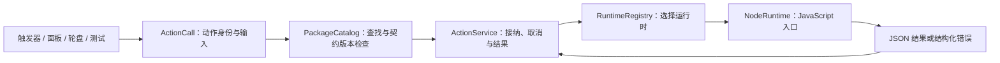

# 动作包与 JavaScript 入口

动作包把动作身份、参数和执行实现分开。一个绑定保存“调用哪个动作、传什么输入”，动作包提供清单和入口文件，运行时负责执行。当前提供 Node.js 运行时，适合带参数的程序启动、多个步骤、条件判断和结果处理；不内置流程图编辑器。

现有的运行程序、快捷键、本地步骤、系统调节和内置截图插件继续使用原有配置。新增脚本业务通过 `invoke` 入口接入，不需要为每个业务增加 `ActionSpec` 枚举成员或修改输入核心。

本文描述当前可运行的执行层原型。正式用户数据将按[账号工作区与同步设计](ACCOUNT_WORKSPACE.md)引入独立动作实体和 SQLite；手工目录保留为开发与导入入口，应用管理的动作内容及运行缓存属于待实现部分。当前尚无账号登录或云同步。

## 统一接口



| 对象 | 职责 | 变化时影响 |
| --- | --- | --- |
| `ActionCall` | 保存 `package_id`、`action_id`、`action_version` 和 JSON 对象 `input`。 | 绑定和轮盘使用同一调用结构。 |
| `PackageManifest` | 描述包身份、包版本和动作目录；每个动作声明运行时与入口。 | 添加 JS 动作只需增加清单和脚本。 |
| `PackageCatalog` | 加载目录、检查重复身份和入口路径、解析动作引用。 | 缺失或无效包产生诊断，用户绑定继续保留。 |
| `ActionService` | 有界接纳、调用 ID、忙碌判断、取消和终态回执。 | 执行管理不依赖脚本内部步骤。 |
| `ActionRuntime` | 将已解析动作和调用上下文转为结果。 | 新增语言或流程执行器时实现适配器并注册运行时 ID。 |
| `NodeRuntime` | 在独立 Node 进程调用 JS 默认导出，通过版本化协议取得 JSON 结果。 | JS 宿主 API 与绑定格式分别演进。 |

这些类型位于 `omnitrigger-actions`，不依赖 GPUI 或 Windows 输入核心。应用层负责目录位置、界面编辑和状态展示。原有执行器保留各自的输入目标核验、队列和系统调节合并语义，当前没有覆盖所有执行器的统一全局配额。

## 创建动作包

将文件放在绑定配置同级的 `actions` 目录下：

```text
OmniTrigger/
  bindings.json
  actions/
    my-tools/
      action.json
      main.mjs
```

默认根目录是 `%LOCALAPPDATA%\OmniTrigger`；使用 `--config D:\Demo\bindings.json` 时，动作目录为 `D:\Demo\actions`。程序只读取 `actions` 下一级目录里的 `action.json`，不会递归寻找包。包目录、清单和入口不支持云端占位文件或符号链接；将需要使用的文件放在普通本地目录。

`action.json`：

```json
{
  "schema_version": 1,
  "id": "my-tools",
  "name": "我的工具",
  "version": "1.0.0",
  "actions": [
    {
      "id": "launch-sequence",
      "title": "运行两个步骤",
      "version": 1,
      "runtime": "node",
      "entry": "main.mjs"
    }
  ]
}
```

`entry` 是包内相对文件路径，不能指向包目录之外。一个包可声明多个动作，每个动作有独立的稳定 ID、契约版本和入口。显示名称可以改变，不用作引用键；目录名也不代替清单中的包 ID。

`main.mjs`：

```javascript
export default async function (ctx) {
  const { firstProgram, firstArgs = [], secondProgram, secondArgs = [], cwd } = ctx.input;
  if (typeof firstProgram !== 'string' || typeof secondProgram !== 'string') {
    throw new Error('请提供两个程序的路径');
  }

  const first = await ctx.process.run(firstProgram, firstArgs, { cwd });
  await ctx.delay(100);
  const second = await ctx.process.run(secondProgram, secondArgs, { cwd });

  return { firstCode: first.code, secondCode: second.code };
}
```

这里按顺序等待两个进程退出。第一步抛错时不会执行第二步；需要分支、循环或特定失败处理时，直接使用 JavaScript。

启动编辑器等需要保持打开的桌面程序时，使用 `start`，创建进程后即可继续后续步骤：

```javascript
export default async function (ctx) {
  const { editor, document } = ctx.input;
  const { pid } = await ctx.process.start(editor, [document]);
  return { launchedPid: pid };
}
```

`run` 等待进程退出并取得输出；`start` 只确认进程已创建，返回 `{ pid }`，不确认窗口已显示或文档已打开。通过 `start` 成功启动的独立程序不会随本次动作结束或取消而关闭。

程序路径和参数数组分开传递，不按空格拆分，不隐式调用 Shell。需要运行 PowerShell 等解释器时，显式将解释器路径作为程序，把脚本路径和其他参数分别放入数组。

## 输入与 JS API

每次运行调用 `export default async function(ctx)`，返回 JSON 可序列化结果；抛出异常会使本次调用失败。

| API | 含义 |
| --- | --- |
| `ctx.input` | 绑定保存的 JSON 输入对象。由动作入口验证业务字段和取值。 |
| `ctx.invocation` | 当前 `invocation_id` 和 `binding_id`，以十进制字符串保留 Rust `u64` 的完整精度，用于关联本次调用。 |
| `ctx.packageRoot` | 当前动作包的绝对目录，可用于定位包内资源。 |
| `ctx.process.run(program, args, { cwd, allowNonZero })` | 启动进程并等待退出，返回 `code`、`stdout` 和 `stderr`；启动失败或非零退出抛错。省略 `cwd` 时使用包目录；显式设置 `allowNonZero: true` 时由脚本处理非零退出。 |
| `ctx.process.start(program, args, { cwd })` | 独立启动程序，返回 `{ pid }`，不等待退出、不采集输出；省略 `cwd` 时使用包目录。成功启动后，取消动作不会关闭该程序。 |
| `ctx.delay(milliseconds)` | 等待指定毫秒数。 |
| `ctx.signal` | 当前调用的取消信号；自定义异步步骤可监听此信号停止后续工作。 |

当前参数编辑器保存 JSON 对象，没有通用参数表单或完整 JSON Schema 校验。包清单加载和“检查动作”只验证调用结构、动作身份、版本和运行时解析，不执行脚本，所以不能验证所有业务输入。需要修改必填输入、输出含义或行为约定时，提高动作的契约版本，并显式更新绑定；包的发布版本不能代替动作契约版本。

## 设置触发与命令行调用

1. 安装 Node.js，使 `node` 可从 `PATH` 启动；也可在启动 OmniTrigger 前通过 `OMNITRIGGER_NODE` 指定 `node.exe` 的完整绝对路径。应用不会自动下载安装 Node。
2. 将包放入所选配置目录的 `actions`，重新启动 OmniTrigger 加载清单。
3. 在“动作库”选择动作并“设置触发”，录制或选择触发方式，编辑 JSON 输入后保存。选择动作不自动运行脚本，“测试动作”才会真实执行。
4. 也可将已有动作绑定复制到轮盘槽位，槽位保存同一 `invoke` 描述。

绑定中的动作形态如下；`bindings.json` 使用版本 8，轮盘中的 `invoke` 需要版本 3：

```json
{
  "kind": "invoke",
  "package_id": "my-tools",
  "action_id": "launch-sequence",
  "action_version": 1,
  "input": {
    "firstProgram": "C:\\Tools\\first.exe",
    "firstArgs": ["--title", "包含空格的参数"],
    "secondProgram": "C:\\Tools\\second.exe",
    "secondArgs": ["--finish"],
    "cwd": "C:\\Tools"
  }
}
```

命令行直接调用时，将上例去掉 `kind` 字段，保存为独立的 `call.json`。这份文件只保存 `ActionCall`，不需要创建输入触发器：

```powershell
.\target\debug\omnitrigger.exe --config D:\Demo\bindings.json --check-action D:\Demo\call.json
.\target\debug\omnitrigger.exe --config D:\Demo\bindings.json --run-action D:\Demo\call.json
```

`--check-action` 只读检查，不执行 JS，不安装 Hook。`--run-action` 真实执行并返回结构化结果，也不安装 Hook。运行时或包不可用、版本不兼容、调用忙碌、进程启动失败和脚本运行失败均报告错误，不自动重试。

仓库提供可直接复制的[顺序运行程序示例包](../examples/actions/process-sequence/)，其包 ID 为 `examples.process-sequence`，动作 ID 为 `run`，同时提供[完整绑定配置](../examples/action-packages.json)和[独立调用文件](../examples/actions/process-sequence/call.json)。从仓库根目录可以直接检查并运行两个无文件写入的 Node 步骤；需要 `node` 位于 `PATH`：

```powershell
.\target\debug\omnitrigger.exe --config .\examples\action-packages.json --check-config
.\target\debug\omnitrigger.exe --config .\examples\action-packages.json --check-action .\examples\actions\process-sequence\call.json
.\target\debug\omnitrigger.exe --config .\examples\action-packages.json --run-action .\examples\actions\process-sequence\call.json
```

运行会依次读取 Node 版本和输出“第二步完成”，返回两个进程的输出与退出状态。也可以带同一 `--config` 启动界面，用示例绑定 `CapsLock + R` 触发。若复制到其他目录试用，应同时复制配置文件和同级 `actions` 目录。独立调用文件内容如下：

```json
{
  "package_id": "examples.process-sequence",
  "action_id": "run",
  "action_version": 1,
  "input": {
    "steps": [
      { "program": "node", "args": ["--version"] },
      { "program": "node", "args": ["-p", "'第二步完成'"] }
    ]
  }
}
```

## 执行与权限边界

通用动作服务最多接纳 4 次未完成或终态未读取的调用；同一绑定不重叠执行。每次调用获得独立 ID，终态区分成功、失败和取消。工作线程异常转为失败，不把异常当作成功继续执行。动作编辑区的“停止此动作”请求取消；Node 先通知 `ctx.signal`，协作取消会请求终止 `ctx.process.run` 启动的直接子进程，宽限后强制停止仅作用于 Node 宿主。脚本占满 CPU、阻塞事件循环或自行通过原生 API 创建进程时，不能保证子进程全部结束；不提供完整进程树收尾保证。`ctx.process.start` 已成功启动的独立程序始终不随动作取消关闭。取消和超时不能撤销已经发生的文件修改或其他副作用。

JS 宿主必须返回匹配协议版本和调用 ID 的有效结果；仅有进程退出码 0 不算动作成功。成功结果表示脚本完成其声明的逻辑，外部程序的业务是否真正完成仍由动作自行验证。单次调用上限为 60 秒；每个子程序的标准输出和标准错误合计最多 64 KiB，最终 JSON 回执最多 64 KiB。宿主不保留 `console` 日志；需要带回的信息应通过 `return` 返回，界面只显示终态，命令行可读取 JSON 结果。协议使用独立临时响应文件，与日志输出分开，运行后清理临时目录。

Node 进程以当前用户权限运行，能导入 Node 自带模块并访问用户权限范围内的文件、网络和进程。清单、独立进程及路径检查均不是安全沙盒；只加载自己信任的包。当前没有浏览器扩展 API、权限声明与授权隔离，也没有供脚本直接调用的原生键盘、剪贴板或窗口 SDK。

## 动作内容来源与托管（规划）

本节为设计目标，尚未实现。当前只有上文的 `actions\<包目录>` 手工目录。

动作内容按是否需要文件分为三种来源，用户不需要像安装浏览器扩展那样经过打包和安装步骤：

| 来源 | 适用场景 | 内容位置 | 同步 |
| --- | --- | --- | --- |
| 内联 | 快捷键、本地步骤、系统调节、打开程序等无文件动作 | 配置档中的一条记录 | 随配置档同步 |
| 托管包 | 单个脚本文件，或包含入口与资源的目录 | 应用管理的内容仓库 | 按内容哈希同步 |
| 链接目录 | 在外部目录（例如 git 仓库）中开发的动作包 | 用户指定的本机目录，应用只读不复制 | 只同步链接记录，每台设备分别指定路径 |

在界面中新建脚本动作时，应用直接创建托管包；导入文件夹或 zip 时复制为托管包。链接目录用于开发调试，界面标明“仅本机”。现有 `actions\<包目录>` 保留为链接目录模式，配置档迁移时可导入为托管包。

### 修订与编辑

托管包在所属配置档下保存不可变修订和一份可编辑的工作副本：

```text
profiles\<配置档 ID>\packages\<包 ID>\
  revisions\<内容哈希>\   不可变修订，执行与同步只使用这里
  work\                   工作副本，供编辑器直接修改
```

- “在编辑器中打开”准备 `work\` 并用用户选择的编辑器打开，修改的就是普通文件。
- 应用监视工作副本。保存后校验清单与入口，通过则生成新修订，后续调用使用新修订；正在运行的调用继续使用开始时的修订。
- 校验失败时继续使用上一修订，界面显示结构化错误，不运行未通过校验的内容。
- 旧修订保留，可以回退到任一修订；回退本身也生成记录。
- 单文件动作是只有一个文件的包，清单由应用生成，用户不需要编写 `action.json`。

### 引用、依赖与限制

- 用户动作引用包 ID 与动作 ID，默认跟随最新修订，也可以锁定某一修订。修订以内容哈希标识，与[账号工作区与同步设计](ACCOUNT_WORKSPACE.md)中按哈希引用内容的规则一致。
- 托管包不包含 `node_modules` 等依赖目录。依赖需打包进入口文件，或在清单中声明，由每台设备分别准备。
- 单个包设定大小上限，大资源通过内容仓库单独存放。
- 密钥不写入包内容，只能通过本机凭据引用使用，因为包内容会同步。
- 运行本机已有的脚本文件（例如 `D:\scripts\x.ps1`）属于命令动作加本机路径映射，不是托管内容；界面区分“托管脚本”与“引用本机文件”。
- 导出格式与托管包相同；以后的分享或市场在此格式上增加签名，不另设格式。

## 后续扩展方式

| 需求 | 应采用的扩展点 |
| --- | --- |
| 新的程序启动或复杂步骤 | 增加动作包和 JS 入口，复用 `runtime: "node"`。 |
| 业务输入表单 | 基于动作描述扩充编辑器，最终仍生成 `ActionCall.input`。 |
| 流程图（外部扩展） | 不内置。外部工具编辑图，图作为包内资源，由扩展提供的运行时适配器解释，默认不安装；触发绑定仍是同一个 `ActionCall`。 |
| 新语言或外部执行服务 | 实现并注册 `ActionRuntime`，明确结果、取消和超时语义。 |
| 原生桌面能力 | 增加宿主能力接口并定义目标、权限和输入释放边界；不能靠新增任意 JSON 字段绕过这些约束。 |

流程图扩展、跨动作调用、包市场、热重载和自动更新均未实现。这套接口把新增业务与输入绑定解耦，但新增运行时或宿主能力仍需要对应实现和测试；契约发生不兼容变化时仍需版本迁移。
