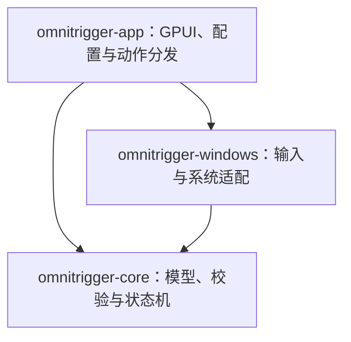

# 工程架构

OmniTrigger 是一个 Rust workspace，按输入匹配、Windows 能力和桌面应用划分为三个 crate。当前应用面向 Windows；纯 Rust 核心不依赖 Windows API 或 GPUI，可以独立测试。功能入口见 [README](../README.md)，专题说明见[文档索引](README.md)。

## 依赖与数据流



依赖保持单向：核心不能引用平台或应用，Windows crate 不引用 GPUI。应用保存动作参数和界面状态，核心只接收标准化输入、显式时间、屏幕上下文及 `TriggerSpec`，返回 `Decision`。

```text
录制 / 配置编辑
    → TriggerSpec → 注册验证 → Windows 后端绑定集

Windows Hook / 计时到期 / 上下文变化
    → 标准化事件与显式时间 → 核心 Engine
    → Decision：透传 / 消费 / 补发计划 / 触发 ID / 拖拽生命周期
    → Windows 输入交付与 BackendEvent
    → 应用层：提示 / 面板 / 轮盘 / 后台动作执行
```

录制、注册、冲突检查和运行时匹配使用同一份 `TriggerSpec`。应用的 JSON DTO 负责版本兼容和序列化，不另行定义一套匹配规则。核心不读取系统时钟、前台窗口或磁盘；相同的输入序列、时间和上下文应产生相同决策。

## 目录定位

```text
crates/
  omnitrigger-core/src/       输入模型、注册验证、状态机与录制器
  omnitrigger-windows/src/    Windows Hook、输入补发、窗口与系统能力
  omnitrigger-app/
    src/                     配置、GPUI 页面与动作执行器
    assets/                  图标源稿与构建时嵌入的 ICO
    plugins/                 内置插件动作清单
docs/                        架构、使用说明与发布检查
examples/                    可校验的绑定配置与脚本示例
scripts/check.ps1            Windows 本地与 CI 共用检查入口
scripts/build-app.ps1        构建应用并返回本次 EXE 的准确路径
.github/                     CI、Issue 与 PR 模板
rust-toolchain.toml          固定 Rust 工具链与检查组件
```

构建产物位于 `target/`，本机试用配置可放入被忽略的 `.local/`。真实配置默认在 `%LOCALAPPDATA%\OmniTrigger`，不属于仓库内容；`--config` 可选择独立位置。

## 核心：`omnitrigger-core`

| 文件 | 职责 |
| --- | --- |
| `lib.rs` | crate 入口及公共类型再导出，供上层保持稳定导入路径。 |
| `model.rs` | 按键、滚轮、输入事件、激活方式、`TriggerSpec` 和 `Decision` 等共享模型。 |
| `registration.rs` | 注册约束、组合冲突与结构化 `RegistrationError`。 |
| `engine.rs` | 前缀缓冲、消费和回退、重复过滤、长按计时、拖拽会话及取消状态。 |
| `recorder.rs` | 将规范化输入序列录制为 `TriggerSpec`。 |
| `regions.rs` | 屏幕矩形、鼠标区域条件、命中及互斥判定。 |
| `tests.rs`、`drag_tests.rs`、`region_tests.rs` | 输入序列与预期决策测试，覆盖基础、拖拽及多屏区域语义。 |

`Engine::process_at`、`advance_time` 和指针 / 屏幕上下文接口是重放验证的主要入口。新增激活方式或条件时，同步检查录制、注册、取消、释放和冲突语义；不要只在界面添加一种解释。

## 平台：`omnitrigger-windows`

| 模块 | 职责 |
| --- | --- |
| `lib.rs` | 后端命令、事件、诊断快照与公开能力入口。 |
| `platform.rs` | 专用消息线程、低级 Hook、计时器、录制、启停与恢复协议。 |
| `replay_runtime.rs` | 有界输入交付队列、独立补发线程、顺序与失败收尾。 |
| `screen_context.rs` | 显示器上下文采集和更新，供核心区域条件使用。 |
| `shortcut.rs`、`automation_basics.rs` | 目标身份检查、快捷键 / 文字注入、剪贴板与打开目标。 |
| `system_adjustment.rs` | 系统音量、显示器亮度及能力检测。 |
| `window_action.rs`、`title_bar.rs`、`wheel_window.rs` | 窗口操作、标题栏和轮盘原生窗口适配。 |
| `*_tests.rs` 与 `examples/hook_*.rs` | 输入交付和平台边界测试、需要桌面会话的 Hook 检查程序。 |

Hook 回调只做有界状态更新、匹配与排队。动作、磁盘、网络及等待外部程序必须离开同步输入路径。被消费的按下和释放需要成对收尾；输入补发改变时序和部分鼠标语义，不能描述为无损恢复。

## 应用：`omnitrigger-app`

| 模块 | 职责 |
| --- | --- |
| `main.rs` | 启动参数、`Workspace` 状态、后端事件处理、动作分发与主界面组合。 |
| `settings.rs`、`trigger_conditions.rs`、`presets.rs` | 绑定配置、版本迁移、候选校验、条件编辑与预设。 |
| `event_bridge.rs` | 有界后端事件转发与 GPUI 唤醒。 |
| `execution.rs`、`local_executor.rs`、`system_executor.rs` | 命令 / 快捷键、本地步骤与系统调节后台执行。 |
| `local_action.rs`、`local_editor.rs`、`shortcut.rs`、`system_action.rs`、`window_action.rs`、`external_action.rs` | 各动作参数、校验和编辑支持。 |
| `plugins.rs`、`plugin_install.rs`、`action_library.rs` | 内置插件动作解析、共享依赖设置、下载安装与动作库页面。 |
| `trigger_panel.rs`、`radial_wheel.rs` | 浮动面板与轮盘的呈现、选择和交互。 |
| `wheels.rs`、`wheel_editor.rs`、`wheel_workspace.rs` | 轮盘配置、编辑、应用覆盖和拖拽呼出会话。 |
| `theme.rs`、`assets.rs`、`message_input.rs` | 共用界面组件、内置资源与文本输入。 |

动作执行的容量、目标校验、取消与回执见[动作执行架构](EXECUTION_ARCHITECTURE.md)。配置保存保留损坏或不支持版本的原文件；兼容升级和备份行为需要与示例、文档及测试同步维护。

`main.rs` 目前仍集中较多界面与协调逻辑，其他页面模块也会扩展 `Workspace`。当前采用三 crate 边界，没有将每个页面或执行器拆成独立 crate。后续可按启动、监听协调、动作协调和页面逐步拆分；这属于维护方向，不代表已有独立模块或稳定扩展 API。

## 修改从哪里开始

| 改动 | 首先检查 | 对应验证 |
| --- | --- | --- |
| 输入匹配或冲突 | 核心模型、注册与状态机；应用配置转换 | `cargo test -p omnitrigger-core --locked`，然后检查配置相关测试。 |
| Hook、补发或释放 | `platform.rs`、`replay_runtime.rs`、平台测试 | Windows crate 测试与真实桌面 Hook 检查。 |
| 新动作或执行行为 | `settings.rs`、动作模型、应用分发与对应执行器 | 应用定向测试；涉及原生能力时补充桌面验证。 |
| 配置格式 | `settings.rs`、`wheels.rs`、`plugins.rs` 与示例 | 兼容读写、失败不覆盖、旧版备份及 `--check-config`。 |
| 页面与视觉交互 | 对应页面、`theme.rs`、窗口适配 | 应用构建、启动及实际窗口交互检查。 |
| 开源或分发内容 | 许可证、第三方通知、CI 和发布文档 | [发布检查](RELEASING.md)。 |

常规命令与提交规范见[贡献指南](../CONTRIBUTING.md)。[`rust-toolchain.toml`](../rust-toolchain.toml) 固定 Rust 1.90.0。Windows CI 与本地共用 [`scripts/check.ps1`](../scripts/check.ps1)，依次检查格式、工作区测试、Clippy、应用构建及示例配置；指定 `-SmokeTest` 时额外安装并卸载真实 Hook。检查与启动脚本共用 [`scripts/build-app.ps1`](../scripts/build-app.ps1)，从本次 Cargo 构建回执定位 EXE，支持自定义 `CARGO_TARGET_DIR` 与 Windows 目标目录。

CI 还配置了 Linux 核心测试与 Clippy，用于检查核心的跨平台边界；这不表示桌面应用已支持 Linux。CI 配置本身不代表远端检查已经通过。交互式桌面的焦点、权限、按键释放及硬件能力仍需人工或专门的桌面验证。
