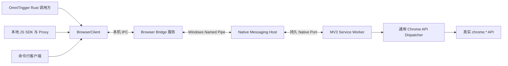

# Chrome API 桥接扩展设计

状态：独立 Windows 开发原型与 OmniTrigger 可选插件安装入口已实现，工程名为 `omnitrigger-browser`。已有 MV3 扩展、Rust Native Host 与桥接服务、CLI、Rust 客户端及 JS Proxy，主程序动作库已接入常用浏览器动作和通用 API 调用。已在隔离 Chrome 155 中验证真实书签读取、并发、错误及约 760 KiB 的 Unicode 结果传输；本轮新增动作、SDK 组合操作和可选权限有模拟回归测试，尚未逐项完成真实 Chrome 验证。尚未提供事件订阅、callback-only 适配、书签增量索引或 `ctx.browser` 宿主接口。

下文同时描述后续目标设计，已实现范围以上述原型为准。首要交付是本地与 Chrome 扩展之间的持久连接及通用 `chrome.*` API 调用转发；完整书签读取是首个端到端验收场景。

扩展命名为 **OmniTrigger Browser**，已在独立仓库 [omnitrigger-browser](https://github.com/ceastld/omnitrigger-browser) 发布 v0.1.0 预览版。它提供浏览器 API 的远程执行端、本机桥接服务和客户端 SDK。本轮新增可选权限与 SDK 组合操作尚未发布，公开 v0.1.0 资产保持不变。OmniTrigger 的浏览器动作直接复用固定版本的 Rust 客户端，不为每次调用启动 CLI 或 Node 子进程。

## 从 OmniTrigger 安装连接器

在侧栏“扩展”页找到“浏览器连接器”，点击“安装”。安装成功后显示“已安装”，后续启动由程序管理，无需填写路径或扩展 ID。实际连接状态在 Chrome 扩展弹窗中显示。

Chrome 扩展从[独立仓库 Releases](https://github.com/ceastld/omnitrigger-browser/releases) 单独取得并在浏览器侧加载；发布包具有固定扩展身份，本机连接会自动完成注册。Chrome Web Store 上架尚未配置。

连接器约 532 KiB，当前作为独立插件按需下载，便于单独升级。下文的协议、清单和生命周期是开发设计，不属于用户安装步骤。

## 本地调用方式

### 在动作库中设置触发

在“动作库”选择“浏览器操作 → 设置触发”，选择操作、设置触发组合并保存。已有触发器也可在“触发后执行”中选择“浏览器操作”。支持新建、关闭、刷新、复制、固定、静音、前后切换标签页，网页前进后退、恢复最近关闭和新建窗口。已保存的浏览器绑定可以作为轮盘槽位来源。

“调用 Chrome API”接受不带 `chrome.` 前缀的方法名和 JSON 参数数组，例如 `bookmarks.search` 与 `[{"query":"Rust"}]`。界面日志仅显示完成或错误状态，不保存书签树或网页内容。开发者需要完整结果时，可使用独立 SDK，或将以下动作保存为 JSON 后运行 `omnitrigger.exe --browser-action <文件路径>`：

```json
{"command":{"operation":"call","method":"bookmarks.getTree","args":[]}}
```

该命令不启动界面或输入 Hook，完整 JSON 输出到 stdout。运行要求已安装的连接器和 Chrome 扩展正常连接。后台执行队列最多接纳 4 个动作；同一目标复用持久 IPC，活动标签页先唯一定位，再用明确 ID 执行。未指定目标时只接受一个已连接浏览器配置；多个连接时在编辑器按名称选择。超时或断线不自动重放修改操作。

### JavaScript

本地 JavaScript 使用 `Proxy` 提供接近原生 Chrome API 的写法，实际调用通过 IPC 发到扩展：

```javascript
import { connect } from './sdk-js/index.mjs';
const browser = await connect(); // 恰好一个连接时自动选择。
const chrome = browser.chrome;

const tree = await chrome.bookmarks.getTree();
const matches = await chrome.bookmarks.search({ query: "Rust" });
const children = await chrome.bookmarks.getChildren("folder-id");
```

无需为 `getTree`、`search` 等 API 各写一个 OmniTrigger 业务动作。通用接口为 `client.call(method, args, options)`，例如 `client.call("bookmarks.getTree", [])`；Rust 客户端也使用相同的方法路径、参数数组和 JSON 结果。

`bookmarks.getTree()` 一次返回整棵书签树，局部读取可使用 `getChildren()` 或 `getSubTree()`，按条件查找可直接使用 `search()`。这些接口是 profile 级操作，需要 `bookmarks` 权限，不需要前台标签页、网页注入或站点授权。[Chrome Bookmarks API](https://developer.chrome.com/docs/extensions/reference/api/bookmarks)

## 连接架构



`BrowserClient` 是 RPC 客户端的共同契约，Rust 与 JavaScript 各有实现。桥接服务负责多连接、profile 路由、请求关联和背压，不把方法改写成固定业务动作。扩展内的 dispatcher 才调用真实 `chrome.*`。

正式通道采用 Native Messaging。扩展主动通过 `connectNative()` 建立持久连接；Chrome 启动小型 Native Host，host 再接入已经运行的本机桥接服务。请求和结果均复用这条连接，不为一次书签读取重启进程。[Native Messaging](https://developer.chrome.com/docs/extensions/develop/concepts/native-messaging)

桥接服务、host、CLI 和 SDK 放在独立仓库。OmniTrigger 可启动或连接桥接服务，开发阶段也能单独启动服务，通过 CLI 完成验证，不需要先接入动作 UI 或安装输入 Hook。Windows 的 SDK 客户端和 host 分别连接明确的 Named Pipe 入口，身份和角色在握手时区分；不开放网页到本地的任意访问接口。

Native Host 安装使用当前用户的 Chrome 注册项与精确扩展 ID；当前本机 IPC 限制为当前用户和 SYSTEM，并拒绝远程客户端，尚未隔离同一用户的多个 Windows 登录会话。安装路径保留在本机，不进入动作参数。

### 连接生命周期与 profile

- 握手返回协议版本、扩展版本、`browser_instance_id`、本次 `session_id`、已授予权限与 API 适配信息。
- `browser_instance_id` 为每个 profile 本地生成并保存；当前 SDK 的 `profile` 参数直接接受这一 ID，恰好一个连接时可省略。“工作 Chrome”等逻辑别名映射属于后续接入。多个 profile 不能按最后回包者猜测。
- 保存“连接本机”开关，在 worker 启动、profile 启动和扩展更新时恢复连接；失败后退避并使用 `alarms` 恢复。不能只依靠进程内全局变量或普通 timer。
- Native 连接可维持 worker 活动，仍需处理 worker、host、桥接服务或浏览器意外退出。重连建立新会话，旧请求结果不能错误投递到新会话。[Worker 生命周期](https://developer.chrome.com/docs/extensions/develop/concepts/service-workers/lifecycle)
- JS SDK 在连接建立后支持多个并发请求，由请求 ID 关联；当前 Rust 客户端每条连接顺序调用。后续订阅将复用持久连接。

## 通用方法转发

每次调用只传方法路径和参数，扩展解析真实对象及方法，保留调用所属对象。例如 `bookmarks.getTree` 解析为 `owner = chrome.bookmarks` 和 `fn = owner.getTree`，再通过 `Reflect.apply(fn, owner, args)` 调用。

```javascript
// 核心机制示意，省略协议校验、兼容适配和分块。
async function dispatch(method, args) {
  const { owner, fn } = resolveChromeMethod(method);
  return await Reflect.apply(fn, owner, args);
}
```

执行逻辑随扩展打包，方法名和参数以结构化数据传入，不依赖 `eval` 或把本地源码发进扩展执行。方法解析仅在真实 `chrome` 命名空间下完成，检查路径、可调用性和当前上下文，不允许访问原型链上的通用 JavaScript 方法。

### 调用兼容性

| API 类型 | 转发方式 |
| --- | --- |
| 返回 Promise 的方法 | 直接调用并等待 resolve 或 reject，结果保持原 API 数据结构。 |
| 同步返回可序列化值的方法 | 执行后通过同一响应协议返回；本地仍表现为异步调用。 |
| 仅支持 callback 的方法 | 首版返回未支持；后续按兼容元数据补 callback，在 callback 内立即读取 `runtime.lastError` 并统一返回。 |
| Chrome 事件 | 走独立订阅协议，SDK 在本地执行回调。 |
| 返回 Port、函数、DOM 或其他非 JSON 对象的方法 | 使用明确的句柄适配；未适配时报告 `unsupported_serialization`。 |
| 要求页面上下文、权限或用户手势的方法 | 保留 Chrome 的实际限制，返回缺少的条件；通道本身不伪造这些条件。 |

Promise 与 callback 调用模式必须在调用前确定，不能先试一种、失败后重新调用另一种，否则可能重复执行副作用。兼容信息记录调用模式、上下文、最低版本和必要权限，不为每个方法手写一套业务包装。[Chrome Promise 与 callback 说明](https://developer.chrome.com/docs/extensions/develop/migrate/api-calls#replace_callbacks_with_promises)、[runtime.lastError](https://developer.chrome.com/docs/extensions/reference/api/runtime#property-lastError)

JS SDK 的 `Proxy` 把属性路径累积为方法名，调用时生成参数数组；需要特别处理 `then` 等 Promise 探测属性。事件回调不作为 JSON 参数传输。同步属性通过独立的远程属性读取接口获取，不承诺把整个 `chrome` 对象的同步语义原样复制到另一进程。

普通可序列化方法是通用转发，事件、对象句柄及特殊调用上下文属于协议适配。新增普通 API 的主要工作是声明权限、确认兼容模式并补验收，不必增加一个新动作类型。

## 请求与结果协议

协议使用版本化 JSON 消息，方法路径不带 `chrome.` 前缀。请求示例：

```json
{
  "v": 1,
  "type": "call",
  "id": "client-a:42",
  "browser_instance_id": "profile-a",
  "session_id": "session-a",
  "method": "bookmarks.getTree",
  "args": [],
  "timeout_ms": 10000
}
```

普通成功响应：

```json
{
  "v": 1,
  "type": "result",
  "id": "client-a:42",
  "session_id": "session-a",
  "ok": true,
  "has_value": true,
  "value": [
    {
      "id": "0",
      "title": "",
      "children": []
    }
  ]
}
```

`has_value: false` 表达原 API 返回 `undefined`；原 API 返回 `null` 时仍使用 `has_value: true, value: null`。需要区分的其他非 JSON 类型只能通过显式编解码适配，不能静默改变含义。

失败响应携带 `code`、原始 Chrome 错误消息、方法名和派发状态。错误区分 `api_unavailable`、`permission_required`、`unsupported_context`、`chrome_error`、`timeout`、`disconnected`、`result_unknown` 等。超时与取消只能停止等待或尚未执行的请求，不能承诺中断已经进入 Chrome 的操作；修改调用结果未知时不自动重放。

协议还包含 `hello`、`subscribe`、`unsubscribe`、`event`、`cancel` 和结果分块消息。请求 ID 在客户端连接内唯一，bridge 转发时再加入来源身份，避免多个客户端冲突。限制并发、在途字节数和待发送队列，满额直接反馈，不积压无限请求。

### 大书签树传输

书签树不能套用现有动作系统 64 KiB 的最终输出上限。Chrome Native Messaging 的 host 到扩展单消息上限为 1 MiB，扩展到 host 为 64 MiB；项目统一采用不超过 256 KiB 的完整帧，大结果自动拆成 `result.begin`、`result.chunk`、`result.end`。[Native Messaging 协议](https://developer.chrome.com/docs/extensions/develop/concepts/native-messaging#native-messaging-protocol)

分块传输一次 API 调用所得结果的 UTF-8 字节，携带总长度、分块序号和请求身份；二进制片段用 base64，帧大小计算包含编码与信封开销。客户端收齐、校验并解码后恢复完整 JSON，业务调用者仍取得原始书签树。配置总结果和在途内存预算，超限明确返回 `result_too_large`，不静默截断。

采用接收窗口与确认控制发送速度，避免直接把所有 chunk 堆进 Native Port。每个请求内部保持顺序，独立请求可以交错传输。首版建议完整结果上限 32 MiB、单连接在途预算 64 MiB，发布时根据大树测试调整。

`getTree()` 本身一次生成完整结果；分块只解决传输限制，不把 Chrome 的书签 API 变成内部流式读取。大树按需读取也可直接调用 `getChildren` 或 `getSubTree`。

## 书签读取的首轮闭环

第一轮先完成以下路径：连接指定 profile → 本地调用 `chrome.bookmarks.getTree()` → 扩展执行一次真实 API → 完整结果回到本地 → 本地解析、搜索或导出。再用 `bookmarks.search()` 验证参数原样转发，用 `getChildren()` 验证局部读取。

这一步不依赖 GPUI、轮盘、前台窗口、tab 快照或网页权限。验收需要包含数 MiB 的树，避免小样本成功而实际使用被结果大小限制卡住。

### 持续读取与事件

后续提供通用 `subscribe("bookmarks.onCreated", handler)` 等接口。订阅得到确认后，本地通过事件消息收到参数数组、订阅 ID、会话身份和递增序号；移除订阅时清理转发关系。

支持唤醒的 Chrome 事件监听器在 worker 顶层同步注册，远程订阅只改变转发对象。不能等本地调用到了再延迟注册所有监听器，否则 worker 重启后可能收不到唤醒事件。[Worker 事件监听](https://developer.chrome.com/docs/extensions/develop/concepts/service-workers/events)

高效书签索引建立在通用 RPC 之上，`chrome.bookmarks.getTree()` 始终保持直接调用 Chrome 的语义；缓存由单独的本地书签索引服务管理：

- 先确认订阅，再取得初始树；读取期间发生变更则标脏并安排合并刷新。
- 监听新增、修改、删除、移动和子节点重排，按需重读受影响的父目录或子树；批量导入时合并昂贵刷新，导入结束后校准。
- 出现事件缺口、连接或 worker 会话改变时重读快照。递归删除目录时处理整棵本地子树，不能等待每个后代都收到删除事件。
- 本地序号只用于发现传输缺口，不代表 Chrome 提供事务修订；快照与事件不构成原子历史。这一索引采用最终一致语义。[书签事件](https://developer.chrome.com/docs/extensions/reference/api/bookmarks#event-onCreated)

先保证通用调用能可靠取回完整数据，再做缓存和增量更新；不靠循环轮询整棵树维持实时性。

## 扩展权限与打包

默认权限仍限于连接、书签和状态保存。新版源码额外声明可选权限：

```json
{
  "manifest_version": 3,
  "minimum_chrome_version": "120",
  "name": "OmniTrigger Browser",
  "version": "0.1.0",
  "background": {
    "service_worker": "background.js",
    "type": "module"
  },
  "permissions": ["nativeMessaging", "bookmarks", "storage", "alarms"],
  "optional_permissions": ["tabs", "tabGroups", "history", "sessions", "downloads"],
  "incognito": "not_allowed"
}
```

上述示例省略固定扩展身份等打包字段，以独立仓实际 manifest 为准。在扩展弹窗展开“功能权限”，点击需要的功能后由 Chrome 授权；拒绝或撤销授权不会影响其他功能。授权变化会重新握手刷新能力目录。普通标签页的新建、刷新、关闭等无需 `tabs` 权限，读取标题和 URL 需要 `tabs`；恢复会话、历史、下载、标签组分别按需开启。缺少必需权限时调用返回 `permission_required` 和 `required_permissions`，不会伪造用户手势或自动重试。不申请所有站点访问权限。

dispatcher、编解码器与适配元数据随扩展打包；本地只发送结构化方法请求。Chrome 的远程代码规则区分执行代码和 JSON 数据，这种实现不需要远程加载代码；商店审核仍需根据实际功能与打包产物评估。[远程代码规则](https://developer.chrome.com/docs/extensions/develop/migrate/remote-hosted-code)

## 与 OmniTrigger 集成

共享 RPC 服务位于动作系统之下。OmniTrigger 的 Rust 模块、本地 JS、CLI 和后续动作运行时都是调用方，普通书签查询不必占用 `ActionService` 的 4 个动作执行槽。

| 接入位置 | 设计 |
| --- | --- |
| Rust 应用层 | 使用共享 `BrowserClient` 发起 API 调用和订阅；不把浏览器 API 加入输入核心。 |
| 独立 CLI | 先提供通用 `call <method> <args-json>` 与 profile 选择，直接输出完整 JSON，用于端到端诊断。 |
| JS SDK | 提供 `call`、`subscribe` 和 `chrome.*` Proxy，通过独立 IPC 复用 bridge。 |
| JS 动作宿主 | 后续增加 `ctx.browser`，由初始请求提供 broker 地址和调用凭据，使用独立 IPC。 |
| 动作包适配 | 按需提供一个通用 `chrome.call` 动作，输入为 method、args 和逻辑 profile；不按 API 数量扩充动作清单。 |

当前 Node 宿主的结果通过临时文件返回，stdout/stderr 被丢弃，stdin 用于初始请求和取消；并不存在可直接复用的双向 stdout RPC。独立 IPC 客户端可避免为浏览器访问先重做这套协议。

Node 的动作最终结果目前限制 64 KiB。SDK 可以在脚本内处理大树并返回摘要，CLI 或直接客户端则接收完整结果；不要先把大书签树塞进最终动作结果文件，或为了浏览器查询普遍放宽所有动作输出。上述 SDK 已实现，主程序的通用浏览器动作也已接入；`ctx.browser` 宿主接口属于后续接入。现有能力见[动作包](ACTION_PACKAGES.md)及[动作执行架构](EXECUTION_ARCHITECTURE.md)。

## 独立仓库与实施顺序

建议独立仓库结构：

```text
omnitrigger-browser/
  extension/          MV3、通用 dispatcher、事件与权限适配
  bridge/             本机共享 RPC 服务、连接路由与背压
  native-host/        Native Messaging 与本机 IPC 桥接
  sdk-rust/           BrowserClient
  sdk-js/             call、subscribe 与 chrome Proxy
  cli/                通用调用与连接诊断
  protocol/           消息 Schema、兼容元数据与 fixtures
  installer/          Windows 当前用户注册与卸载
  tests/              模拟 API、协议、大结果与端到端测试
  docs/               安装、调用示例与兼容范围
  LICENSE
  THIRD_PARTY_NOTICES.md
```

项目自身内容使用 MIT，新增依赖按实际产物整理第三方通知。独立仓库固定 host、bridge 和 SDK 的兼容版本，主仓接入已验证的版本；公开和分发前执行[发布检查](RELEASING.md)。

| 顺序 | 交付与验收 |
| --- | --- |
| 1 | 扩展、host、bridge 和 CLI 持久连通；从本地取得真实 `bookmarks.getTree` 完整结果。 |
| 2 | 通用 `method + args` dispatcher、Rust / JS SDK 与 Proxy；参数、Promise、错误、大树分块和并发响应正确。 |
| 3 | 通用事件订阅与书签增量索引；重连、序号缺口和导入后能重新校准。 |
| 4 | OmniTrigger 应用层与 JS 宿主接入同一客户端，再按需提供动作入口。 |

首轮成功标准是可调用、可取数的 Chrome API 桥接：同一持久连接下读取完整书签树、直接搜索书签，并在扩展 reload 或 Chrome 重启后恢复调用。测试覆盖多 profile 隔离、UTF-8 分块、缺块、超大结果、异常参数、Chrome API 报错和断连；性能记录首次读取耗时、持续调用耗时和峰值内存，不能预先承诺尚未测量的延迟。
