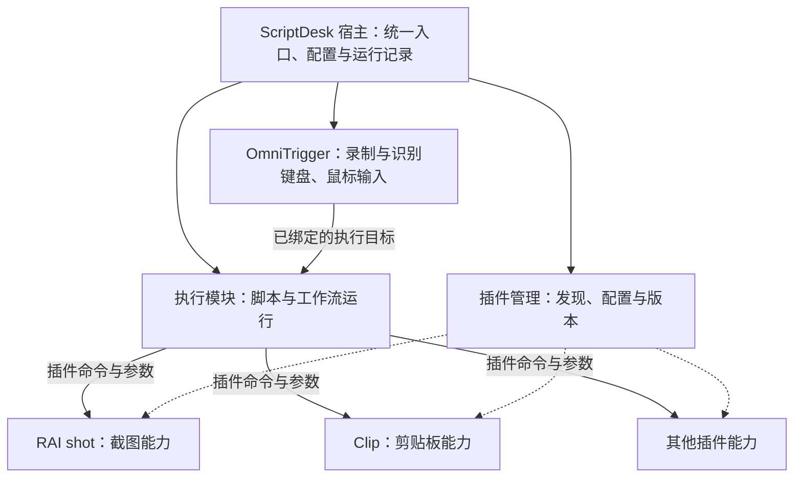

# 触发、执行与插件架构建议

本文记录 OmniTrigger 面向脚本、工作流和插件的设计方向。它不是现有 API 说明；具体可用功能和启动命令以 [README](../README.md) 为准。

针对“选择 Clip、RaiShot 预设动作并快速设置触发”的近期需求，优先采用[插件动作与快速绑定设计](PLUGIN_SYSTEM.md)：通过本地声明式动作目录直接接入现有进程执行器。简单插件动作不以 ScriptDesk 外部入口或统一宿主为前置条件。下文的阶段是可分别推进的能力方向，不能理解为必须先完成工作流调用才能提供插件动作。

## 产品形态与职责

建议最终以 ScriptDesk 作为面向用户的统一产品入口，管理触发器、工作流、插件、配置与运行记录。ScriptDesk 的界面宿主与执行模块保持内部边界，OmniTrigger 作为输入模块接入；开发期间可以作为独立程序运行，后续再整合安装与界面。



- **OmniTrigger** 负责输入标准化、录制、冲突检查、消费与回退，产出一次触发通知。Hook 同步路径不启动程序、不运行脚本、不访问磁盘或网络。
- **ScriptDesk** 负责执行接纳、参数校验、脚本与工作流运行、停止和结果记录。它决定任务是否能启动，以及忙碌、取消、超时和失败的处理方式。
- **插件** 提供可调用的业务命令，例如截图、打开剪贴板历史或处理文本。插件不需要各自重复实现全局输入监听、脚本编排与统一历史。
- **宿主** 统一呈现安装、启停、绑定、配置与诊断。用户应能从“某个组合触发失败”追踪到执行器回执和插件错误。

“一个软件”不要求所有能力放在同一个进程。模块划分先服务于职责和生命周期，是否合并进程应由实际启动耗时、内存、稳定性和部署需求决定。

## 当前能力与规划边界

OmniTrigger 已有独立的确定性输入核心、Windows 采集适配和 GPUI 管理界面。录制、注册与运行时匹配共用 `TriggerSpec`。外部执行必须放在触发通知之后的应用层，不能进入输入核心。

通用外部命令是最小接入方式：绑定保存程序路径、独立的参数数组及可选工作目录，由应用层启动程序。它既可直接调用一个能力程序，也可显式调用脚本解释器运行脚本。启动程序成功只说明进程已创建，不能据此显示“截图完成”或“工作流成功”。

ScriptDesk 已有已保存项目执行、Action 工作流与统一的运行接纳基础。当前没有供 OmniTrigger 使用的外部工作流运行接口；启动 ScriptDesk 程序不等于请求运行指定项目。已有的单脚本运行约束和忙碌拒绝策略应在接通外部入口时保留。

统一宿主、插件注册与安装、稳定插件命令目录，以及 OmniTrigger 到 ScriptDesk 的工作流调用与结果关联，均属于后续设计。通用外部命令不代表这些接口已经实现。

## 第一阶段：先让现有程序可被触发

先建立“组合命中 → 应用层执行 → 外部程序”的最小链路。RAI shot 和 Clip 保持各自现有程序，通过其真实支持的命令行或本地调用接口接入，不复制业务实现。

绑定应保存结构化的程序路径与参数数组，避免把所有内容拼成一段隐式 Shell 命令。需要 PowerShell、Node.js 等脚本时，显式指定解释器和脚本路径；由调用方决定解释器参数。包含空格或中文的路径仍是一个参数，不通过空格拆分猜测。

此阶段至少要明确三件事：

1. 程序无法启动时返回可见错误，并在触发记录中保留结果。
2. 连续触发受有界队列或明确的忙碌策略约束，不能无限创建线程、进程或待执行任务。
3. 启动外部程序与等待业务结果是两种不同能力。无法获知完成、无法撤销或无法停止外部任务时，按真实边界展示状态。

这一阶段解决可用性和接口验证，不建立插件市场、通用 RPC 框架或另一套工作流引擎。

## 第二阶段：接通 ScriptDesk 的已保存执行目标

在 ScriptDesk 增加窄外部入口，将请求接到现有运行协调器。首先支持运行已保存项目，再按已有 Action 的存储与运行语义增加工作流目标。

OmniTrigger 绑定一个稳定的目标 ID，而不是 ScriptDesk 内部文件路径、编辑器草稿或一段待执行源码。执行器自行从存储层解析真实目标，检查启用状态、参数和可执行版本。目标不存在、版本冲突或执行器不可用时，明确返回错误，不新建替代目标。

建议的协议对象如下；这是目标模型，字段名与命令尚未成为可用 API：

```text
执行请求
  protocolVersion
  invocationId                 每次触发的唯一身份
  target: projectId/workflowId  已保存目标的稳定身份
  parameters                   结构化输入
  source: bindingId             用于关联来源，不充当运行授权

接纳回执
  invocationId
  accepted / rejected
  runId                        接纳后关联实际运行
  reason                       busy、target-missing、invalid-parameters 等

运行进度与终态
  invocationId、runId
  preparing / executing / stopping / terminal
  completed / stopped / failed / canceled-before-start / unknown
```

接纳回执和完成回执分开：进程启动、请求送达、任务接纳与业务完成不能混成同一种成功。连接断开后的未知结果保留为未知；带副作用的截图、写剪贴板等任务不能因超时而自动重试。

初期沿用一次一个任务、忙碌即拒绝、不积压补跑。后续确有需求时，再对明确目标增加有限排队或并发，保持手动、时间与输入来源共用接纳和停止规则。

本地传输可在命名管道与回环服务之间按部署需求选择；传输方式不改变上述执行契约。外部入口需校验调用来源，并通过宿主已配置的绑定限制可运行目标，不能把知道某个 UUID 当作授权。

## 第三阶段：把能力整理为插件

插件先做现有能力程序的薄适配。RAI shot 保留截图和编辑逻辑，Clip 保留剪贴板数据与业务逻辑；适配层只处理命令、参数、结果和生命周期。已有程序可以独立使用，再逐步提供由宿主安装和管理的形态。

一个插件包的稳定契约建议包含：

| 项目 | 作用 |
| --- | --- |
| 插件 ID 与版本 | 识别安装对象，判断兼容性和更新来源 |
| 命令 ID | 供脚本与工作流稳定引用，例如 `raishot.capture`；这是命名示例 |
| 输入与输出 Schema | 校验参数和结果，支持编辑表单及脚本类型提示 |
| 执行方式 | 短生命周期进程、现有常驻程序适配或宿主管理的服务 |
| 生命周期 | 启动、就绪、停止、退出、超时与异常处理 |
| 配置与副作用说明 | 说明需要的目录、系统能力以及是否写入或发送数据 |
| 兼容范围 | 宿主协议版本、命令版本及升级迁移规则 |

插件命令的业务输入输出可以丰富，面向用户的简单脚本仍可只暴露几个参数。工作流通过命令 ID 调用能力，不绑定某个安装目录或插件界面控件。

插件具有当前用户权限时，应如实说明；独立进程和能力声明本身不构成安全沙盒。更新应校验包身份与版本，保留必要配置和回退方式，不能静默改变已保存工作流的含义。

## 建议的第一个完整示例

选择一个实际可验证的组合，例如“录制组合 → 截图”，逐步完成：

1. OmniTrigger 直接启动 RAI shot 的真实接口，验证路径、参数、连续触发与启动失败。
2. 将同一调用封装为 ScriptDesk 的已保存脚本，手动运行验证截图能力。
3. 接通外部执行入口，让 OmniTrigger 仅引用该脚本 ID，并展示接纳与运行结果。
4. 将脚本里的程序路径适配迁入插件命令，工作流保持稳定引用；再接入 Clip 作为第二个插件验证通用性。

每一步都交付一条可用链路。最终用户只需选择触发组合与执行目标，程序位置、插件适配及回执关联由宿主和执行器处理。
