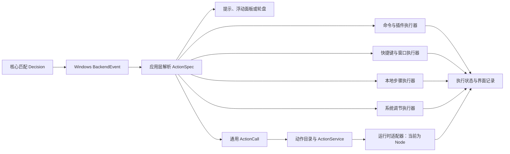

# 动作执行架构

本文说明 OmniTrigger 当前的动作分发、后台执行和结果边界。使用方法见[程序与脚本](COMMAND_ACTIONS.md)、[本地步骤动作](LOCAL_ACTIONS.md)、[动作包与 JS 入口](ACTION_PACKAGES.md)及[插件动作](PLUGIN_SYSTEM.md)；整体依赖关系见[工程架构](ARCHITECTURE.md)。

## 从输入匹配到动作执行

核心引擎只知道 `TriggerSpec` 和触发器 ID，不保存程序路径、插件清单或界面对象。Windows 输入线程把匹配结果转成 `BackendEvent`，应用层收到通知后解析绑定的 `ActionSpec`，选择对应的界面操作或执行器。



Hook 同步路径不运行用户动作，不等待进程退出，不访问磁盘或网络。前缀输入补发属于 Windows 输入交付协议，由独立补发线程负责，与本页的用户动作执行器分别管理。

浮动面板和轮盘选择也进入应用层分发。执行前先收起浮窗，需要操作原前台窗口的动作使用捕获的目标身份。保存草稿只校验和保存；“测试动作”会真实执行当前草稿。

## 当前执行器

| 动作 | 应用层模块 | 执行方式与接纳边界 |
| --- | --- | --- |
| 运行程序、外部动作、插件动作 | `execution.rs`、`external_action.rs`、`plugins.rs` | 命令工作线程启动并监测外部进程；一个执行器最多 4 项未完成或结果未读的调用。相同绑定的程序调用不重叠，插件并发组在多个绑定之间共享占用。 |
| 快捷键、窗口最大化 / 恢复 / 最小化 / 关闭 | `execution.rs`、`shortcut.rs`、`window_action.rs` | 使用独立的快捷键工作线程，与外部进程监测分别调度。该执行器也有 4 项配额，快捷键及窗口调用按队列顺序处理，同一绑定可在配额内连续排队。 |
| 本地步骤 | `local_action.rs`、`local_executor.rs` | 单个后台线程按动作内顺序执行步骤，最多保留 4 次调用；同一绑定的前次调用终态未读取时拒绝新调用。 |
| 动作包 `invoke` | `omnitrigger-actions` | 通用目录解析动作引用并选择运行时；服务最多保留 4 次调用，同一绑定不重叠。Node 宿主在独立进程调用 JS，并返回结构化业务结果。 |
| 音量、亮度 | `system_action.rs`、`system_executor.rs` | 音量与亮度分别使用工作线程，共享 8 个批次配额。同一绑定、目标及方向的相邻待执行请求可合并，亮度还要求触发坐标相同。 |
| 提示、面板、轮盘 | `main.rs`、`trigger_panel.rs`、`radial_wheel.rs`、`wheel_workspace.rs` | 由 GPUI 管理窗口和交互生命周期；被选中的业务动作再交给对应执行器。 |

表中的容量按执行器分别计算，当前没有覆盖所有动作类型的统一全局任务配额。容量包含执行中、待执行以及终态尚未被界面读取的占用，避免结果积压时仍无限接纳。队列满、绑定忙碌、插件不可用和工作线程退出会返回错误，不自动补跑。

`CommandAction` 分别保存 `program`、字符串数组 `args` 和可选 `working_directory`。启动时逐项传给 `std::process::Command`，不隐式经过 Shell，不展开环境变量，不拆分空格。运行脚本时需显式选择解释器及参数。标准输出与标准错误当前不采集。

## 目标身份与取消

快捷键、窗口动作和本地步骤在提交时保存目标窗口身份；执行前核验窗口有效性及前台状态。本地步骤在每一步前继续检查取消和目标，等待步骤分片检查。输入注入及必要的按键释放由 Windows 适配层负责，自身注入不会再次进入触发匹配。

外部动作在启动前核验目标；进程创建后，OmniTrigger 无法强制约束外部程序最终操作哪个窗口。普通“运行程序”动作不提供窗口目标约束。音量与亮度动作使用触发时冻结的鼠标坐标，亮度设备选择由 Windows 适配层处理。

取消本地步骤会阻止后续步骤，已经完成的输入、剪贴板修改或打开操作不会撤销。窗口及设备的原生调用可能暂时阻塞，应用销毁时不在界面线程等待它们，也不强制终止工作线程。暂停监听阻止新的输入触发；退出 OmniTrigger 不会终止普通命令已经启动的外部程序。

通用动作服务提供取消令牌；Node 适配器先请求脚本协作停止，宽限后强制停止仅作用于宿主。`ctx.process.run` 等待进程退出并采集输出，协作取消会请求终止其直接子进程；脚本阻塞事件循环、宿主被强制终止或脚本自行创建进程时，不能保证子进程全部收尾。`ctx.process.start` 在进程创建后返回 `{ pid }`，独立程序不随动作完成或取消关闭。取消、超时及宿主终止均不会回滚外部副作用，也不会自动重跑。通用 JS 动作当前不附带原前台窗口操作保证。

## 执行回执的含义

程序、快捷键和窗口执行事件携带绑定 `id` 及每次调用的 `invocation_id`；本地步骤事件也携带这两个字段，以区分同一绑定的多次执行。系统调节按批次返回绑定 ID 与设备调用结果。

| 结果 | 可以确认的事实 |
| --- | --- |
| 程序 `Started` | 进程已创建并取得 PID，尚未确认业务结果。 |
| 程序 `Finished` | 已观察到进程退出，可报告退出码和成功标志；不能据此认定截图已生成或外部业务已完成。 |
| `ShortcutSent` / `WindowApplied` | 对应原生操作已返回成功，不能推断目标应用后续业务状态。 |
| 本地步骤进度 | 即将尝试某一步；仅进度通知不代表该步骤成功。终态分别报告完成、失败或取消及已完成步数。 |
| 系统调节结果 | 包含请求值和设备读回值；硬件不支持或读取失败会明确报错。 |
| 程序 `Unknown` | 暂时无法取得进程状态，保留占用并继续检查；不能按完成释放配额或自动重试。 |
| 动作包 `Succeeded` | JS 入口完成，宿主返回与本次调用匹配的 JSON 结果；只依据脚本自身的业务核验。 |
| 动作包 `Failed` / `Cancelled` | 返回结构化错误或取消终态，不表示此前副作用已撤销。 |

应用读取终态后才释放对应占用。动作执行记录与输入命中记录分别表达执行和触发来源，均只保留本次运行的有限历史。

## 插件边界

当前插件是应用内置的声明式动作适配：清单提供动作身份、参数、默认触发组合和依赖说明，`plugins.rs` 校验并解析为外部命令，再交给现有执行器。插件不可用时保留用户绑定与参数，将其从实际监听注册集移除，并在界面说明原因。

依赖下载由独立安装流程处理；安装不执行动作，也不自动注册快捷键。当前内置截图适配的下载、校验及第三方许可见[插件说明](PLUGIN_SYSTEM.md)和[第三方通知](../THIRD_PARTY_NOTICES.md)。外部程序使用当前用户权限运行，独立进程和插件清单本身不构成安全沙盒。

## 扩展时保持的边界

新增业务优先使用 `ActionSpec::Invoke(ActionCall)`：绑定只保存包 ID、动作 ID、动作契约版本和 JSON 输入。包清单决定入口和运行时，新增 JS 业务无需再扩充绑定枚举。`RuntimeRegistry` 注册 `ActionRuntime`，新语言或未来流程解释器可沿用同一调用入口；只有输入匹配语义改变时才修改输入核心。

包目录只读取配置同级 `actions` 下一级清单，检查格式、入口路径和重复身份；校验与目录加载不执行用户脚本。缺失或不兼容的包保留绑定，实际监听移除不可用动作。Node 协议检查版本、调用标识和结果大小，仅观察到进程正常退出不能释放为成功。清单格式、JS SDK 和版本演进见[动作包说明](ACTION_PACKAGES.md)。

不内置流程图编辑器；跨动作调用、包市场、自动更新和权限沙盒尚未实现。内置截图插件仍使用原有清单与安装流程；新动作包不会自动把旧命令、插件或本地步骤改写为脚本。

## 验证入口

`execution.rs` 的测试覆盖参数完整传递、启动失败、非零退出、调用配额、插件组占用和未知状态。`local_executor.rs` 使用替身验证步骤顺序、目标变化、取消及异常，不访问真实剪贴板或发送真实输入。`system_executor.rs` 使用替身验证合并、容量和音量 / 亮度隔离。

```powershell
cargo test -p omnitrigger-app execution --locked
cargo test -p omnitrigger-app local_executor --locked
cargo test -p omnitrigger-app system_executor --locked
cargo test -p omnitrigger-actions --locked
```

自动化测试不能替代真实桌面的焦点、权限、设备及输入释放验证。涉及这些边界时，按[贡献指南](../CONTRIBUTING.md)与[发布检查](RELEASING.md)补充桌面验证记录。
