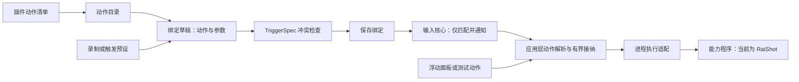

# 插件动作与快速绑定设计

状态：RaiShot 截图的首条链路已实现，包括动作库与名称搜索、依赖安装、默认快捷键、自定义与恢复默认、共享插件设置、版本 7 绑定配置及进程执行。本文同时保留后续插件扩展的设计；外部清单导入、通用参数表单和适配更新尚未实现。

## 目标与首版决策

插件向 OmniTrigger 提供可选择的预设动作和默认快捷键。当前动作是 RaiShot 的“截图”。用户安装插件、选择动作、确认或修改触发方式、保存即可。程序位置通过安装自动配置，也可手动填写，后续绑定复用。

首版采用**声明式动作包 + 现有外部程序执行**：动作包描述名称、参数和调用方式，具体业务仍由能力程序负责。OmniTrigger 管理动作目录、本机配置、输入绑定和执行记录。简单插件动作可直接接入，不以工作流执行器或统一宿主为前置条件。

| 对象 | 回答的问题 | 示例 |
| --- | --- | --- |
| 插件 | 谁提供能力、程序在哪里？ | RaiShot，本机 CLI 路径 |
| 动作预设 | 做什么、默认如何触发？ | 截图，左 Ctrl + 左 Alt + A |
| 触发预设 | 什么输入触发？ | 右键长按 300ms |
| 用户绑定 | 哪个输入执行哪个动作？ | 侧键 2 → RaiShot / 截图 |

动作预设与触发预设独立组合。插件安装、动作选择与触发预设选择均不自动注册按键，不执行动作；只有保存绑定才使其生效。

插件声明的默认快捷键是可编辑的 `TriggerSpec` 草稿，不参与自动抢占。RaiShot 适配默认使用 `左 Ctrl + 左 Alt + A`，用户可重新录制、选择触发预设或恢复默认；恢复后仍需保存并检查冲突，不改其他绑定。



当前范围是内置 RaiShot 清单、截图程序与依赖下载、共享路径、快速绑定和进程状态。外部动作包导入、通用参数表单、在线市场、自动更新、进程内 DLL、常驻 RPC、工作流编排及业务结果协议后续按需要增加。

## 用户流程

侧栏“动作库”提供 RaiShot 截图卡片和名称搜索，展示动作、可用状态和绑定情况。共享程序路径、安装、刷新和停用也在该页管理。独立插件管理页属于后续扩展。

以截图为例：

1. 在“动作库”点击“安装 RaiShot 插件”，后台下载固定发布包及随包运行库；已有安装可填写本机 `raishot-cli.exe` 的完整路径后“保存并启用”。
2. 点击截图卡片的“设置触发”，默认组合 `左 Ctrl + 左 Alt + A` 填入草稿。
3. 保留默认，或点击“重新录制”录制自己的组合、“选择预设”改用长按等方式；“恢复默认”只恢复草稿。
4. 查看触发方式、截图动作和冲突检查结果。当前截图没有业务参数。
5. 点击“添加触发器”，编辑已有绑定时点击“保存动作”。动作就绪且无冲突才允许生效；“测试动作”真实执行但不保存、不计组合命中次数。

也保留从“触发预设”或“录制组合”开始的入口：完成触发草稿后，在“触发后执行”中选择“插件动作”，再选择插件和动作。两种顺序得到相同绑定。

触发草稿与动作草稿独立维护。更换长按时间、重新录制或改选触发预设，只更新 `TriggerSpec`，保留动作与参数。普通触发预设不再强制设置“打开面板”；专用的“录制面板呼出组合”入口仍明确选用面板动作。

首批动作目录以真实接口为准：

| 插件 | 首个动作 | 接入依据 |
| --- | --- | --- |
| RaiShot | 截图，动作 ID `capture` | 内置适配调用 `raishot-cli.exe --capture`，依赖安装固定使用 RaiShot v0.4.15 |

高级用户仍可选择“运行程序”。插件截图使用共享程序路径与固定参数；调用状态显示适配版本，完整手动调用方式见 [程序与脚本说明](COMMAND_ACTIONS.md)。

## 数据模型与职责

| 对象 | 关键内容 | 存放位置 |
| --- | --- | --- |
| `PluginManifest` | 插件 ID、适配包版本、宿主 API 版本、动作声明、设置字段 | 当前为内置 `plugins/raishot.json` |
| 本机插件设置 | 启停、已配置的程序路径 | 绑定文件同级的 `plugins.json` |
| 动作声明 | 插件内稳定动作 ID、契约版本、标题、默认触发、调用及并发策略 | 插件清单的 `actions` |
| `PluginActionRef` | 插件 ID、动作 ID、动作契约版本、明确的参数值 | 用户绑定 |
| `Binding` | 原 `TriggerSpec`、名称、用户启用意愿、一个 `ActionSpec` | 绑定配置 |
| 执行请求 | 本次调用 ID、绑定、已解析的程序及参数、并发组 | 运行期内存 |

`ActionSpec` 使用互斥枚举：`notification`、`show_panel`、`command`、`plugin`。不继续叠加 `is_plugin` 等布尔字段。`TriggerSpec` 保持现有语义，输入核心只接收触发描述与绑定 ID，无需了解插件清单或业务参数。

插件 ID 在本机目录中唯一，动作 ID 在插件内唯一，完整身份是 `(pluginId, actionId, actionVersion)`。显示名称可调整，不能作为查找键。插件 ID 只是引用身份，不证明发布者可信。

首版不增加独立的“已配置动作实例”存储：一条绑定保存一份动作引用和参数，同一动作可以绑定多个组合、使用不同参数，统计和启停独立。所有绑定共享插件的本机路径设置。未来确需无触发动作、面板去重或共享业务参数时，再引入动作实例。

当前截图动作的 `parameters` 必须为空，未知参数会报告错误。后续通用表单可支持字符串、布尔值、整数、枚举和路径，声明必填、默认值、范围和说明，并在保存时物化默认值；新增必填参数或修改含义需要新的动作契约版本。动作输出当前不参与其他动作的输入。

## 内置清单与依赖安装

当前清单编译进 OmniTrigger，仅接受内置 RaiShot 的调用契约。解析时检查格式、插件与动作身份、宿主 API 版本、默认触发、固定调用和单并发策略，不加载其他目录中的清单。

“安装 RaiShot 插件”在后台下载原始 [v0.4.15 发布包](https://github.com/ceastld/raishot/releases/tag/v0.4.15)，固定 ZIP 大小、SHA-256 和内部清单哈希，再逐项校验必要程序、运行库和许可文件。通过隔离目录解包及校验后，安装到绑定文件同级的 `plugins/raishot/runtime/0.4.15`，成功才接纳共享程序路径。同版本已有安装先完整校验；内容损坏时明确失败，不覆盖原目录。安装过程不运行截图程序。

安装先尝试匿名 HTTPS；当前仓库需要访问权限，匿名下载不可用时尝试使用本机已安装、已登录且有仓库访问权的 `gh`。安装器不自动安装或登录 `gh`。下载安装失败不改插件设置、不自动重试，用户可在动作库明确重试，或填写已有程序路径。Windows 安装器使用系统 PowerShell 与 .NET 的下载、ZIP 和哈希功能，没有新增 Cargo 依赖。

原包的三个 RaiShot 程序、VC / ONNX Runtime DLL 及许可文件一起保留，截图动作不额外安装 OCR 模型。RaiShot 为 GPL-3.0-or-later，外部程序及运行库不转为本项目 MIT 资源，见 [第三方说明](../THIRD_PARTY_NOTICES.md)。

以下 JSON 与当前内置 RaiShot 清单使用同一结构；外部文件导入尚未提供：

```json
{
  "schemaVersion": 1,
  "hostApiVersion": 1,
  "id": "raishot",
  "version": "0.1.0",
  "name": "RaiShot",
  "description": "通过本机 RaiShot CLI 提供截图动作",
  "settings": [
    {
      "key": "cliPath",
      "type": "executable_path",
      "title": "RaiShot CLI",
      "required": true
    }
  ],
  "actions": [
    {
      "id": "capture",
      "version": 1,
      "title": "截图",
      "description": "调用截图入口，具体操作在 RaiShot 中完成",
      "parameters": [],
      "defaultTrigger": {
        "held": [
          { "kind": "key", "value": 162 },
          { "kind": "key", "value": 164 }
        ],
        "activation": { "kind": "press", "value": { "kind": "key", "value": 65 } }
      },
      "runner": {
        "kind": "process",
        "program": { "setting": "cliPath" },
        "args": [{ "literal": "--capture" }],
        "workingDirectory": { "parentOfSetting": "cliPath" },
        "completion": "process_exit"
      },
      "concurrency": {
        "group": "capture",
        "maxRunning": 1,
        "onBusy": "reject"
      },
      "effects": ["screen_capture"]
    }
  ]
}
```

这里的 `version` 是适配包版本，不表示 RaiShot 程序版本；动作的 `version` 是调用契约版本。`effects` 用于说明动作影响，不构成权限隔离。

首版 `process` 适配遵守以下规则：

- `program` 取安装成功后配置或用户明确填写的完整程序路径；清单只声明所需字段。不搜索用户目录或猜测安装位置，也不依赖启动时的 `PATH`。
- 当前参数只接受 `literal` 固定字符串 `--capture`，逐项传递，不做字符串拼接、表达式执行或隐式 Shell 展开。引用业务参数的通用适配后续实现。
- 工作目录明确来自设置字段或程序所在目录。读取、解析和验证均在应用层；最终命令继续通过 `CommandAction::validate` 的参数数量、大小和空字符检查。
- `completion = process_exit` 表示跟踪本次子进程至退出。常驻程序应通过专用短命令入口接入，不能直接把托盘主进程当作短动作。
- 清单、动作数与参数定义设置有界大小；不允许任意脚本参与清单解析、表单生成或输入匹配。

本机插件设置与绑定分开，保存在绑定文件同级的 `plugins.json`。默认目录为 `%LOCALAPPDATA%\OmniTrigger`；使用 `--config` 时跟随所选绑定文件目录，便于隔离试用。程序路径更新后，所有引用该插件的绑定使用新配置，不逐条改写。

后续外部动作包导入应检查 ID 冲突、兼容版本和许可，不按扫描顺序覆盖。导入后复制到受管目录，原导入文件变化不自动生效；适配更新完整验证后显式切换，失败保留旧副本。ID 与版本禁止路径分隔符、`.` / `..` 路径段及越出目录的解析结果。同一 `actionVersion` 保持参数与调用语义兼容，破坏性变化发布新契约，旧契约缺失时保留原绑定并标记不兼容。上述通用导入及更新流程尚未实现。

## 绑定配置与迁移

绑定配置保存使用版本 7，保留现有 `held`、`activation`、位置条件和绑定 ID。下面是侧键 2 触发截图的配置示例；实际可用性还取决于同级 `plugins.json` 中的安装路径：

```json
{
  "version": 7,
  "bindings": [
    {
      "id": 6,
      "held": [],
      "activation": {
        "kind": "press",
        "value": { "kind": "x2" }
      },
      "message": "截图",
      "enabled": true,
      "action": {
        "kind": "plugin",
        "pluginId": "raishot",
        "actionId": "capture",
        "actionVersion": 1,
        "parameters": {}
      }
    }
  ]
}
```

`message` 暂时沿用现有字段：通知动作将其作为提示文字，其他动作将其作为列表与面板名称。首版无需同时重命名该字段。

迁移规则必须明确：

1. 读取兼容版本 1–7，其中版本 1–4 在内存中转换为统一 `ActionSpec`：`show_panel = true` → 面板动作；否则有 `command` → 原始程序动作；两者都没有 → 通知。原配置同时设置面板与命令时仍拒绝，不猜测优先级。版本 5 引入统一动作描述与快拖配置，版本 6 引入位置条件与系统调节动作，版本 7 引入本地步骤动作；本地步骤动作内部版本为 1，独立于插件动作契约版本。
2. 保留组合、长按阈值、名称、启用状态和原始参数，不自动增加绑定，不把看起来像 RaiShot 的旧命令转换为插件动作。
3. 首次写入版本 7 前保留旧配置备份，名称为 `<原文件名>.v<旧版本>.bak`；先写临时文件，再替换，备份或保存失败均保留原文件并报告。相同名称但内容不同的备份不覆盖。旧程序可能不支持版本 7，回退需使用对应备份。
4. 缺失插件或动作属于“目标不可用”，不属于整份配置格式损坏；保留动作引用和参数，其他可用绑定继续工作。结构损坏、未知配置版本或未知动作种类仍保护原文件，不重置成示例。
5. 插件目录解析与绑定格式解析分开。仅在动作存在且版本兼容时检查其参数契约；缺失目标不删除无法解释的参数。

## 可用状态与输入行为

`enabled` 保存用户意愿；`availability` 是从插件设置、文件和动作契约推导的状态。有效运行条件为 `enabled && availability == ready`，两者不能混为一个开关。

| 状态 | 界面操作 | 实际行为 |
| --- | --- | --- |
| 未配置路径 | 选择程序 | 可编辑草稿，不测试或保存为生效绑定 |
| 程序文件缺失 | 重新定位程序 | 保留原绑定，不纳入运行时注册集 |
| 插件停用 | 启用插件 | 保留各绑定原有启用意愿，不纳入运行时注册集 |
| 动作缺失或版本不兼容 | 查看详情、更换动作或适配包 | 保留引用和参数，不猜测替代动作 |
| 参数不符合契约 | 修改参数 | 保留原值，停止该绑定的实际注册 |
| 就绪 | 设置触发、测试 | 根据用户启用状态注册并执行 |
| 忙碌 | 显示正在执行 | 保持触发注册，再次命中明确拒绝，不排队 |

不可用绑定不进入核心运行时注册集，避免已知不可执行的动作继续消费按键；但所有已保存绑定仍参与冲突检查，保持现有禁用项占位规则。恢复可用后重新验证并注册，原来由用户停用的绑定仍停用。

启动、保存路径和显式刷新时检查文件与配置；这类检查不启动外部程序。执行时再次解析并检查。文件刚被移动而尚未检测时，本次输入仍可能已被消费，需如实报告启动失败；不能宣称将其无损交还。确认程序缺失后再将绑定移出注册集。一般非零退出不等同于路径失效，不因此永久停用绑定。

可用状态变化通过应用层更新注册列表，沿用现有取消缓冲和释放收尾协议，保留暂停状态；Hook 内不读取插件文件，不做磁盘检查。

## 执行接纳、面板与记录

组合、面板点击与测试动作共用 `resolve → validate → admit → execute` 入口。执行器每次接纳生成独立 `invocationId`，保留绑定与并发组身份；已解析的程序和参数随请求提交，之后更新路径不改变已提交的调用。界面区分输入、面板和测试记录，插件提交状态包括动作身份与适配版本。

沿用四项总容量，包括待启动、运行中及终态尚未处理的调用；同一绑定的调用未结束前仍拒绝重复提交。插件动作额外按 `(pluginId, concurrency.group)` 接纳，RaiShot 的截图组限制为 1，避免两个组合或测试入口同时启动截图。原始程序动作保留现有按绑定限制，不根据程序名推断与某插件共用互斥组。

当前内置清单固定截图组单并发，不提供适配快照更新。后续通用动作包中，同插件同组的所有动作必须声明相同的 `maxRunning` / `onBusy`，不一致时拒绝清单；仅在该插件没有待启动、运行中及未处理终态的调用时切换适配快照，避免运行期间修改组策略。

`CommandExecutor` 将调用身份与绑定身份分开，并持有组配额。验证、队列提交和确认未创建进程的启动失败回收所占配额；确认子进程退出且处理终态后回收运行配额。读取进程状态失败不等于进程退出，保留该调用及组占用并标记未知，继续观察直至确认退出。事件通道失效时停止接纳新请求，不能因无法观察结果就释放仍可能运行的进程配额。采用忙碌即拒绝，不自动补跑、不自动重试。

组配额跟踪的是子进程生命周期。若 CLI 只把请求交给常驻程序就退出，组配额随进程退出释放，不能据此保证后台业务也已结束；这类能力需由插件自身接纳，或后续通过业务回执协议完善。

配额仅覆盖本次 OmniTrigger 运行。退出后已启动的外部程序可能继续运行，跨应用重启的业务互斥仍由能力程序负责。

首版浮动面板继续一条绑定一张卡片，显示动作名、插件名、组合与状态。同一动作的不同绑定不合并，以保留不同参数、启停和统计；暂不提供没有绑定的独立面板动作。不可用或忙碌卡片不可点击，打开面板的控制动作不显示为卡片。

面板先隐藏再提交截图；执行前不弹出提示浮层。沿用暂停监听仍可手动点击面板、录制期间不执行动作的规则。测试草稿不改保存内容、不增加组合命中计数，但使用同一并发限制并留下测试来源记录。

状态只报告真实已知的事实：等待启动、进程已启动、正常退出、非零退出、启动失败、忙碌拒绝、进程状态未知。零退出码不表示“截图完成”或“已写入剪贴板”；标准输出与错误输出仍不作为业务回执。未来可增加接纳、业务完成和取消协议，不改变稳定动作引用。

插件解析错误以结构化类型返回，例如 `plugin_missing`、`plugin_disabled`、`program_missing`、`action_missing`、`incompatible_version`、`invalid_parameters`；界面显示中文原因与下一步。忙碌、容量满和启动失败目前由执行器返回中文错误，统一结构化执行接纳错误属于后续扩展。

## 对现有代码的落点

| 模块 | 当前职责 |
| --- | --- |
| `omnitrigger-core` | 保持纯输入模型、确定性匹配及结构化冲突检查，不加入插件依赖 |
| `plugins.rs` | 内置清单、本机设置、可用状态、默认触发与调用解析；逻辑不依赖 GPUI |
| `plugin_install.rs` / `plugin_install.ps1` | 后台下载、隔离解包、哈希及依赖校验，不运行截图程序 |
| `settings.rs` | `Binding.action`、版本 1–6 迁移、版本 7 保存；目标不可用与格式损坏分离 |
| `presets.rs` | 继续只生成 `TriggerSpec`；使用预设时保留动作草稿 |
| `execution.rs` | 复用进程执行与总容量，加入调用 ID、并发组和结构化接纳错误 |
| `main.rs` | 动作库、共享设置、默认与自定义触发；`fire` / 面板 / 测试统一调用入口 |
| `trigger_panel.rs` | 展示插件名称与不可用原因，保持一绑定一卡片和先隐藏再执行 |

后续增加内置适配时，先确认能力程序的真实入口与返回语义，再验证动作目录模型；外部动作包导入和参数表单单独演进。README 只列真实可用范围，未接通的动作保留明确状态。

## 首版验收

- 安装依赖不执行截图程序、不新增组合；下载内容不匹配固定哈希或缺少程序、运行库、许可时拒绝启用。安装失败不改变已保存的插件设置。
- 默认快捷键由清单声明；自定义和恢复默认只改草稿，通过冲突检查后保存才生效。
- 从动作开始和从触发开始均能保存相同绑定；选截图后更换触发预设，动作及参数保持不变。
- 同插件配置路径一次可供多个绑定复用；更新路径不改组合或业务参数。
- 使用事件序列验证新增绑定仍遵循现有消费、释放、重复、注入与前缀回退规则，不引入插件专用匹配逻辑。
- 版本 1–4 分别迁移，通知、命令、面板行为保持；迁移失败保留原文件与备份，不增加示例绑定。
- 插件缺失、停用、动作删除和版本不兼容时保留配置，排除实际注册；恢复后尊重原启用状态，注册变更正确收尾被消费的释放。
- 同一截图动作绑定两个组合，同时从输入、面板和测试调用时仍只有一个被接纳；第五项总任务明确拒绝，未启动失败及确认退出后正确释放配额，进程状态未知时继续拒绝组内调用。
- 内置清单的宿主版本或截图并发策略不符合契约时拒绝解析。
- 中文和空格路径、参数中的引号与 Shell 符号逐项传递，不拼接执行；无效参数在启动前定位到字段。
- 面板截图先隐藏，测试不保存、不计输入命中；正常退出与截图生成结果不混淆。
- 新增适配只有在实际入口及返回语义验证后才能标为就绪，不将设计动作 ID 当作现有 CLI 参数。
