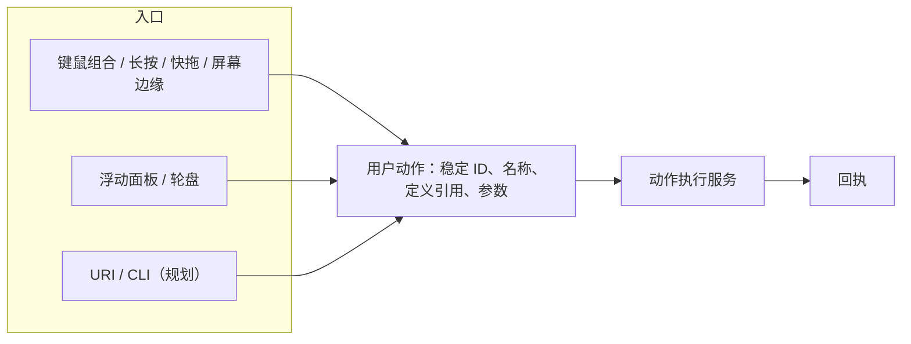

# 产品理念

OmniTrigger 把常做的事变成一个手势或一个链接：用户先定义好动作，再从键鼠组合、浮动面板、轮盘或外部调用一步触发。本页说明产品定位、核心模型和取舍原则，用于判断功能该不该做、该怎么组织。已实现的功能以[当前功能](FEATURES.md)为准，本页标为“规划”的内容尚未实现。

## 定位

通用 Agent 擅长理解需求和规划步骤，但响应慢、需要切换窗口和输入文字，每次结果也不完全相同。OmniTrigger 只负责另一段：用户已经知道要做什么，手不离开键鼠就能立即执行，结果确定、可见。

因此 OmniTrigger 是任务的**启动层**：

- 不规划、不推断意图，也不做流程编排。
- 用户定义动作，触发方式决定何时执行，执行结果以结构化回执返回。
- 其他程序、脚本和 Agent 可以调用用户定义好的动作，OmniTrigger 不反过来编排它们。

## 核心模型：动作是一等公民



| 概念 | 含义 |
| --- | --- |
| 用户动作 | 独立对象，有跨设备稳定的 ID、可修改的名称、动作定义引用（内置能力、动作包或插件）和参数。 |
| 入口 | 引用用户动作 ID 的触发方式。同一动作可被多个入口引用，修改一处即全部生效。 |
| 动作 ID | 对外地址，创建后不变，不随名称、分类或所在轮盘变化；删除后不复用。 |
| 回执 | 每次执行的成功、失败、取消及来源，用于界面反馈和外部调用的返回值。 |

当前触发绑定和轮盘槽位各自内嵌一份 `ActionCall`，尚无独立用户动作。拆分方式与迁移顺序见[账号工作区与同步设计](ACCOUNT_WORKSPACE.md)：旧绑定中的每份动作先分别导入，不自动合并。

## 原则

1. **人决定，机器执行。** 不猜测意图，不自动规划。同样的触发在同样的上下文中产生同样的结果，与核心状态机可重放的设计一致。
2. **手不离开，焦点不被抢。** 触发、选择和执行都在当前上下文完成；面板与轮盘不抢焦点、不移动鼠标。
3. **被调用，而不编排。** 对外提供稳定的调用入口，复杂逻辑交给动作包或外部程序，OmniTrigger 不内置流程图或 Agent 规划。
4. **做薄，不做厚。** 输入核心只做有界匹配，应用层负责传参、有界执行和回执；新增业务通过动作包扩展，不修改输入核心。
5. **执行可见。** 结果、错误和冲突以结构化信息返回，不静默更改用户的动作或绑定。

## 动作随人走（规划）

用户积累的动作、绑定和轮盘是个人资产，应当跟随账号在多台设备间同步，而不是绑定在某一台机器的配置文件里。稳定的动作 ID 同时服务于外部调用和同步：同一个动作在每台设备上 ID 相同，外部链接和脚本无需按设备修改。

- 同步动作、参数、绑定、轮盘和期望启停状态；程序路径、设备映射、依赖安装状态和凭据实际值只保留在本机。
- 未登录或离线时照常创建和运行动作，同步在后台进行；Hook 只使用本机内存快照，不等待网络。
- 并发修改同一动作时保留两个版本供用户选择，不静默覆盖。

本机可以有多个相互隔离的配置档：未登录的本地配置档即离线账号，测试数据使用独立的测试配置档，不会混入自己的数据。设计见[配置档与数据目录设计](PROFILES.md)，账号、存储与同步协议见[账号工作区与同步设计](ACCOUNT_WORKSPACE.md)。

## 外部调用（规划）

为每个用户动作提供稳定的外部地址，规划形式如下：

```text
omnitrigger://run/<动作 ID>
omnitrigger.exe --run <动作 ID>
```

两者都转交正在运行的实例，经过与其他入口相同的执行路径。由于任意网页都可以放置 `omnitrigger://` 链接，外部调用需要满足以下约束：

- 每个动作单独设置“允许外部调用”，默认关闭。
- 只接受动作声明过的参数，未声明或类型不符时返回结构化错误，不忽略、不猜测。
- 记录调用来源；未授权的来源不执行，并在界面中说明。

现有 `--run-action <call.json>` 用于开发时直接执行调用文件，不经过用户动作 ID，也不是面向用户的外部入口。

## 与 Agent 的关系

| 角色 | 方式 |
| --- | --- |
| 作者 | Agent 编写动作包，`--check-action` 校验调用，用户确认后绑定触发。 |
| 调用方 | Agent 通过外部调用入口运行用户已允许的动作（规划）。 |
| 目标 | 动作把触发时的上下文交给用户选择的 Agent 或程序。 |

触发那一刻的上下文是 OmniTrigger 独有的信息：前台进程、鼠标所在屏幕和位置，以及规划中的选中文字、剪贴板和浏览器当前页面。把这些作为动作输入，是辅助人工作的主要方式。

## 不做的事

- 内置工作流画布、流程图编辑器与跨动作编排。需要时由外部工具以扩展接入：图作为动作内容，由对应的运行时适配器执行，默认不安装。
- 内置对话、模型调用或 Agent 规划。
- 在 Hook 同步路径中执行动作、访问磁盘或网络。

## 规划顺序

1. 独立用户动作与稳定 ID，绑定和轮盘改为引用动作 ID。
2. `--run <动作 ID>` 转交运行中的实例，结果以回执返回。
3. 注册 `omnitrigger://` 协议，提供逐动作的外部调用开关与来源记录。
4. 浮动面板补充搜索和最近使用，作为启动器入口。
5. 触发上下文变量：选中文字、剪贴板、浏览器当前页面。
6. 账号与个人多设备同步，按[账号工作区与同步设计](ACCOUNT_WORKSPACE.md)的实现顺序推进；第 1 步的稳定 ID 是其前提。
